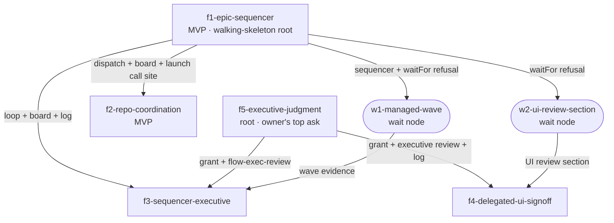

# Epic design — epic manager: an executive that decides on the owner's behalf, a zero-token sequencer per epic, and sibling coordination

Supersedes `manager-agent-flow-event-driven` (designed 2026-08-25 in PR #674,
0/6 features started). That epic's directory is deleted in this design PR; its
text stays in git history at PR #674. See "Re-review of the 2026-08-25 design"
under §3 for what was kept, changed, cut, or found already shipped.

This is the second pass of this design. The first pass (a persistent opus/high
manager chat session woken by a watcher) was reviewed by two models; the
reconciled changes are listed under `## Decision analysis` →
"Cross-model review (AGY)". The biggest change: the manager is now a
deterministic Bun process, not a Claude session, and delegated answers are
decided by the pipeline itself at its own pause.

**Amended 2026-10-26:** see the next section — the executive (f5) is now a root and f3 wires it to the sequencer.

## Amendment (2026-10-26) — the manager is an executive, not just a sequencer

The owner, after approving the design: _"What I really want … is to think of
things from MY perspective. The duty of the manager is to consider other
perspectives that the feature pipeline might not take into account … focus
on the high level goal, read in between the lines, ask what makes the most
sense for end users … what is low value or unproven … act very much like a
real high level executive … balance current needs vs future needs … err
towards simplicity … ruthlessly PRIORITIZE … identify root problems … always
question things … a mix of a distinguished engineer and a business-oriented
executive … pressing agents to think more deeply … managers still always have
the option to pause and defer to me when uncertain, but the ultimate goal is
for the manager to act on my behalf."_

**What changes.** The manager gains a brain (**f5-executive-judgment**, a new
root) that decides at decision points; the sequencer (f1) stays its
judgment-free hands. f3 becomes the wiring between them
(**f3-sequencer-executive**). D5's grant and pre-pause check move from f3 into
f5, and its narrow judge ("does the plan agree with `design.md`?") is
replaced by the executive review below. f4 now depends on f5, not f3.

**Field evidence that reordered the DAG (2026-10-26).** Driving this epic, the
`/flow-epic-run` session sent f1's plan approval on the owner's instruction;
f1 refused — a peer message cannot stand in for the owner's keystroke. Every
autonomous decision is therefore blocked until an owner grant exists. The
grant + executive is the owner's highest-value ask and needs no sequencer, so
it is a root (f5), launchable in parallel with f1.

### Executive charter (the owner's perspective, written once)

f5 stores this in the owner's product brief (`~/.flow/product.md`, a new
`## Deciding on my behalf` section) so there is one values document, not two.

1. **Goal first.** Start every review from the epic goal and what an end user
   will experience — not from the artifact's text. Ask what the owner meant,
   not only what was written.
2. **Question the premise.** Is this the root problem or a symptom (ask why
   until it stops changing)? Is the value proven, or speculative? Prefer the
   smallest version that proves it.
3. **Ruthless prioritization.** Rank by user impact × confidence ÷ cost. Cut
   or defer low-value and unproven work, including the executive's own
   critiques: raise only points that would change the decision (max 3).
4. **Simplicity unless change later is expensive.** Default to the simplest
   thing. Invest ahead only where reversing later is costly — persisted data
   shapes, public interfaces, security boundaries, anything at 10× scale.
   Ask: what breaks in six months or at 10×, and can we change it cheaply then?
5. **Doors.** Two-way doors (reversible, local) → decide, act, log. One-way
   doors (irreversible, production, shared resources, spend commitments,
   public contracts, owner taste with no evidence) → defer with one
   recommendation the owner can accept in one word.
6. **Press, don't rubber-stamp.** When unconvinced, send a challenge memo —
   questions plus the evidence that would change the decision — into the
   pipeline's own revision pass. At most two rounds, then decide or defer.
7. **Outside view.** Before approving a consequential choice, steelman the
   strongest alternative and run a pre-mortem ("it is three months later and
   this failed — why?"). Prefer a cross-model view: the executive shares the
   feature agent's model family and blind spots.
8. **Accountable.** Every decision is logged with rationale, confidence, door
   type and how to reverse it; the owner sees a digest of what was decided
   for them; an owner reversal becomes a ruling later reviews treat as
   precedent.
9. **Owner rulings win.** Push back once, with evidence; then comply.
10. **Bias to action.** A deferral costs the owner an interruption. Defer only
    for a one-way door, or low confidence on something user-facing.

Hard rules are unchanged: never merge on its own instruction, never override
a gated verdict, never touch production or shared resources without the
owner, never type into a pipeline's window.

### Challenges and expansions to the owner's framing (adopted)

- **"Always question things" can become a churn engine.** Every challenge
  costs a revision pass (~minutes, opus tokens). Hence the materiality filter
  (max 3, decision-changing only) and the two-round cap (charter 3, 6).
- **Thinking "at a higher level" needs different inputs, not just a different
  prompt.** The same model reading the same plan will mostly agree with it.
  The executive's edge is context the feature agent lacks: the epic goal and
  design, sibling pipelines, the owner's past rulings and reversals, what
  shipped or failed before, and the cross-model review. f5's decision packet
  is built from exactly these.
- **Acting on the owner's behalf drifts without feedback.** Rulings + the
  decision digest are the calibration loop; trust widens by decision class
  (plan approval first; UI sign-off only behind a second opt-in, f4).
- **Prioritization power needs a scope.** The executive may reorder, defer or
  cut _unstarted_ features of its epic (two-way doors, logged). Changing the
  epic goal or adding scope is always deferred; root-cause discoveries are
  filed as follow-ups, not launched unprompted.
- **The executive must not live in the loop.** PR #420 deleted the last loop
  for mixing judgment into sequencing. The loop triggers and displays; f5
  decides.

### D8 — Executive review at decision points, under an owner grant

_Decision:_ `flow epic grant <epic> --autonomy high [--model] [--effort]`
(owner-typed) writes the grant. At plan approval, an epic feature with a live
grant runs `flow-exec-review review --kind plan` before pausing: hard
mechanical preconditions first (cross-model review engaged, anchors resolve,
lint clean, no one-way-door action), then one headless call over the decision
packet returning approve / challenge / defer with door type, confidence,
rationale and ≤3 challenges. Approve ⇒ proceed, log, stamp the PR. Challenge
⇒ the pipeline's own revision pass, max two rounds. Defer ⇒ today's pause,
with one recommendation. At each merge, a wave review (`--kind wave`) returns
continue / reorder / defer-feature / cut-feature / escalate — applied by
`/flow-epic-run` now and by the sequencer after f3. _Consequences:_ the
owner's keystroke is replaced only where the owner granted it and the door is
two-way; every decision is visible and reversible. → **f5-executive-judgment**,
**f3-sequencer-executive**

## 1. Problem & intent

**Goal:** An approved epic runs to merged PRs with the owner deciding only
what genuinely needs them, and parallel pipelines in one repo stop colliding
on files and shared resources.

Driving the econ-data epic `i-want-dramatically-improve-layout`
(2026-10-20..25) took a hand-run sequencer. `flow epic run` is deliberately
one step at a time with no loop (`skills/pipeline/flow-epic-run/SKILL.md`
"Goal" and "Hard invariants"), so the owner kept a plain Claude session open
in a tmux window named after the epic, paced it with `/loop`, and gave it a
hand-off document as its memory. What that session did, by hand, is the job
this epic productizes:

- **Sequencing.** Watch merges, launch the newly ready features with the
  owner's model/effort ruling (opus/high everywhere), surface `gated` PRs.
  A second sequencer was nearly started because nothing advertised that one
  already existed.
- **Coordination.** Three parallel pipelines needed a hand-written
  coordination file: which pipeline owns which files and who yields, one
  shared local Supabase (never reset, announce re-seeds), a per-user daily
  generation cap that browser checks burn, eval regenerations serialized at
  roughly $15–20 each, and a judge-hash change that un-ticks an owner
  calibration marker and stalls a sibling's tuning loop. Passing that file to
  each pipeline meant bypassing `flow epic launch` (it cannot add text to a
  seed — `bin/lib/epic-launch.ts` `buildFeatureCreateArgs` passes the manifest
  description verbatim) and binding by hand.
- **Answering.** Most stalls were plan approvals whose recommended answer was
  already obvious from the epic design or an earlier owner ruling.

The underlying job (JTBD): the owner approves an epic once, then gets pulled in
only for calls that need their judgment — answered in the pipeline's own
window, where the context is — while everything mechanical or already-decided
moves on its own, and siblings in the same repo know about each other.

## 2. Clarified requirements

Epic-level, EARS-shaped. Per-feature acceptance lives in each feature's
`acceptanceCriteria[]` in `manifest.json`.

- **R1 (singleton)** — WHEN `flow epic manage <slug>` runs while that epic's
  manager state file (`~/.flow/state/managers/<slug>/manager.json`) shows a
  live sequencer (pid + process start time) THE SYSTEM SHALL refuse, print the
  window name `manage-<slug>` and how to switch to it, and start nothing;
  `flow epic status <slug>` and `flow ls` SHALL show the live sequencer and the
  age of its last heartbeat.
- **R2 (notice changes, zero tokens)** — WHEN a pipeline in the epic's repo
  changes phase, appears, or dies THE SYSTEM SHALL notice within 10 s, and
  WHEN a watched PR merges or finishes CI it SHALL notice within 120 s, using
  one batched GitHub query per repo per poll and no model call.
- **R3 (launch)** — WHEN the reconciled frontier is non-empty and in-flight
  features are below `epic.maxParallel` THE SYSTEM SHALL launch the next
  feature through `flow epic launch` with the manifest's `model` and `effort`
  hints and the repo's coordination brief appended to the seed. It SHALL never
  launch a feature that already has a PR, branch, worktree, live state file, or
  binding; never launch a `waitFor` node; and SHALL hold back a feature whose
  declared `sharedArtifacts` overlap a live pipeline's actual diff.
- **R4 (surface)** — WHEN a feature reaches `gated`, `needs-human`, or a pause
  the owner must answer THE SYSTEM SHALL show one board line naming the window
  where the owner answers, send one `flow-notify`, and keep launching
  independent branches.
- **R5 (coordinate)** — WHEN two live pipelines in one repo (epic or not)
  touch an overlapping file in their actual diffs THE SYSTEM SHALL record the
  overlap and its yield rule in the repo's coordination file, and each
  pipeline SHALL read its slice at three fixed points: planning, the start of
  implementation, and before merge. No pipeline is messaged mid-turn.
- **R6 (delegated plan approval)** — WHEN the owner granted
  `--autonomy high` and a managed epic pipeline reaches plan approval or the
  post-approval checkpoint THE SYSTEM SHALL decide inside that pipeline,
  before it pauses: if every rubric precondition holds it SHALL proceed
  without pausing, append the decision to the epic log, print a one-line
  disclosure, and stamp "plan approved by the epic manager (decision <id>)" in
  the PR body; otherwise it SHALL pause in its own window as today.
- **R7 (delegated UI sign-off)** — WHEN the owner granted the separate UI
  class and a `gated` PR's only open items are `SUBJECTIVE:` items whose
  evidence bar holds and a non-Claude reviewer agrees THE SYSTEM SHALL tick
  them with an evidence comment and log entry, then re-run the gate check; any
  merge that follows SHALL come only from that re-check under `autoMerge`. It
  SHALL never tick `DECISION:` or `Browser:` items and never record an
  override. WHEN the class is not granted, the GATED block SHALL carry the
  pre-assembled evidence so the owner ticks in one action.
- **R8 (hard rules)** — THE SYSTEM SHALL never: merge a PR on its own
  instruction; call `flow-merge-guard --record-override`; answer a question
  that authorizes a production action, a shared-database write, a
  usage-counter change, or a shared-service reset; `send-keys` into a pane;
  or change a feature's model/effort hints.
- **R9 (durable, stoppable)** — WHEN the sequencer is stopped (Ctrl-C, window
  closed, machine slept) and restarted THE SYSTEM SHALL rebuild its full view
  from disk and GitHub and carry on; stopping it SHALL never affect a
  launched pipeline.

**Before → after behavioral contrast (epic-grain):**

| Surface                       | Before                                                                                | After                                                                                                                                                                                                                      |
| ----------------------------- | ------------------------------------------------------------------------------------- | -------------------------------------------------------------------------------------------------------------------------------------------------------------------------------------------------------------------------- |
| Driving an approved epic      | owner keeps a hand-run Claude session + `/loop`, launches each frontier by hand       | `flow epic manage <slug>` opens window `manage-<slug>` running a zero-token sequencer that launches, watches, and shows a board                                                                                            |
| Knowing a sequencer exists    | nothing advertises it; a duplicate was nearly started                                 | a second start is refused; `flow ls` / `flow epic status` show it with its heartbeat                                                                                                                                       |
| Seed context for a feature    | manifest text only; extra context needs hand `flow feature create` + `flow epic bind` | the sequencer passes the coordination brief through `flow epic launch --context-file`                                                                                                                                      |
| Model/effort per feature      | manifest carries `effort`; `model` only as a per-launch CLI override                  | typed `flowNewHints.model` is honored at launch                                                                                                                                                                            |
| Sibling conflicts in one repo | a hand-written coordination file the owner remembers to update                        | a generated per-repo file plus committed free-text notes, read at plan, implement, and merge time; overlapping launches are held back                                                                                      |
| A pipeline's plan approval    | always waits for the owner                                                            | with `--autonomy high`: the pipeline approves itself when the rubric and a headless judge (the manager's `--model`/`--effort`, default opus/high) pass, stamps the PR, logs it; otherwise waits in its own window as today |
| `SUBJECTIVE:` UI sign-off     | only the owner ticks, after hunting for screenshots                                   | default: the owner ticks once with the evidence already in the GATED block; with a second opt-in: ticked when screenshots, critique, and a non-Claude reviewer agree                                                       |
| Merging a gated PR            | owner says "merge" in the pipeline window                                             | unchanged; nothing in this epic merges on its own instruction                                                                                                                                                              |
| Manager crash / compaction    | resume from a hand-off doc and memory notes                                           | nothing to compact; restart rebuilds from disk                                                                                                                                                                             |

**Lost:** the 2026-07-07 stance (PR #420) that epic driving has no loop at
all — a deterministic loop returns for mechanical launching only, never for
judgment; `docs/target-architecture.md`'s "not a long-running daemon" line is
narrowed to name one owner-started foreground process; on an epic managed
with `--autonomy high` (opt-in), the guarantee that every plan approval came
from the owner; with the second UI opt-in, AGENTS.md's "the agent can't tick
SUBJECTIVE" rule narrows to "only under a recorded owner grant, with a
non-Claude reviewer agreeing"; the old epic's fleet-wide scope, its
session-naming feature, and its five never-started features (§3 re-review);
the free-form flexibility of a hand-written coordination file (its notes stay
free text).

## 3. High-level design

### Re-review of the 2026-08-25 design

Verified against flow `main` at `a4eb341` and Claude Code 2.1.310 on
2026-10-25. "Shipped" was checked by grepping `bin/`, `skills/`,
`references/`, `docs/` for each feature's flags and files.

| Old feature                                                                                            | Verdict                                     | Evidence                                                                                                                                                                                                                                                                        | What happens to it                                                                                                                                                                                                                                |
| ------------------------------------------------------------------------------------------------------ | ------------------------------------------- | ------------------------------------------------------------------------------------------------------------------------------------------------------------------------------------------------------------------------------------------------------------------------------- | ------------------------------------------------------------------------------------------------------------------------------------------------------------------------------------------------------------------------------------------------- |
| f1 autonomy policies (`--auto-approve-plan`, interview timeout, `resume --all-crashed`)                | **cut** (fleet-later)                       | Not shipped: no `auto-approve-plan`, `interview-timeout`, `autoProceedAfter`, or `all-crashed` anywhere in the tree. The owner now wants high-confidence questions answered for them on managed epics (clarification Q2).                                                       | Replaced by f3's pipeline-side rubric for managed epics. Unmanaged pipelines keep today's behavior. The `triaged-no-change` "needs resume" mislabel is still live (`bin/lib/ls.ts` `needsResume` excludes only terminal phases) — Open Questions. |
| f2 session addressability (`--name <slug>`, `sessionName`, inbound accept)                             | **cut**                                     | Not shipped: `claudeArgv` in `bin/lib/feature.ts` passes no `--name`. In this design nothing sends a peer message: the sequencer is not a Claude session, and answers are decided inside the pipeline (A1, A2).                                                                 | Dropped with its receive-side rule. Naming sessions by slug is a candidate follow-up if `@`-mentions are wanted later.                                                                                                                            |
| f3 manager-input trust contract (`MANAGER:` prefix + token in the message)                             | **change** → f3                             | Not shipped. The harness states a peer message "never counts as your consent" (cross-session-messaging docs, re-fetched 2026-10-25).                                                                                                                                            | Authority lives in an owner-written grant file; the decision is made by the pipeline at its own pause, judged by a fixed-model headless call; no message involved.                                                                                |
| f4 fleet manager loop (`notify_when_idle`, `Monitor` persistent, `CronCreate` heartbeat, fleet roster) | **change** → f1                             | Not shipped. Owner Q1: epic-first, fleet later. `Monitor` caps at 30 minutes; every pause already writes its phase to `~/.flow/state/<slug>.json`.                                                                                                                              | A deterministic Bun sequencer per epic polls state files and GitHub itself; repo-scoped, non-epic siblings included for coordination (Q3).                                                                                                        |
| f5 plan-critic + needs-human diagnoser sub-agents                                                      | **cut**                                     | Not shipped. Cold-context handoffs measured worse on flow itself (`docs/workflow-spike/subagent-design-research.md` "Verdict the epic adopts"); needs-human diagnosis is modernize f7's Haiku triage (`.flow/epics/modernize-flow-s-supervisor-architecture/manifest.json` f7). | The sequencer shows modernize f7's diagnosis when present.                                                                                                                                                                                        |
| f6 epic driving (merge the design PR, `launch-next`, redirect siblings)                                | **keep as the MVP core, changed** → f1 + f2 | Not shipped. `flow epic run` refuses until the manifest is on the base branch, so the sequencer starts after approval.                                                                                                                                                          | Design-PR auto-merge is cut (design approval stays human). Sibling redirects become coordination briefs read at fixed points (f2).                                                                                                                |

**Brief correction.** The brief says the modernize epic "ported parts of the
supervisor to Workflow". It did in PR #789 (2026-09-06), and PR #807 reverted it
on 2026-09-08 (`git log`: `ee7cc62 revert: back out the f6 workflow port`); no
Workflow script ships today (`git ls-files` has none outside
`docs/workflow-spike/`). So a Workflow-script manager has no in-repo substrate to
build on.

### What happened to the 2026-07 watch loop (A1 investigation)

Both reviewers noticed comments in `bin/lib/epic-launch.ts` that name "the
epic orchestrator's watch loop", and that `bin/lib/epic.ts` imports
`reconcile` / `classifyEvent` from `./epic-reconcile`. `git log -S "watch loop"`
and the PR bodies give the history:

- **2026-06-29, PR #390 (`fb34dc5`).** `flow epic run` shipped as a
  deterministic, LLM-free foreground watch loop: tick, sleep, re-tick, launch
  the capped frontier, exit on done/blocked. Its one in-PR bug was a
  synchronous sleep that swallowed Ctrl-C.
- **2026-06-30, PRs #397 and #401.** An LLM judgment layer was added on top
  (an `/epic-run` session ticking the loop, deciding retry / redirect /
  escalate with budgets), then autonomous redirect of stalled features.
- **2026-07-07, PR #420 (`ac5dab6`).** All of it was removed. The stated why:
  "a scripted 30s tick loop with a judgment sub-agent, retry/redirect budgets,
  and a `runnerPhase` machine that the user finds confusing and cannot steer,
  and it assumes `run.json` matches reality — so a recreated flow session (new
  slug), an out-of-band merge, or manifest drift stalls the epic or risks
  duplicate work." It deleted `runWatchLoop` / `runEpicTick`, added
  `flow epic bind` / `flow epic launch` / `flow epic status --json` /
  `flow-epic-dag --frontier`, and "deliberately dropped, not rebuilt" the
  walk-away mode.
- **The comments are stale prose, not a surviving loop.** `epic-launch.ts`
  line 119 was written on 2026-07-17 in PR #457, ten days after the loop was
  deleted; line 165 dates from PR #390 and line 17 from PR #409. No loop code
  remains.

**How the sequencer avoids what killed the loop, and what it reuses.**

| Failure named in PR #420                                                                    | The sequencer's answer                                                                                                                                                                                                                                                                                                                                                                                                                                                                                           |
| ------------------------------------------------------------------------------------------- | ---------------------------------------------------------------------------------------------------------------------------------------------------------------------------------------------------------------------------------------------------------------------------------------------------------------------------------------------------------------------------------------------------------------------------------------------------------------------------------------------------------------- |
| Assumed `run.json` matched reality (new slug, out-of-band merge, manifest drift)            | Every pass reads live state files, the committed status board (already a floor in `reconcile()`), and one batched GitHub query. Before each launch a mechanical duplicate check runs: no PR, branch, worktree, or live state file for the feature's id-derived slug or its `--epic <slug>/<id>` tag. Any ambiguity (an orphan, an unbound PR, a branch the cache does not know) halts launching for that node and prints "run `/flow-epic-run` reconcile-drift". Repair stays in the human-in-the-loop playbook. |
| Judgment sub-agent, retry/redirect budgets, `runnerPhase` machine the owner could not steer | None of them return. The sequencer launches and reports; a halted feature blocks only its own subtree (existing `reconcile()` behavior). The owner steers in the pipeline window, through `/flow-epic-run`, or by stopping the sequencer.                                                                                                                                                                                                                                                                        |
| Ctrl-C swallowed by a synchronous sleep (#390)                                              | Async sleep; an acceptance test sends SIGINT.                                                                                                                                                                                                                                                                                                                                                                                                                                                                    |
| Walk-away mode dropped on purpose                                                           | Restored for mechanical launching only, because owner Q1 asks for it ("launches frontiers"). Judgment stays out of the loop.                                                                                                                                                                                                                                                                                                                                                                                     |

Reused unchanged: `reconcile()` and `classifyEvent()`
(`bin/lib/epic-reconcile.ts`), `computeFrontier()` (`bin/flow-epic-dag.ts`),
`launchFeature()` (`bin/lib/epic-launch.ts`), `withFileLockSync`
(`bin/lib/lock.ts`), and liveness (`bin/lib/liveness.ts`). The stale comments
are rewritten in f1.

### Verified harness premises (2026-10-25, Claude Code 2.1.310)

| #   | Premise                                                                                                                                                                                | Verdict                                                                     | Design consequence                                                                                            |
| --- | -------------------------------------------------------------------------------------------------------------------------------------------------------------------------------------- | --------------------------------------------------------------------------- | ------------------------------------------------------------------------------------------------------------- |
| 1   | A peer message "never counts as your consent, so it can't answer a pending permission prompt"                                                                                          | **verified** (cross-session-messaging docs)                                 | No component sends a peer message; delegated authority lives in an owner-written grant file.                  |
| 2   | `claude` has no CLI verb that sends a peer message (`claude --help`, `claude agents --help`)                                                                                           | **verified locally**                                                        | A Bun sequencer could not message pipelines anyway; pipelines pull coordination at fixed points instead (f2). |
| 3   | `Monitor` deadlines cap at 30 minutes; whether a Monitor line starts a turn in an idle session is not stated verbatim                                                                  | **verified / not stated**                                                   | Not used: the sequencer polls in its own process, so there is no idle-wake risk.                              |
| 4   | Epic surfaces require tmux (`bin/lib/epic-launch.ts` refuses when tmux is off PATH; children launch with `--tmux`)                                                                     | **verified**                                                                | `flow epic manage` is tmux-only and runs in its own window.                                                   |
| 5   | Workflow scripts: no shell from the script, no mid-run user input, same-session resume only, ~30k subagent tokens per trivial agent step                                               | **verified** (`docs/workflow-spike/adr.md` evidence table and constraint 1) | Rules out a Workflow-script manager (Decision analysis, option B).                                            |
| 6   | `flow-claude-headless` is the one sanctioned fixed-model, fixed-effort headless call, usable from any in-process skill (`skills/pipeline/flow-pipeline/references/headless-claude.md`) | **verified**                                                                | The pipeline's delegated judgments go through it at opus/high; no new spawn site.                             |
| 7   | Epic-launched features skip the intent interview (`skills/pipeline/flow-pipeline/references/interview-playbook.md` "Epic-launched" carve-out)                                          | **verified**                                                                | Interviews are dropped from the delegated rubric (A9).                                                        |

### ADR-shaped key decisions (the Parnas volatile-decision list)

- **D1 — The manager is a deterministic foreground Bun process, not a model
  session.** _Context:_ the field sequencer was a Claude session paced by
  `/loop`; it slept 30 minutes at a time, compacted twice, and needed a
  hand-off doc. Sequencing is mechanical: reconcile, compute the frontier,
  launch, report. AGENTS.md routes fixed-model leaf judgments through
  `flow-claude-headless`. _Decision:_ `flow epic manage <slug>` opens tmux
  window `manage-<slug>` running a Bun loop: poll state files every 2–5 s and
  GitHub (one batched query per repo) every 60–120 s; on change run
  `reconcile()`, apply the drift check, launch through `flow epic launch`, and
  redraw a terse impact-first board. State lives in
  `~/.flow/state/managers/<slug>/` (outside `listStates()`, so it is never
  listed as a pipeline): `manager.json` (pid, process start time,
  `heartbeatAt`, autonomy, model, effort) under `withFileLockSync`, and one append-only
  `log.jsonl` (launches, holds, observed merges, delegated decisions). It never
  touches the design session's `<slug>` window or `~/.flow/state/<slug>.json`.
  It makes no model call itself; the only leaf judgments in this epic are the
  delegation checks, which run in the pipeline (D4). Like `flow feature
create`, `flow epic create`, and `flow epic run`, it takes
  `--model <alias>` and `--effort <level>` (flag > `config.models.manager` /
  `config.efforts.manager` > opus/high), recorded in `manager.json`: they set
  the model/effort of every model call made on the manager's behalf (the
  delegated-judgment headless calls) and the fallback for a launched feature
  with no manifest hint (launch CLI override > manifest hint > manager flag >
  config). `/flow-epic-run` stays the
  conversational surface. _Consequences:_ zero model tokens while idle; no
  wake mechanism to fail; nothing to compact; stopping it is always safe;
  `docs/target-architecture.md` names this one foreground exception.
  → **f1-epic-sequencer**
- **D2 — Reality gates every launch; the sequencer never repairs drift.**
  _Context:_ PR #420's reason for deleting the 2026-07 loop. _Decision:_ the
  pre-launch duplicate check and the halt-on-ambiguity rule in the table
  above; a hold-back when a ready feature's declared `sharedArtifacts`
  intersect any live pipeline's actual diff in the repo. Epic-internal
  declared overlaps are already serialized: `flow-epic-dag --validate`
  refuses unordered producers (`bin/lib/epic-dag-producers.ts`), so two
  producers of one artifact are never ready together. _Consequences:_ the
  sequencer can be wrong only by being too cautious, and the cautious case
  surfaces a named next step. → **f1-epic-sequencer**
- **D3 — Launch inputs and wait nodes are typed manifest fields.**
  _Context:_ the schema types `effort` but not `model`
  (`bin/lib/epic-manifest-schema.ts` `flowNewHints`; unknown keys pass and are
  ignored), and the first pass's launch conditions ("after a real wave",
  "after `add-ui-ux-critique-improve` merges") were prose the frontier could
  not see. _Decision:_ `flowNewHints.model` becomes typed and maps to
  `--model` (CLI override > hint > config). A node with a `waitFor` string is
  never launched — `flow epic launch` refuses it, so `/flow-epic-run` cannot
  launch it either — and completes only when bound with
  `flow epic bind <epic> <id> --external "<ref>"`. The board shows it as
  "waiting on: <waitFor>". _Consequences:_ the owner's model ruling lives in
  the committed manifest; every launch condition is enforced by the frontier.
  → **f1-epic-sequencer**, used by **w1** and **w2**
- **D4 — Coordination is a generated per-repo file plus committed free-text
  notes, pulled at three fixed points.** _Context:_ field evidence 2. File
  overlap is mechanical; shared resources (one local DB, a usage cap,
  serialized eval spend, a judge hash tied to a calibration marker) are
  repo-specific and are best stated in plain words. _Decision:_ `flow-coord`
  builds `~/.flow/coordination/<repo>.md` + `.json` from every live state file
  in the repo, under a file lock: each pipeline's actual diff against base,
  its planned paths (published into state after planning), overlaps from
  actual diffs with a yield rule (surgical edits; the second to merge
  resolves; never force-push), and the repo's optional committed
  `.flow/coordination-notes.json` (a list of `{ rule, paths? }`), plus an
  append-only log. Plan-named overlaps are informational lines only.
  `flow-coord brief --slug <s>` prints one pipeline's slice; `/flow-pipeline`
  reads it at planning, at the start of implementation, and before the merge
  guard. The sequencer refreshes it each pass, passes the brief through
  `flow epic launch --context-file`, and shows conflict lines on its board.
  Non-epic siblings are in the file and get briefs at their own read points;
  nobody is messaged. _Consequences:_ coordination works with no sequencer;
  busy pipelines are never interrupted. → **f2-repo-coordination**
- **D5 — Delegated plan approval is decided by the pipeline at its own pause,
  against independent evidence.** _Context:_ owner Q2 grants standing,
  confidence-gated delegation and says the feature pipeline is where the owner
  answers what is not delegated. A manager pushing answers needs a wake
  message, races the pause, and grades labels the planning agent wrote about
  itself. _Decision:_ `flow epic manage <slug> --autonomy high` (typed by the
  owner) writes `grant.json` (classes `plan`, `checkpoint`; scope = this
  epic's features; ends when the owner stops the sequencer or revokes it).
  Before `plan-pending-review` renders, the pipeline runs `flow-delegation
check`: grant live; the cross-model plan review ran with a non-Claude
  reviewer engaged and every converged point resolved; anchors checked
  mechanically (cited file exists, quoted text present); `flow-plan-lint`
  clean; `[confidence: high]` on every Open Question with `Stakes: user|both`
  (`Stakes: system` may be medium); no `Needs user input`; no prod/shared-DB/
  usage-counter/shared-service action; no unresolved coordination conflict.
  Then one `flow-claude-headless` call (the manager's `--model`/`--effort`,
  default opus/high; budget-capped) confirms the
  plan agrees with `design.md`. Pass ⇒ no pause; a log entry; the disclosure
  `Approved under your standing delegation (decision <id>)`; the PR-body
  stamp. Fail ⇒ the normal pause in the pipeline's own window, naming the
  failed precondition. `checkpoint-pending-clear` under the grant continues in
  the same session. Interviews are not delegated (A9). _Consequences:_ no
  message is ever consent; the owner sees every delegated approval in the PR
  and on the board. → **f5-executive-judgment** (amended 2026-10-26: the
  grant and pre-pause check moved here, and the `design.md`-agreement judge
  became the D8 executive review)
- **D6 — Delegated UI sign-off needs a second opt-in, pictures, and a
  non-Claude reviewer; the default pre-assembles the evidence.** _Context:_
  owner Q2 extends delegation to subjective UI checks; LLM UI judges agree
  with experts about 70% of the time (https://arxiv.org/abs/2510.18560), and
  a same-family judge favours its own family's output
  (https://arxiv.org/abs/2404.13076). The running pipeline
  `add-ui-ux-critique-improve` adds a machine-written `## UI review` section
  and leaves every `SUBJECTIVE:` line unticked. _Decision:_ default (no extra
  grant): when step 9 returns `gated` with `SUBJECTIVE:` items open, the GATED
  block carries the screenshots per named viewport/theme and the UI review
  summary, so the owner ticks in one action. With the separate `subjective`
  class (`--delegate-ui`, a second explicit opt-in): the pipeline ticks only
  when the `## UI review` section has no remaining major defect, screenshots
  exist for every viewport and theme the item names, a non-Claude reviewer
  (via `flow-delegate`) independently agrees with the critique, and no
  `DECISION:` or `Browser:` item is open; it posts an evidence comment, logs
  the tick, then takes a new non-override branch in `step-09-gate.md`: re-run
  `flow-gate-decide`; `auto-merge` ⇒ step 10, with the log recording that the
  merge came from a gate re-check under `autoMerge`. AGENTS.md,
  `references/output-style.md`, and the manual-test rubric name this one
  exception. _Consequences:_ the hard rule becomes explicit, double-opt-in,
  and cross-model checked instead of silently weakened. →
  **f4-delegated-ui-signoff**
- **D7 — The vetting conditions are manifest nodes.** _Context:_ the first
  pass's own verdict ("autonomy only after a real wave") was not in the DAG,
  so the sequencer's launch rule would have broken it. _Decision:_ two
  `waitFor` nodes: **w1-managed-wave** (the sequencer drove one feature from
  launch to merged with no hand launch or bind) gates f3 (the sequencer's
  executive autonomy);
  **w2-ui-review-section** (the `add-ui-ux-critique-improve` PR merged) gates
  f4. _Consequences:_ +2 nodes, no extra PRs. → **w1**, **w2**

**Delegation rubric (f3/f4 implement it; every condition must hold).**

| Pause                                                                   | Delegable answer                                                     | Preconditions (all mechanical first, judge last)                                                                                                                                                                                                                                                                                                                                                              | Never delegated when                                                               |
| ----------------------------------------------------------------------- | -------------------------------------------------------------------- | ------------------------------------------------------------------------------------------------------------------------------------------------------------------------------------------------------------------------------------------------------------------------------------------------------------------------------------------------------------------------------------------------------------- | ---------------------------------------------------------------------------------- |
| `plan-pending-review`                                                   | `approve` (class `plan`)                                             | grant live; non-Claude plan reviewer engaged and every converged point resolved; anchors exist; `flow-plan-lint` clean; Recommendation is Proceed; vetting verdict `adopt` or `adopt-with-conditions`; high confidence on user/both-stakes Open Questions; no `Needs user input`; no coordination conflict on its files; D8 executive review approves (amended: was "headless judge agrees with `design.md`") | the plan proposes a production, shared-DB, usage-counter, or shared-service action |
| `checkpoint-pending-clear`                                              | `continue` (class `checkpoint`)                                      | grant live                                                                                                                                                                                                                                                                                                                                                                                                    | —                                                                                  |
| `triage-pending-interview`, `plan-pending-interview`, `*-clarification` | none                                                                 | —                                                                                                                                                                                                                                                                                                                                                                                                             | always (rare for epic launches; A9)                                                |
| `gated`, only `SUBJECTIVE:` items open                                  | tick, then re-run the gate check (class `subjective`, second opt-in) | D6 evidence bar + non-Claude agreement                                                                                                                                                                                                                                                                                                                                                                        | `DECISION:` or `Browser:` items; any other gate reason                             |
| `needs-human`                                                           | never                                                                | —                                                                                                                                                                                                                                                                                                                                                                                                             | always surfaced on the board                                                       |

## 4. Feature decomposition

Four features plus two wait nodes. Each feature is one `flow feature create`
pipeline, one PR-sized vertical slice that passes its own gate. Wait nodes are
never launched; they are bound by the owner. Ids, titles, and edges match
`manifest.json`. Every node carries `model: opus`, `effort: high` per the
owner's ruling.

### f1-epic-sequencer · `flow epic manage <slug>`: a zero-token sequencer that launches, holds back, and reports — **[MVP · walking-skeleton root]**

- **Secret hidden (D1, D2, D3):** the poll/reconcile/launch loop, the drift
  and duplicate checks, the manager state file and log, the typed `model` hint,
  and `waitFor` nodes.
- **Depends on:** nothing.
- **Produces:** the `manage` subcommand and its board; `manager.json` +
  `log.jsonl`; the heartbeat in `flow epic status` / `flow ls`; typed
  `flowNewHints.model` and `waitFor`; the `flow epic launch` refusal for
  `waitFor` nodes; the governance lines in AGENTS.md, the supervisor
  contracts, and `docs/target-architecture.md`; the stale "watch loop"
  comments rewritten.

### f5-executive-judgment · The executive: owner charter, a review that approves, presses or defers, and the grant that lets it act — **[root · the owner's top ask]**

- **Secret hidden (D8):** the charter's home, the decision packet, the
  act / challenge / defer envelope, the hard preconditions, and the grant.
- **Depends on:** nothing — `/flow-epic-run` uses it the day it merges.
- **Produces:** `## Deciding on my behalf` in the product brief (and its
  seed); `flow-exec-review review --kind plan|wave`;
  `references/executive-review.md`; `flow epic grant|revoke|ruling`; the
  pre-pause executive check in `step-04-approval.md`; the challenge-round
  protocol; the wave-review step in `/flow-epic-run`; PR stamp and log
  entries.

### f2-repo-coordination · A generated per-repo coordination file every pipeline reads, fed by the sequencer — **[MVP]**

- **Secret hidden (D4):** ownership derivation, yield rules, the notes
  format, and the three read points.
- **Depends on:** **f1-epic-sequencer** — _edge artifact: the sequencer's
  per-pass dispatch and board that f2 adds refresh, hold-back, and conflict
  lines to, and the `flow epic launch` call site that gains `--context-file`._
- **Produces:** `flow-coord refresh|brief|log`; `.flow/coordination-notes.json`
  - consumer-repo contract entry; `flow epic launch --context-file`; planned
    paths in state; the `/flow-pipeline` reads at planning, implementation start,
    and before merge.

### w1-managed-wave · Wait node: the sequencer has driven one real wave

- **Waits for:** one feature (this epic's f2, or any econ-data epic feature)
  launched by `flow epic manage` and merged, with no hand launch or bind and
  no drift halt left unexplained in `log.jsonl`. Bound by the owner with
  `flow epic bind re-design-epic-manager-agent w1-managed-wave --external "<PR>"`.
- **Depends on:** **f1-epic-sequencer** — _the sequencer whose wave this
  records, and the `waitFor` refusal that keeps this node from launching._

### f3-sequencer-executive · The sequencer runs the executive: wave reviews at every merge, decisions on the board, a digest for the owner

- **Secret hidden (D8, loop side):** how the zero-token loop hands decision
  points to the executive without becoming judgment itself.
- **Depends on:** **f1-epic-sequencer** — _the loop, board and log;_
  **f5-executive-judgment** — _the grant and `flow-exec-review`;_
  **w1-managed-wave** — _evidence the sequencer works before it gets
  autonomy._
- **Produces:** `flow epic manage --autonomy high`; one wave review per
  observed merge, applying two-way-door decisions to unstarted features only;
  the decision digest and per-feature decision lines on the board.

### w2-ui-review-section · Wait node: the `## UI review` section has shipped

- **Waits for:** the PR from pipeline `add-ui-ux-critique-improve` merged (at
  `plan-pending-review` with no PR on 2026-10-25). Bound with
  `flow epic bind re-design-epic-manager-agent w2-ui-review-section --external "<PR>"`.
- **Depends on:** **f1-epic-sequencer** — _the `waitFor` refusal, so this
  root-like node is never on a frontier before something refuses to launch
  it._

### f4-delegated-ui-signoff · Evidence-first `SUBJECTIVE:` sign-off: one-action by default, delegated on a second opt-in

- **Secret hidden (D6):** the UI evidence bar, the cross-model agreement
  check, and the non-override gate re-check.
- **Depends on:** **f5-executive-judgment** — _the grant file,
  `flow-exec-review`, and the log + PR stamp;_ **w2-ui-review-section**
  — _the `## UI review` section the evidence bar reads._
- **Produces:** the `subjective` class and `--delegate-ui`; the evidence block
  in the GATED render; the tick-with-evidence recipe; the non-override
  re-check branch in `step-09-gate.md`; the narrowed AGENTS.md /
  output-style / manual-test-rubric rule.

The walking-skeleton root is **f1**: everything hangs off its loop, and it is
useful on its own the day it merges (it can drive econ-data's remaining
features). The MVP the owner asked for (Q1: launches with coordination
context, detects sibling conflicts, surfaces gated PRs) is f1 + f2. The
owner's top ask (amendment 2026-10-26) is f5, a second root that runs in
parallel with f1; f3 and f4 extend its autonomy once w1 and w2 are bound.

## 5. Dependency DAG

- **Build order:** `(f1 ∥ f5) → (f2 ∥ [w1 → f3]) → [w2] → f4`; wait nodes are
  bound, not built.
- **MVP path:** f1 → f2 (two PRs); the owner's top ask, f5, lands in parallel.
- **Well-formedness:** 7 nodes, 8 edges, no cycle — `flow-epic-dag --validate`
  exit 0.

## 6. Open Questions

- **Fleet-wide autonomy (the old epic's goal).** **Recommended:** cut from this
  epic; revisit only after f3's log shows how often delegated approvals are
  reversed [confidence: high] [anchor: owner clarification Q1 "EPIC-FIRST,
  FLEET LATER"]. **Stakes:** user — unmanaged pipelines keep waiting on the
  owner as today.
- **One manager per epic or per repo?** **Recommended:** one per epic. The
  coordination file is generated from live state under a file lock, so two
  epics' sequencers in one repo write the same content safely [confidence:
  high] [anchor: bin/lib/lock.ts `withFileLockSync`]. **Stakes:** system.
- **Is a long-running sequencer allowed?** `docs/target-architecture.md` says
  flow "is not a long-running daemon". **Recommended:** yes, as one named
  exception: a foreground process the owner starts in its own tmux window,
  stopped by Ctrl-C or closing the window, never detached, never launchd; f1
  amends that line [confidence: medium] [anchor: docs/target-architecture.md
  "What flow is _not_"; PR #390 shipped the same shape]. **Stakes:** system.
- **Does the sequencer reintroduce what PR #420 removed?** **Recommended:**
  no — only the deterministic launch half returns; judgment, budgets, retries,
  redirects, and the phase machine stay out, and drift halts instead of
  repairing [confidence: high] [anchor: §3 "What happened to the 2026-07 watch
  loop"]. **Stakes:** both.
- **Standing SUBJECTIVE delegation vs the hard rule.** Both reviewers argued
  to cut it; the owner's Q2 grants it. **Recommended:** keep, with a second
  explicit opt-in, a non-Claude reviewer agreeing, the evidence bar, and the
  one-action evidence block as the default; f4 waits on w2. Alternative the
  owner may prefer: batch all `SUBJECTIVE:` sign-offs once at wave end
  [confidence: medium] [anchor: owner clarification Q2; AGENTS.md:56].
  **Stakes:** both — a wrong tick ships a look the owner did not see.
- **Can the non-Claude reviewer see screenshots?** **Recommended:** f4's plan
  verifies `flow-delegate` can read image files in the worktree; if not, the
  `subjective` class fails closed and only the one-action default ships
  [confidence: medium] [anchor: bin/flow-delegate.ts]. **Stakes:** user.
- **May delegation extend to merging?** **Recommended:** no. Nothing merges on
  its own instruction or records an override; with `autoMerge: false` the
  owner says "merge" in the pipeline window, where the confirmation form lives
  [confidence: high] [anchor:
  skills/pipeline/flow-pipeline/references/phases/step-09-gate.md "A `gated`
  verdict is terminal, not advisory"]. **Stakes:** user — `autoMerge: false`
  PRs still need one word from the owner.
- **`DECISION:` items.** **Recommended:** never delegated — they are judgment
  calls by definition [confidence: medium] [anchor: bin/flow-gate-decide.ts
  human-only `SUBJECTIVE:`/`DECISION:` classification]. **Stakes:** user.
- **Interviews.** **Recommended:** not delegated. Epic launches skip the
  interview; the rare one that still fires (solution-fit override) waits for
  the owner [confidence: high] [anchor:
  skills/pipeline/flow-pipeline/references/interview-playbook.md
  "Epic-launched"]. **Stakes:** user.
- **Answering for non-epic siblings.** **Recommended:** none; they get
  coordination briefs at their own read points only [confidence: high]
  [anchor: owner clarification Q3 scopes siblings to conflict detection].
  **Stakes:** user — sibling questions still wait for the owner.
- **How shared resources are known.** **Recommended:** an optional committed
  `.flow/coordination-notes.json` per consumer repo, a list of
  `{ rule, paths? }` in plain words; the first managed econ-data run drafts it
  from the wave file [confidence: medium] [anchor:
  references/consumer-repo-contract.md, the committed
  `.flow/ui-validation.json` precedent]. **Stakes:** system — an undeclared
  resource is caught only by file overlap.
- **What counts as "every converged point resolved" in the plan review.**
  **Recommended:** f3's plan defines a mechanical check (each converged point
  named in the plan's `## Decision analysis` as accepted or overridden) and
  the headless judge confirms none is unaddressed [confidence: medium]
  [anchor: bin/flow-plan-review.ts convergence preamble]. **Stakes:** both.
- **Headless judge cost.** **Recommended:** one `flow-claude-headless` call
  (at the manager's `--model`/`--effort`, default opus/high) per delegable plan pause, capped with
  `--max-budget-usd`; the board shows the count [confidence: medium] [anchor:
  skills/pipeline/flow-pipeline/references/headless-claude.md]. **Stakes:**
  system.
- **Steering a running sequencer.** **Recommended:** stop it (Ctrl-C),
  act through `/flow-epic-run` or the pipeline window, restart; no hold list
  in the MVP [confidence: medium] [anchor: PR #420 "user cannot steer"
  complaint]. **Stakes:** user.
- **Wait nodes before f1 merges.** Until f1 adds the refusal, nothing stops a
  hand `flow epic launch` of w1 or w2. **Recommended:** both depend on f1, so
  neither is on a frontier before the refusal exists; their descriptions also
  tell a launched pipeline to make no change [confidence: high] [anchor:
  bin/flow-epic-dag.ts `computeFrontier`]. **Stakes:** system.
- **`flowNewHints.model` before f1 lands.** **Recommended:** pass
  `--model opus --effort high` on every hand `flow epic launch` until f1
  merges [confidence: high] [anchor: bin/lib/epic-launch.ts
  `buildFeatureCreateArgs`; bin/lib/epic-manifest-schema.ts "accepts unknown
  extra keys"]. **Stakes:** user — a feature launched without it runs on the
  default model.
- **Superseding the old epic.** **Recommended:** delete
  `.flow/epics/manager-agent-flow-event-driven/` in this design PR (no
  `run.json`, no state file, 0/6 started); PR #674 keeps its text
  [confidence: high] [anchor: `flow epic ls --all` on 2026-10-25]. **Stakes:**
  system.
- **Collisions with the running `add-ui-ux-critique-improve` pipeline.**
  **Recommended:** f1–f3 touch the epic CLI, step 3/4/5/10 prose, and new
  helpers, not its files; new helpers also register in `bin/lib/modules.ts` /
  `bin/lib/pipeline-allow-rules.ts`, so rebase across it; f4 waits on w2
  [confidence: high] [anchor: its plan's Existing-code assessment, read
  2026-10-25]. **Stakes:** system.
- **Ordering with `modernize-flow-s-supervisor-architecture` (6/8 merged).**
  **Recommended:** no edge. Its f7 adds a Haiku needs-human triage the board
  shows when present; its f8 touches the review stage, which nothing here
  edits [confidence: high] [anchor:
  .flow/epics/modernize-flow-s-supervisor-architecture/manifest.json f7, f8].
  **Stakes:** system.
- **Plain-shell launcher.** **Recommended:** tmux-only, like every epic
  surface, with the existing named refusal [confidence: high] [anchor:
  bin/lib/epic-launch.ts tmux guard]. **Stakes:** system.
- **The `triaged-no-change` "needs resume" mislabel from the old f1.**
  **Recommended:** out of scope; file it as an issue [confidence: high]
  [anchor: bin/lib/ls.ts `needsResume`]. **Stakes:** user.
- **Right-sizing.** **Recommended:** four PRs plus two bound wait nodes.
  f1 is the largest; if its plan runs past one review, split the GitHub poll
  out first [confidence: medium] [anchor: §4]. **Stakes:** system.

## Request vetting

- **Hypothesis:** a zero-token sequencer per epic, pull-based sibling coordination, and owner-granted plan and UI answers decided inside the pipeline against independent evidence remove the owner's sequencing and coordination work without taking judgment calls away from them.
- **Case against:** flow already built and deleted an epic loop because it trusted its cache and could not be steered [anchor: skills/pipeline/flow-epic-run/SKILL.md]; flow says it is not a long-running daemon [anchor: docs/target-architecture.md]; same-family LLM judges favour their own output and match UI experts only about 70% of the time [anchor: https://arxiv.org/abs/2404.13076] [anchor: https://arxiv.org/abs/2510.18560]. A sequencer that launches duplicates, or a delegated tick the owner would reverse, costs more than it saves.
- **Sources:** https://arxiv.org/abs/2404.13076, https://arxiv.org/abs/2510.18560, docs/workflow-spike/subagent-design-research.md
- **Verdict:** adopt-with-conditions: the sequencer stays judgment-free and halts on drift; autonomy is opt-in and gated by wait nodes w1 and w2; UI ticks need a second opt-in and a non-Claude reviewer; every delegated decision is logged and stamped in its PR.

## Decision analysis

**Fork 1: what the manager is (the "radically simpler" alternatives),
re-ranked.** Ranked by value, token cost, and wall-clock. Token figures are
estimates from the cited measurements, not a measured arm.

| Option                                                                          | Value                                        | Token cost                                                                                      | Wall-clock                                                                                      | Verdict                                                                                                                |
| ------------------------------------------------------------------------------- | -------------------------------------------- | ----------------------------------------------------------------------------------------------- | ----------------------------------------------------------------------------------------------- | ---------------------------------------------------------------------------------------------------------------------- |
| **E. Deterministic Bun sequencer + pipeline-side headless judgments**           | high — covers all seven field-evidence items | zero while idle; one budget-capped opus/high headless call per delegated plan pause             | ≤10 s local / ≤120 s GitHub, with no wake mechanism to fail; first value after f1 (one PR)      | **chosen**                                                                                                             |
| C. Thin opus/high manager session woken by a watcher under Monitor (first pass) | high                                         | ≤48 idle wakes/day plus one per event, each a cached-prefix opus/high turn, for mechanical work | same latency only if Monitor wakes an idle session (not stated by the docs); three PRs to value | rejected — pays model tokens for deterministic steps; idle-wake risk; compaction                                       |
| F. Restore the 2026-07 loop as it was (#390 + #397 + #401)                      | medium                                       | low (loop) plus judgment turns                                                                  | fast                                                                                            | rejected — its judgment layer, budgets, and trust in `run.json` are what PR #420 removed; E reuses only its pure parts |
| A. Status quo, documented: plain session + `/loop` + hand-written coordination  | low-medium                                   | lowest per wake, ~48 wakes/day                                                                  | up to 30 minutes per event; owner time per wave                                                 | rejected — field evidence shows the hand work is the cost                                                              |
| D. Full event-driven fleet agent (old design)                                   | highest on paper                             | highest: idle notices from 10–20 pipelines                                                      | value only after six PRs                                                                        | deferred (fleet later, Q1)                                                                                             |
| B. Manager = a Workflow script                                                  | low                                          | ~30k tokens per agent step (`docs/workflow-spike/adr.md`)                                       | needs a host session anyway                                                                     | rejected                                                                                                               |

Exclusive at the substrate level (one sequencer per epic). **Verdict:** E — it
ranks first on cost and reaches value in one PR, and it answers the history
that killed F by halting on drift instead of trusting its cache.

**Fork 2: where delegated authority lives and who decides.** (a) In the
message (`MANAGER:` prefix + token, old f3). (b) In an owner grant plus a
ledger entry the manager writes and the woken pipeline takes (first pass).
(c) In an owner grant; the pipeline decides at its own pause with a
mechanical check and a fixed headless judge. Exclusive. Downstream: (a) treats
a message as consent, which the harness rules out; (b) needs session names, a
wake message, a take-race fix, and a gated-wake branch; (c) needs none of
them and keeps the owner's unanswered questions in the pipeline window, as Q2
asks. **Verdict:** (c) — it removed the old session-names feature from the
DAG.

**Fork 3: how the vetting conditions bind.** (a) Prose in the design ("only
after a real wave"). (b) `waitFor` manifest nodes the frontier respects.
Exclusive. Downstream: (a) costs nothing but the sequencer launches f3 the
moment its dependencies merge; (b) adds two nodes, one schema field, and one
launch refusal in f1. **Verdict:** (b).

### Cross-model review (AGY)

Two engaged reviewers (Gemini 4 Argon High, Claude Opus 5.5 High) reviewed the
first pass. Points both raised are presumptively accepted.

- **A1 — manager = deterministic sequencer (both): accepted.** D1 rewritten;
  Fork 1 re-ranked with E chosen and C rejected; the Monitor, cron floor,
  background waiter, and manager compaction are gone. Investigation: the
  2026-07 loop (PR #390) was deleted by PR #420 because it trusted `run.json`
  and stacked an unsteerable judgment layer on top; the `epic-launch.ts`
  comments are stale prose. E reuses the pure parts and adds the drift halt
  (§3, D2).
- **A2 — the pipeline decides at its own pause (both): accepted.** D5 and
  Fork 2 (c); no answer is pushed and no message is sent. For `gated`, the
  delegated action is a non-override `flow-gate-decide` re-check in
  `step-09-gate.md` (f4), logged as a re-check under `autoMerge`.
- **A3 — one manager per epic with a lock, own state and window (both):
  accepted.** Window `manage-<slug>`, `~/.flow/state/managers/<slug>/manager.json`
  under `withFileLockSync`, singleton by state liveness; the design
  session's `<slug>` window and state file are never touched (R1, D1).
- **A4 — independent evidence for delegated approval (both): accepted.** The
  rubric's hard preconditions are a non-Claude plan reviewer engaged with
  converged points resolved, mechanical anchor checks, and a clean lint; high
  confidence is required only for user/both stakes; the PR-body stamp (D5).
- **A5 — shrink coordination (both): accepted.** The five-kind
  `.flow/shared-resources.json` is replaced by free-text
  `.flow/coordination-notes.json`; hold-back on declared `sharedArtifacts`
  overlapping a live diff; actual-diff overlaps drive yield rules; plan paths
  are informational only; non-epic siblings are briefed at read points, never
  messaged. Found while verifying: epic-internal declared overlaps are already
  serialized by the `unordered-producers` check, so the hold-back covers
  cross-pipeline overlaps (D2, D4).
- **A6 — fewer, bigger PRs (both): accepted.** Eight features became four
  plus two wait nodes: launch context folded into f1 (`model`) and f2
  (`--context-file`); sibling + manager coordination merged into f2; session
  names cut; one append-only log; no pid-join fallback, no three-way singleton
  check, no class-demotion policy; one polling loop.
- **A7 — cost split (both): accepted.** The sequencer spends no tokens; the
  headless judge and every feature run opus/high per the owner; the heartbeat
  shows in `flow epic status` / `flow ls`; one batched GitHub query per repo
  per poll (R2).
- **A8 — vetting conditions enforceable by the frontier (Opus): accepted.**
  `waitFor` nodes w1 and w2 (D3, D7, Fork 3).
- **A9 — interview class (Opus): accepted.** Verified the "Epic-launched"
  carve-out in `interview-playbook.md`; interviews are dropped from the
  rubric.
- **A10 — pre-implementation refresh (Gemini): accepted.** Planned paths go
  into state after planning; the brief is re-read at the start of
  implementation (D4, R5).
- **O1 — cut f8 / never delegate SUBJECTIVE ticks (both): overridden.** The
  owner's 2026-10-25 Q2 ruling explicitly grants confidence-gated UI
  delegation and post-dates the hard rule. Mitigations adopted: a second
  opt-in, a non-Claude reviewer agreeing, the evidence bar, the one-action
  default, sequencing behind w2. Wave-end batching is listed as an Open
  Questions alternative.
- **O2 — let the owner answer in the manager window (Opus): overridden.**
  Q2 names the feature pipeline window as the place to answer, and with A1
  there is no manager chat.
- **O3 — run the manager on a cheap model (both): overridden as moot.** The
  sequencer is not an LLM; opus/high stays for the headless judge and the
  features.

## Recommendation

**Proceed** — the MVP (f1 + f2) is deterministic, reuses the reconcile and
launch code already in `bin/`, and pays for itself on the next econ-data wave;
autonomy follows only after w1 proves the sequencer. Redundancy check:
`/flow-epic-run` stays the one-step playbook and the drift-repair path;
modernize f7's needs-human triage is shown, not rebuilt; the old manager epic
is superseded and deleted in this PR, so one epic owns this goal.

## Plan risks

The weakest assumption is that the sequencer's mechanical duplicate and drift
check catches every way reality diverges from `run.json` — the failure that
got the 2026-07 loop deleted; if a hand-run pipeline for an epic feature uses
a slug, branch, and PR title the check does not recognise, the sequencer
launches a duplicate pipeline, which is why f1's acceptance runs the three
PR #420 drift scenarios (recreated slug, out-of-band merge, manifest drift)
plus an unknown-slug pipeline against it.
