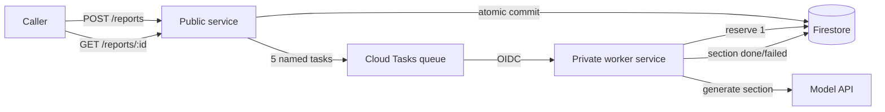

# PRD

> [!NOTE]
> Web-grounded research (discovery Step 1.5): skipped — not a researchable question; force with `flow feature create --research`.

# Create company reports: `POST /reports` with five generated sections

**Goal:** A caller asks for a company report in one request, gets its id at once, and reads all five generated sections as they finish, with model spend capped daily.

## Problem Statement

The reports service can show a company report and mark it shared, but nothing can create one, so every report a caller asks for comes back as "not found". Each section of a report is written by a paid model call that takes 20 to 60 seconds, so a five-section report is minutes of paid work. Built the obvious way, with the caller waiting on one request, that caller would wait minutes, lose sections already paid for whenever the connection or the server drops, and the finished report could still be invisible to the next request. The user-experience cost is a feature that does not exist yet; the cost risk is a public endpoint that spends money on every call with no ceiling.

| Evidence | What the code shows |
| --- | --- |
| No create path | The only write is the share handler, and it runs only on a report that already exists, so no report can ever be stored [anchor: src/app.ts:17] |
| Model latency and cost | "Takes 20-60 s per call and costs money per call" [anchor: src/llm.ts:1] |
| Storage is process-local | Reports live in a module-level `Map`, lost on restart and not shared between instances [anchor: src/db.ts:9] |
| Public service | Deployed with `--allow-unauthenticated`, so any internet caller can reach a new paid endpoint [anchor: deploy.sh:3] |
| Model client has no timeout or status check | A hung call never returns; a failed call yields `undefined` text [anchor: src/llm.ts:10] |

Framed against the product brief's ranked priorities: **user experience** (one request, an id right away, no lost work), then **cost** (every report is at least five paid calls, so spend needs one ceiling), then **architecture** (the work has to survive restarts and retries).

## Request vetting

- **Hypothesis:** One POST can start a five-section report and the caller can read it later, provided each model call runs outside the request as its own retried, idempotent, capped task and the report lives in a store every instance and the worker share.
- **Case against:** Taken literally, five model calls inside the request hold the caller 100-300 s sequentially or about 60 s in parallel [anchor: src/llm.ts:1], far past a 10 s interactive budget and up to Cloud Run's 5-minute default timeout (https://docs.cloud.google.com/run/docs/configuring/request-timeout); a drop loses paid sections, and the result would land in a process-local map other instances cannot read [anchor: src/db.ts:9].
- **Case against (the plan itself):** The durable design adds a datastore, a queue and a private worker service to a service with no callers yet — roughly tripling its surface [anchor: deploy.sh:3].
- **Sources:** https://docs.cloud.google.com/run/docs/configuring/request-timeout and https://docs.cloud.google.com/run/docs/configuring/billing-settings — cited via the flow-system-design GCP mapping (retrieved 2026-11-03), not re-fetched in this pass.
- **Verdict:** adopt-with-conditions: POST /reports answers 202 in under 10 s p99 with no model call inside any public request, and each section runs as its own queued task with at most 3 attempts under one daily model-call cap.

## Existing-code assessment

- **src/app.ts:** simplify — handlers import the store directly, so neither tests nor the second (worker) service role can inject a store, queue or ledger; move to a `createHandler(deps)` factory before adding routes [anchor: src/app.ts:1]
- **src/db.ts:** rewrite — a process-local `Map` cannot be the status store the worker writes and the public service reads; replace with a `ReportStore` interface (memory + Firestore implementations) [anchor: src/db.ts:9]
- **src/llm.ts:** simplify — add a per-call timeout and a response-status check, and classify failures as retryable or permanent, before the worker depends on it [anchor: src/llm.ts:10]
- **deploy.sh:** rewrite — a one-line single-service deploy cannot express the worker service, queue, datastore, backups or a rollback [anchor: deploy.sh:3]
- **Dockerfile:** keep — one image serves both roles, selected by an env var at start [anchor: Dockerfile:6]

## Scope Boundary

**In scope:**

- `POST /reports` — authenticated (API key), validated, optionally idempotent; answers `202` + `Location: /reports/<id>`.
- Five fixed, server-defined sections per report; one model call per section, each as its own queued task with bounded retries.
- `GET /reports/:id` returns overall status (`running` / `done` / `partial` / `failed`) and per-section status and text.
- A durable shared store (Firestore) replacing the in-memory map, with point-in-time recovery, daily backups and a restore check.
- One daily model-call cap enforced before every model call; a `429` from `POST /reports` when the day's budget cannot cover a report.
- Model-client timeout and failure classification; metrics helper and `.flow/metrics.md`.
- Deploy script for the public service, private worker service, queue, datastore, plus `rollback` and `restore-check` subcommands with a dry-run mode.

**Out of scope:**

- Caller-chosen sections or section count (the five are fixed in code).
- A generated report title (title stays `null`; see Open Questions).
- Re-driving failed sections on an existing report (the caller creates a new report).
- Streaming or push notifications on completion (polling the report link is enough for minute-scale work).
- Report retention / deletion (reports are kept; each is regenerable at five model calls).
- Changing who may read or share an existing report (see Candidate follow-up issues).

## Behavioral contrast

### User flow

| Before | After |
| --- | --- |
| There is no way to request a report; reading any report link answers "not found" | Sending a company name with the API key answers at once (`202`) with a link to the new report |
| — | Reading that link shows the report as running, then done, partial or failed, with each section's text as soon as it is written |
| — | Repeating a request with the same idempotency key returns the same report instead of paying for a second one |
| — | When the day's model budget is spent, a new request is refused (`429`) with the time it resets, instead of queueing work that would fail |
| Marking a report shared only works on reports that cannot exist | Marking a report shared works on created reports |

### System flow

- **Before:**
  - One public service; reports held in process memory; no outbound call in any request.
- **After:**
  - The public service validates the request, writes the report and its five section records to Firestore in one atomic commit, and enqueues five named Cloud Tasks tasks.
  - A private worker service, reachable only by the queue's service account, runs one model call per task after reserving one unit of the daily model-call budget, and records each section as done or failed.
  - Reads derive the report's status from its five section records.

**Lost:** the report's `sections` field changes from a list of section texts to a list of per-section records (name, status, text, error) — no caller can have relied on the old shape because no report could be created; process-local storage is removed (it never held a creatable report).

## User Stories / Acceptance Criteria

### Story 1: Request a report

- [ ] Given a valid API key, when a caller POSTs `{"company":"Acme Corp"}`, then the response is `202` with `Location: /reports/<id>` and a body whose `status` is `running` and whose five sections are `queued` — checked by `bun test src/app.test.ts`.
- [ ] Given that request, when it completes, then exactly five section tasks were enqueued, each named `<id>-<section>` — checked by `bun test src/app.test.ts`.
- [ ] Given a missing or wrong API key, when a caller POSTs, then the response is `401` and nothing is stored or enqueued — checked by `bun test src/app.test.ts`.
- [ ] Given a company that is empty, longer than 200 characters or contains control characters, or a body over 4 KB, when a caller POSTs, then the response is `400` (or `413` for size) and nothing is stored — checked by `bun test src/app.test.ts`.

### Story 2: Repeat a request safely

- [ ] Given a POST with `Idempotency-Key: k1` for "Acme Corp", when the same request is sent again, then the same report id is returned and no new tasks are enqueued — checked by `bun test src/app.test.ts`.
- [ ] Given `Idempotency-Key: k1` was used for "Acme Corp", when it is reused for "Other Inc", then the response is `422` — checked by `bun test src/app.test.ts`.

### Story 3: Sections fill in and failures are visible

- [ ] Given a queued section, when its task runs and the model answers, then the section becomes `done` with the text stored — checked by `bun test src/worker.test.ts`.
- [ ] Given a section already `done`, when its task is delivered again, then no model call is made and the worker answers `2xx` — checked by `bun test src/worker.test.ts`.
- [ ] Given a transient model failure (timeout, 5xx, 429) on attempt 1 or 2, when the task runs, then the worker answers `503` so the queue retries; on attempt 3 it marks the section `failed` and answers `2xx` — checked by `bun test src/worker.test.ts`.
- [ ] Given a permanent model failure (4xx other than 429, or a response with no text), when the task runs, then the section is `failed` immediately and the worker answers `2xx` — checked by `bun test src/worker.test.ts`.
- [ ] Given sections in mixed states, when the report is read, then `status` is `running` while any section is queued, otherwise `done`, `failed` or `partial` — checked by `bun test src/db.test.ts`.

### Story 4: Spend has one ceiling

- [ ] Given the day's model-call budget is spent, when a section task runs, then no model call is made and the section is `failed` with `budget_exhausted` — checked by `bun test src/worker.test.ts`.
- [ ] Given fewer than five calls remain today, when a caller POSTs, then the response is `429` with a `Retry-After` header and nothing is stored — checked by `bun test src/app.test.ts`.

### Story 5: Deploy, recover and roll back

- [ ] Given `DRY_RUN=1`, when `./deploy.sh` runs, then it prints the worker deploy with `--no-allow-unauthenticated`, the queue with `--max-attempts=3`, and Firestore point-in-time recovery and a daily backup schedule — checked by a `grep` exit code on the dry-run output.
- [ ] Given `DRY_RUN=1`, when `./deploy.sh rollback` runs, then it prints a traffic shift to the previous revision for both services and a queue pause — checked by a `grep` exit code.

## Instrumentation

**Contract:** `.flow/metrics.md` create

### Metrics

| Metric | Instrument | Unit | Attributes (closed values) | Emitted at |
| --- | --- | --- | --- | --- |
| `reports.section.duration` | Histogram (bounds 1, 5, 10, 20, 30, 45, 60, 90, 120 s) | seconds | `operation.outcome` (ok, error) | section worker |
| `reports.section.failures` | Counter | none | `error.type` (the 9 listed values) | section worker |
| `reports.model_call.duration` | Histogram (same bounds) | seconds | `server.address` (api.example-llm.com), `operation.outcome` (ok, error) | model client |
| `reports.model_call.failures` | Counter | none | `error.type`, `server.address` (api.example-llm.com) | model client |
| `reports.create.failures` | Counter | none | `error.type` | `POST /reports` handler |
| Cloud Run request count and latency by response class | platform-native | — | — | platform-native (Cloud Run service metrics) |
| Cloud Tasks queue depth and task attempt delays | platform-native | — | — | platform-native (Cloud Tasks `queue/depth`) |

Estimated series: 33 per operation for `reports.section` (2 × (9 + 3) = 24 histogram + 9 counter), per instance
Estimated series: 33 per operation for `reports.model_call` (1 × 2 × 12 = 24 histogram + 9 counter), per instance
Estimated series: 9 per operation for `reports.create` (counter only; latency is platform-native), per instance

Samples per month if Google Cloud Monitoring over OTLP is adopted at a 60 s export interval: about 1.4 M each for section and model-call, about 0.4 M for create — roughly $0.20 a month per instance at the medium-confidence $0.06 per million samples; nothing is billed until a backend is chosen.

**Attributes:** new registry with `error.type`, `operation.outcome` (`ok`, `error`) and `server.address` (closed list: `api.example-llm.com`), added as `.flow/metrics.md` `## Attributes` rows.

### Error types

Starter list (`_OTHER`, `internal`, `invalid_input` (client-caused), `not_found` (client-caused), `rate_limited`, `unauthorized` (client-caused), `upstream_error`, `upstream_timeout`) plus one new value:

- `budget_exhausted` — the daily model-call cap was reached, so no model call was made.

### Dashboard panels

All on a new "Reports service" dashboard (spec only):

- Section success vs failure; Section failures by `error.type`; Section latency p50 / p95 / p99.
- Model call latency p50 / p95 / p99; Model call failures by `error.type`.
- Create failures by `error.type` (shows auth, validation and budget refusals).
- Queue depth (platform-native, max by queue).

### Alerts

| Signal | Condition | Sustained for | Action | Routes to | Dashboard |
| --- | --- | --- | --- | --- | --- |
| Oldest queued section task age | above 10 minutes | 10 minutes | notify | `#reports-alerts` | Reports service |
| Section failures with `error.type=budget_exhausted` | above 0 | 5 minutes | notify | `#reports-alerts` | Reports service |

Plus burn-rate tiers for the new SLO below, defined once in `.flow/metrics.md` `## Alerts`.

### SLO

New journey SLO "Generate a company report": availability SLI = share of section jobs ending `ok` (client-caused and `budget_exhausted` excluded), target 99% over 30 days; latency SLI = share of section jobs finishing under 90 s, target 95% over 30 days.

**As-code:** spec-only — the repo keeps no dashboard or alert files and has no metrics backend yet (`backend: none yet — suggested: Google Cloud Monitoring via OTLP`).

## Architecture Decisions

| Aspect | Decision |
| --- | --- |
| Layers touched | HTTP handlers, domain/persistence, outbound integrations (model API, Firestore, Cloud Tasks), deploy/infra |
| Domain modules | Existing: handlers, persistence, model client. New: section list, Google REST access, Cloud Tasks queue, Firestore store, spend ledger, section worker, config, metrics helper |
| Data flow | Caller → public service (validate, auth, budget pre-check) → Firestore commit (report + 5 sections) → 5 Cloud Tasks tasks → private worker (budget reserve → model call → section write) → caller polls `GET /reports/:id` (status derived from sections) |
| Pattern | New for this repo: queued per-step work with a parent record and child records (flow-system-design workflows reference). Google APIs are called over REST with `fetch`, matching the existing model client and adding no runtime dependency |
| Binary-framing check | The request does not frame an A-or-B; the implicit fork (wait inline vs. answer at once) is resolved toward 202 + polling, with the middle option (inline but parallel, ~60 s) recorded under Alternatives considered |
| Goal anchor | Every decision serves "id at once, sections as they finish, spend capped": the queue serves the first two, the single ledger the third |

### Runtime design

| Operation | Est. p99 | Execution model | Timeout / deadline | Retries | Idempotency key | Cost bound |
| --- | --- | --- | --- | --- | --- | --- |
| `POST /reports` (validate, commit, enqueue 5) | ~2 s | inline — 2 s, timeout 8 s | handler 8 s; each Google API call 3 s | none in the handler; caller retries with `Idempotency-Key` | `Idempotency-Key` header → idempotency record (new) | daily model-call ledger pre-check (new): refuses when fewer than 5 calls remain |
| `GET /reports/:id` | ~0.5 s | inline — 0.5 s, timeout 3 s | 3 s per Google API call | none | read-only | none — no paid call |
| `POST /reports/:id/share` | ~0.5 s | inline — 0.5 s, timeout 3 s | 3 s per Google API call | none | naturally idempotent (sets a flag) | none — no paid call |
| Section generation (one per section) | ~65 s | queue: Cloud Tasks HTTP target → private worker, invoked synchronously under the dispatch deadline | model call 90 s < worker handler 100 s < dispatch deadline 120 s < worker request timeout 150 s | queue only: max attempts 3, min backoff 10 s, max backoff 300 s, max doublings 4; transient failures only | task name `<reportId>-<section>` plus consumer skip when the section is already terminal | daily model-call ledger (new) reserves 1 before every model call; `DAILY_MODEL_CALL_CAP` default 300; queue max 5 concurrent dispatches and 1 dispatch/s; worker max 2 instances |
| Model API call | ~60 s | called only from the section worker | 90 s | none in the client (the queue is the single retry layer) | inherited from the section task | the same ledger |

**Platform:** gcp

**Proportionality:** Left out deliberately: a workflow engine (five independent steps with no branches or waits — a queue plus parent/child records covers it); Pub/Sub (one consumer, and Cloud Tasks gives named dedupe and rate caps); a finalize step (no title is generated); per-caller rate limiting beyond one API key plus the daily cap (there is one caller today); SSE or push (polling suffices for minute-scale work); a canary rollout (no live users exist — POST is the first way to create a report — so deploy to 100% with a tested rollback command); a dead-letter destination (Cloud Tasks has none; the final failed attempt is recorded on the section, which is the visible failed state).

**Recovery:** Firestore database: point-in-time recovery on (7-day window), a daily backup schedule with 7-day retention, and a `./deploy.sh restore-check` subcommand that restores the latest backup into a scratch database, counts `reports` documents and deletes the scratch database — all in Task 9. Section texts are regenerable at five model calls per report; report records and idempotency mappings are not, which is why backups are on. Idempotency and spend records expire via Firestore TTL (7 days and 40 days).

**Rollback:** Task 9 — `./deploy.sh rollback` shifts both services' traffic back to their previous revision and pauses the queue; the task's acceptance criterion runs it under `DRY_RUN=1`. Queue payloads carry `version: 1` and the worker rejects nothing older (there is nothing older), so a rolled-back worker still reads every payload the new public service writes.

## Technical Constraints

- Google APIs (Firestore, Cloud Tasks, metadata-server token) are called over REST with `fetch`; no new runtime dependency — "No new runtime dependencies without a reason" [anchor: AGENTS.md:5], following the existing raw-`fetch` model client [anchor: src/llm.ts:6].
- No model call may run inside a public request or continue after a response: Cloud Run request-based billing throttles CPU after the response (https://docs.cloud.google.com/run/docs/configuring/billing-settings, via the flow-system-design GCP mapping).
- Cloud Tasks retries any non-2xx answer, so the worker must answer 2xx after recording a permanent or final-attempt failure, and 503 only for a transient failure with attempts left (flow-system-design GCP mapping).
- The worker service is deployed `--no-allow-unauthenticated`, with `roles/run.invoker` granted only to the queue's service account; tasks carry an OIDC token for that account.
- Deadlines shrink inward: model call 90 s < worker handler 100 s < dispatch deadline 120 s < worker request timeout 150 s.
- **Cost implications:** each report costs 5 paid model calls (up to 15 when every section uses all 3 attempts), bounded per day by `DAILY_MODEL_CALL_CAP`; it also adds 5 queue tasks and about 17 datastore writes per report (Cloud Tasks and Firestore prices are not quoted here — not verified in this pass).
- **Latency implications:** the caller now waits for the `202` (about 2 s) and then polls; the first section appears 20-60 s later [anchor: src/llm.ts:1].

## Open Questions

- [ ] Q1. Which five sections does every report contain? On redirect, only the section list constant and the tests' expected names change.
  - **Stakes:** user — a report whose sections are not the ones its readers expect is the wrong product, whatever its quality (brief priority 1, user experience).
  - **Needs user input:** a user-held preference — the section names and their order are content choices. The plan ships a placeholder list so implementation is not blocked: Company overview, Products and services, Market and competition, Financial performance, Risks and outlook.
- [ ] Should the caller wait for the finished report, or get an id at once and poll? On redirect to "wait", Tasks 4, 5, 7 and 9 collapse into an inline handler with a raised request timeout.
  - **Stakes:** both — waiting means a 60-300 s request that loses paid sections on any drop (cost, brief priority 2) and a caller stuck on one call (user experience, priority 1).
  - **Recommended:** answer `202` at once with a report link and per-section progress — five calls at 20-60 s each cannot fit any interactive budget, and polling keeps partial work visible [confidence: high] [anchor: src/llm.ts:1]
- [ ] Which datastore replaces the in-memory map? On redirect to Cloud SQL, Task 5 becomes a Postgres store with a driver dependency and Task 9 provisions an instance instead of a Firestore database.
  - **Stakes:** system — the choice sets the idle cost, the dependency count and the backup mechanism (brief priority 2, cost, then 3, architecture).
  - **Recommended:** Firestore (native mode) — no always-on instance to pay for, a document per report and per section fits the shape, and its REST API keeps the repo dependency-free [confidence: medium] [anchor: weighing: footprint — no idle instance cost and no new driver dependency, against Cloud SQL's hourly instance and Postgres client]
- [ ] Who may call `POST /reports`? On redirect to "anyone", Task 6 drops the API-key check and the daily cap becomes the only spend guard.
  - **Stakes:** both — an open paid endpoint lets any internet caller spend the whole day's budget, after which real callers get `429` until midnight UTC (cost, priority 2, and user experience, priority 1).
  - **Recommended:** require a bearer API key held in Secret Manager on `POST /reports` only; reading and sharing stay as they are [confidence: medium] [anchor: weighing: risk — the service is public (deploy.sh:3) and every POST spends five paid calls]
- [ ] What daily model-call cap ships by default? On redirect, only the default value in config and the deploy script change.
  - **Stakes:** both — too low refuses real requests (user experience); too high lets a bug or a leaked key spend more than intended (cost).
  - **Recommended:** 300 model calls per UTC day (60 reports if no section retries), set by the `DAILY_MODEL_CALL_CAP` env var so it changes without a code change [confidence: medium] [anchor: weighing: reversibility — an env-var change on the next deploy, no code change]
- [ ] The request says "calling the model API once for each of five sections" — may a failed call be retried? On redirect to "never retry", the queue's max attempts drops to 1 and any transient failure becomes a failed section.
  - **Stakes:** both — no retries turns every network blip into a missing section (user experience); retries can cost up to three calls per section (cost).
  - **Recommended:** exactly one successful call per section, with up to 3 attempts only on timeouts, 5xx and 429; permanent errors are never retried [confidence: medium] [anchor: weighing: risk — a 20-60 s paid call over the network will sometimes time out, and the ledger counts every attempt so the cap still holds]
- [ ] Should a report with some failed sections show the sections that succeeded? On redirect to all-or-nothing, the read path hides section texts unless all five are done.
  - **Stakes:** user — hiding four good sections because one failed throws away paid work the reader could use.
  - **Recommended:** show every finished section and mark the report `partial` [confidence: medium] [anchor: weighing: symmetry — each section is generated and stored independently, so it is readable independently]
- [ ] Should the report also get a generated title? On redirect to "yes", a finalize step calls the title model once after the fifth section and the plan gains a guarded "last finisher" write.
  - **Stakes:** user — a report without a title is less scannable; a title costs one more paid call per report.
  - **Recommended:** no — the title stays `null`, which the report type already allows, and no sixth paid call is added until someone asks for it [confidence: medium] [anchor: adjacent: src/db.ts:5]
- [ ] Should `Idempotency-Key` be optional or required on `POST /reports`? On redirect to "required", a POST without it returns `400`.
  - **Stakes:** system — without a key, a caller's network retry creates a second report and pays five more calls.
  - **Recommended:** optional — supported and documented, not forced, since the single known caller can adopt it without a breaking change later [confidence: medium] [anchor: weighing: reversibility — making it required later is one validation line]
- [ ] Call Google APIs through client libraries or over REST? On redirect to client libraries, Tasks 4 and 5 add `@google-cloud/firestore` and `@google-cloud/tasks` and drop the hand-written REST calls.
  - **Stakes:** system — client libraries add dependencies whose behaviour under Bun is unverified; REST adds hand-written request code to maintain.
  - **Recommended:** REST over `fetch` with a metadata-server token, as the model client already calls its API [confidence: high] [anchor: src/llm.ts:6]

## Decision analysis

**Decision A — Which datastore replaces the in-memory map?** (mutually exclusive branches; system-perspective flows, no user-visible difference)

| Branch | System flow | Idle cost | New dependency | Backups |
| --- | --- | --- | --- | --- |
| A1 Firestore | Public service commits report + 5 section documents in one REST call; worker patches one section document; reads fetch 6 documents | none (per-operation billing) | none (REST) | PITR + scheduled backups via `gcloud` |
| A2 Cloud SQL Postgres | Public service inserts parent + 5 child rows in a transaction; worker updates one row; reads join | an always-on instance billed hourly even at zero traffic | a Postgres driver (against AGENTS.md:5's default) plus connection handling from Cloud Run | automated backups + PITR |
| A3 Keep the in-memory map | Not viable: the worker is a separate service and cannot see the public service's memory | — | — | — |

Ranked: A1 > A2 > A3 (A3 non-viable). Friction: 0 interruptions per run on every branch. Verdict: **A1 Firestore** — same correctness at no idle cost and no new dependency, which the brief's cost priority decides [confidence: medium] [anchor: weighing: footprint — no idle instance and no driver dependency].

**Decision B — How is `POST /reports` protected from strangers spending the budget?** (B1/B2/B3 mutually exclusive; each is complementary with the daily cap, which ships in every branch)

| Branch | Caller walkthrough | Interruptions per run | What can go wrong |
| --- | --- | --- | --- |
| B1 API key on POST | Caller sends `Authorization: Bearer <key>` and gets `202`; operator creates the secret once and hands the key over | 0 per run (one-time key setup) | a leaked key is rotated by updating one secret |
| B2 No auth, cap only | Caller sends the request as today | 0 per run | anyone can spend the day's budget in minutes; real callers then get `429` until midnight UTC |
| B3 Cloud Run IAM on the whole public service | Caller mints a Google identity token for every request | 0 per run, but every caller needs a Google identity | reading and sharing also stop working for unauthenticated callers — a breaking change to existing routes |

Ranked: B1 + cap > B3 + cap > B2 cap only. Verdict: **B1 + daily cap** — the only branch that keeps existing routes unchanged and still stops a stranger from exhausting spend [confidence: medium] [anchor: weighing: risk — the service is public at deploy.sh:3].

## Alternatives considered

- **Run the five model calls inside the POST request (sequential or parallel)** — rejected: 20-60 s per call (src/llm.ts:1) means 100-300 s sequential or ~60 s parallel, past the 10 s interactive budget and up to Cloud Run's 5-minute default timeout; a drop loses paid sections.
- **Answer 202 and keep generating in a detached in-process promise** — rejected: Cloud Run request-based billing throttles CPU after the response, and the store at src/db.ts:9 is per-process, so other instances never see the result.
- **One queued task per report that generates all five sections** — rejected: a transient failure on the fifth section retries the task and re-pays the first four; one task per section is the unit of retry (flow-system-design workflows reference).

## Recommendation

**Reconsider scope** — build `POST /reports` as asked, but wider: the five calls move into queued per-section tasks behind a durable Firestore store, an API key and one daily spend cap (Decision A, Decision B, and the wait-vs-poll Open Question), and the in-memory store, model client and deploy script are reworked as prerequisites [confidence: high] [anchor: src/llm.ts:1]

**Redundancy:** none found — no existing route, helper or job creates reports; the share handler is the only writer and requires an existing report (src/app.ts:17).

## Plan risks

The weakest assumption is that hand-written REST calls to Firestore (atomic commit with "must not exist" preconditions, increment transforms for the ledger) and Cloud Tasks behave exactly as the plan's contracts assume; they are verified here only by fake-`fetch` unit tests, so the first real deploy is the first true integration test — mitigated by the `DRY_RUN` deploy check, the restore check and the rollback subcommand, all prompt-free.

## Cut list

- The `POST /reports` budget pre-check (`429` when fewer than five calls remain) duplicates the worker's choke point for a better caller experience; cut it first if the diff runs long — the worker cap alone still bounds spend.
- The `restore-check` subcommand could be a documented manual command instead of script code; kept because the recovery rules require a runnable restore check, but it is the next cut.

# Candidate follow-up issues

| Candidate | Value | Complexity | Rationale | Relation to current request | Pull into this pipeline? |
| --- | --- | --- | --- | --- | --- |
| Decide what marking a report "shared" grants | Low | Small | needs its own design/decision session: the open decision is whether "shared" should gate unauthenticated reads (today every report is readable by id and the flag changes nothing) | touches the same report record but not report creation | No |

- [ ] Decide what marking a report "shared" grants — today it only flips a flag that changes no access.
  - **UX:** none
  - **Problem:** the share action sets a flag that nothing reads to make an access decision [anchor: src/app.ts:20]
  - **Stability/efficiency:** none
  - **Value rank:** 2 — an unfired latent risk: callers may believe unshared reports are private when any id holder can read them [anchor: src/app.ts:13]
  - **Complexity:** Small — the read handler and the report record
  - **Risk:** Medium — changing read access can break existing readers
  - **If never done:** "shared" stays a label with no effect, and report privacy rests on ids being unguessable
  - **Verdict:** below bar — no caller has hit it and it needs a product decision on report privacy first

# Task breakdown

### Task 1: Harden the model client (timeout, status check, failure classes)

- **Skill:** `flow-system-design`
- **Bundled:** the missing timeout and unchecked response status in the existing model client, surfaced during discovery
- **Description:** Give `generateSection` and `suggestTitle` an explicit timeout (`AbortSignal.timeout`), check `res.ok`, and throw a typed `ModelCallError` whose `kind` maps to `error.type` and whose `retryable` flag drives the worker's retry decision: timeout → `upstream_timeout` retryable; 429 → `rate_limited` retryable; 5xx and network errors → `upstream_error` retryable; other 4xx → `upstream_error` permanent; 2xx with missing/non-string `text` → `upstream_error` permanent. Add `bun test` coverage with a stubbed global `fetch`.
- **Inputs:** src/llm.ts
- **Outputs:** a model client that never hangs and never returns `undefined` text
- **Contract:**
  - **Files:** src/llm.ts (edit), src/llm.test.ts (create)
  - **Interfaces:** `export class ModelCallError extends Error { kind: "upstream_timeout" | "rate_limited" | "upstream_error"; retryable: boolean; status: number | null }`; `export async function generateSection(company: string, section: string, opts?: { timeoutMs?: number /* default 90_000 */ }): Promise<string>`; `export async function suggestTitle(sections: string[], opts?: { timeoutMs?: number /* default 10_000 */ }): Promise<string>`
  - **Call-site edits:** none yet (the worker in Task 7 is the first caller)
- **Acceptance criteria:** `bun test src/llm.test.ts`

### Task 2: Metrics helper and the repo's metrics contract

- **Skill:** `flow-metrics`
- **Description:** Create a zero-dependency metrics helper with a swappable recorder (in-memory by default) and a closed `ErrorType` union mirroring `.flow/metrics.md`: `_OTHER`, `budget_exhausted`, `internal`, `invalid_input`, `not_found`, `rate_limited`, `unauthorized`, `upstream_error`, `upstream_timeout`. `instrument(op, fn, classify)` records `<op>.duration` (seconds, `operation.outcome`) and, on failure, `<op>.failures` with `error.type`; `recordFailure(op, type)` records a failure only. Operations: `reports.section`, `reports.model_call` (with `server.address=api.example-llm.com`), `reports.create` (failures only). Create `.flow/metrics.md` with `## Backend` (`none yet — suggested: Google Cloud Monitoring via OTLP`, 60 s export interval), `## Namespace` (`reports`), `## Attributes`, `## error.type values`, `## Helper` (`src/metrics.ts`), `## Dashboard panels`, `## Dashboards` (none yet), `## Alerts` (the two notify rows plus burn-rate tiers for the SLO), `## As-code` (`spec-only`), `## SLOs` ("Generate a company report"), `## Coverage`.
- **Inputs:** none
- **Outputs:** src/metrics.ts, .flow/metrics.md
- **Contract:**
  - **Files:** src/metrics.ts (create), src/metrics.test.ts (create), .flow/metrics.md (create)
  - **Interfaces:** `export type ErrorType = "_OTHER" | "budget_exhausted" | "internal" | "invalid_input" | "not_found" | "rate_limited" | "unauthorized" | "upstream_error" | "upstream_timeout"`; `export type Operation = "reports.section" | "reports.model_call" | "reports.create"`; `export type Attributes = { "operation.outcome"?: "ok" | "error"; "error.type"?: ErrorType; "server.address"?: "api.example-llm.com" }`; `export interface Recorder { observe(name: string, seconds: number, attrs: Attributes): void; increment(name: string, attrs: Attributes): void }`; `export function createMemoryRecorder(): Recorder & { observations: Array<{ name: string; seconds: number; attrs: Attributes }>; increments: Array<{ name: string; attrs: Attributes }> }`; `export function setRecorder(r: Recorder): void`; `export async function instrument<T>(op: Operation, fn: () => Promise<T>, classify: (e: unknown) => ErrorType, attrs?: Attributes): Promise<T>`; `export function recordFailure(op: Operation, type: ErrorType): void`; `export function toErrorType(value: string): ErrorType` (unlisted → `_OTHER`)
  - **Call-site edits:** none yet (Tasks 6 and 7 call it)
- **Acceptance criteria:** `bun test src/metrics.test.ts && grep -q 'budget_exhausted' .flow/metrics.md && grep -q '## Coverage' .flow/metrics.md`

### Task 3: Report domain, store interface, memory store, and handler factory

- **Skill:** `flow-system-design`
- **Bundled:** the `src/app.ts` simplify verdict (inject dependencies instead of importing the store)
- **Description:** Define the fixed section list (placeholder names per Open Question Q1), the per-section report shape, the derived report status, and an async `ReportStore` interface with an in-memory implementation for tests. Rewrite `src/db.ts` around it. Convert `src/app.ts` to `createHandler(deps)` and move `GET /reports/:id` and `POST /reports/:id/share` onto the async store with unchanged status codes; `GET` adds the derived `status`.
- **Inputs:** src/db.ts, src/app.ts
- **Outputs:** the domain types every later task imports; a handler factory
- **Contract:**
  - **Files:** src/report-sections.ts (create), src/db.ts (rewrite), src/app.ts (edit), src/db.test.ts (create)
  - **Interfaces:** `export const REPORT_SECTIONS = [{ slug: "overview", title: "Company overview" }, { slug: "products", title: "Products and services" }, { slug: "market", title: "Market and competition" }, { slug: "financials", title: "Financial performance" }, { slug: "outlook", title: "Risks and outlook" }] as const`; `export type SectionSlug = (typeof REPORT_SECTIONS)[number]["slug"]`; `export type SectionStatus = "queued" | "done" | "failed"`; `export type ReportSection = { slug: SectionSlug; title: string; status: SectionStatus; text: string | null; error: ErrorType | null }`; `export type Report = { id: string; company: string; title: string | null; shared: boolean; createdAt: string; sections: ReportSection[] }`; `export type ReportStatus = "running" | "done" | "partial" | "failed"`; `export function deriveStatus(sections: ReportSection[]): ReportStatus`; `export interface ReportStore { createReport(report: Report, idempotency?: { key: string }): Promise<{ created: true; report: Report } | { created: false; report: Report }>; getReport(id: string): Promise<Report | undefined>; setShared(id: string): Promise<boolean>; completeSection(id: string, slug: SectionSlug, result: { status: "done"; text: string } | { status: "failed"; error: ErrorType }): Promise<"written" | "already-terminal" | "missing"> }`; `export function createMemoryStore(): ReportStore`; `export type HandlerDeps = { store: ReportStore }` (extended in Task 6); `export function createHandler(deps: HandlerDeps): (req: Request) => Promise<Response>`
  - **Call-site edits:** src/app.ts `handle` → `createHandler(deps)`; the `import.meta.main` block builds deps (memory store until Task 8); `saveReport({...report, shared:true})` → `store.setShared(id)`
- **Acceptance criteria:** `bun test src/db.test.ts`

### Task 4: Google REST access and the Cloud Tasks queue

- **Skill:** `flow-system-design`
- **Description:** A small Google REST layer: a metadata-server access-token source (cached until 60 s before expiry) and a timed `googleFetch`. A `TaskQueue` interface with a Cloud Tasks implementation that creates one named HTTP task per section — name `<reportId>-<slug>`, `dispatchDeadline: "120s"`, OIDC token for the tasks service account with the worker URL as audience, JSON payload `{ version: 1, reportId, slug }` — treating HTTP 409 (already exists) as `"duplicate"`; and a memory implementation for tests. Every Google call uses a 3 s timeout.
- **Inputs:** src/report-sections.ts (Task 3)
- **Outputs:** src/gcp.ts, src/tasks.ts
- **Contract:**
  - **Files:** src/gcp.ts (create), src/tasks.ts (create), src/tasks.test.ts (create)
  - **Interfaces:** `export type TokenSource = () => Promise<string>`; `export function createMetadataTokenSource(fetchImpl?: typeof fetch): TokenSource`; `export async function googleFetch(url: string, init: RequestInit, opts: { getToken: TokenSource; timeoutMs: number; fetchImpl?: typeof fetch }): Promise<Response>`; `export type SectionTaskPayload = { version: 1; reportId: string; slug: SectionSlug }`; `export interface TaskQueue { enqueueSection(p: SectionTaskPayload): Promise<"enqueued" | "duplicate"> }`; `export function taskName(p: SectionTaskPayload): string`; `export function createCloudTasksQueue(opts: { project: string; location: string; queue: string; workerUrl: string; serviceAccountEmail: string; dispatchDeadlineSeconds: number; getToken: TokenSource; fetchImpl?: typeof fetch }): TaskQueue`; `export function createMemoryQueue(): TaskQueue & { tasks: SectionTaskPayload[] }`
  - **Call-site edits:** none yet (Task 6 enqueues, Task 8 wires)
- **Acceptance criteria:** `bun test src/tasks.test.ts` (asserts the task name, `dispatchDeadline` of `120s`, the OIDC block, base64 payload with `version: 1`, and 409 → `"duplicate"`)

### Task 5: Firestore report store and the daily spend ledger

- **Skill:** `flow-system-design`
- **Description:** Firestore (REST) implementations of `ReportStore` and a new `SpendLedger`. Documents: `reports/{id}`, `reports/{id}/sections/{slug}`, `idempotency/{sha256(key)}` (`reportId`, `company`, `expireAt` = +7 days), `spend/{yyyy-mm-dd}` (`calls`, `expireAt` = +40 days). `createReport` writes the report, its five sections and the optional idempotency record in one `documents:commit` with `currentDocument.exists=false` preconditions; on a failed precondition it reads the idempotency record and returns the existing report (`created: false`), or throws `IdempotencyConflict` when the stored company differs. `completeSection` writes only when the section is still `queued` (update-time precondition). `reserve(day)` increments `calls` with a field transform, reads the returned value, and if it exceeds the cap, decrements and returns `false`. A memory ledger serves tests.
- **Inputs:** src/db.ts (Task 3), src/gcp.ts (Task 4)
- **Outputs:** src/firestore.ts, src/spend.ts
- **Contract:**
  - **Files:** src/firestore.ts (create), src/spend.ts (create), src/firestore.test.ts (create)
  - **Interfaces:** `export interface SpendLedger { remaining(day: string): Promise<number>; reserve(day: string): Promise<boolean> }`; `export function utcDay(now: Date): string`; `export function createMemoryLedger(dailyCap: number): SpendLedger`; `export class IdempotencyConflict extends Error {}`; `export type FirestoreOpts = { project: string; database?: string /* "(default)" */; getToken: TokenSource; fetchImpl?: typeof fetch; timeoutMs?: number /* 3000 */ }`; `export function createFirestoreStore(opts: FirestoreOpts): ReportStore`; `export function createFirestoreLedger(opts: FirestoreOpts & { dailyCap: number }): SpendLedger`
  - **Call-site edits:** none yet (Task 8 wires)
- **Acceptance criteria:** `bun test src/firestore.test.ts` (fake `fetch` asserts the commit body's preconditions, the idempotent-replay path, the conflict path, the terminal-section no-op, and the ledger's over-cap rollback)

### Task 6: `POST /reports`

- **Skill:** `flow-system-design`
- **Description:** Add the create route to `createHandler`. Order: API key (`Authorization: Bearer`, constant-time compare; key unset → `503`, wrong/missing → `401`); body ≤ 4 KB (`413`); JSON `{ company }` trimmed to 1-200 characters with no control characters (`400`); optional `Idempotency-Key` of 1-255 characters (`400`); budget pre-check `ledger.remaining(utcDay(now)) < 5` → `429` with `Retry-After` = seconds to the next UTC midnight; `store.createReport` (existing report → `202` with the same `Location`, no enqueue; `IdempotencyConflict` → `422`); enqueue the five sections in parallel — any section whose enqueue throws is completed as `failed` with `upstream_error` so the report never hangs in `running`; answer `202` with `Location: /reports/<id>` and the report view. Each refusal calls `recordFailure("reports.create", <type>)` with `unauthorized`, `invalid_input`, `rate_limited`, `upstream_error` or `internal`.
- **Inputs:** src/app.ts and src/db.ts (Task 3), src/tasks.ts (Task 4), src/spend.ts (Task 5), src/metrics.ts (Task 2)
- **Outputs:** the create endpoint
- **Contract:**
  - **Files:** src/app.ts (edit), src/app.test.ts (create)
  - **Interfaces:** `export type HandlerDeps = { store: ReportStore; queue: TaskQueue; ledger: SpendLedger; apiKey: string | undefined; now: () => Date; newId: () => string; role: "public" | "worker"; worker?: (req: Request) => Promise<Response> }`; response body `{ id, company, title, shared, createdAt, status, sections }`
  - **Call-site edits:** src/app.ts `createHandler` gains the `POST /reports` branch; the `import.meta.main` deps gain memory queue/ledger until Task 8
- **Acceptance criteria:** `bun test src/app.test.ts` (covers 202 + Location + five enqueued names, 401, 400, 413, 422, idempotent replay with no second enqueue, 429 with `Retry-After`, enqueue failure → that section `failed`, and one `reports.create.failures` increment per refusal type against the memory recorder)

### Task 7: Section worker

- **Skill:** `flow-system-design`
- **Description:** A worker request handler for `POST /internal/section-tasks`, routed by `createHandler` only when `role === "worker"` (404 on the public role). Steps: parse the payload (unparseable or `version !== 1` → record `invalid_input`, answer `200` so it is not retried); load the report (missing → record `not_found`, `200`); section already terminal → `200` with no model call; `ledger.reserve(utcDay(now))` false → complete `failed` with `budget_exhausted`, `200`; call `generateSection(company, title, { timeoutMs: 90_000 })` inside `instrument("reports.model_call", …)`, the whole unit inside `instrument("reports.section", …)`; success → complete `done`, `200`; `ModelCallError` with `retryable=false` → complete `failed`, `200`; retryable and `attempt = Number(X-CloudTasks-TaskRetryCount ?? 0) + 1 < maxAttempts` → `503`; retryable on the final attempt → complete `failed` with the error's type, `200`. Handler deadline 100 s.
- **Inputs:** src/llm.ts (Task 1), src/metrics.ts (Task 2), src/db.ts (Task 3), src/spend.ts (Task 5)
- **Outputs:** src/worker.ts
- **Contract:**
  - **Files:** src/worker.ts (create), src/worker.test.ts (create), src/app.ts (edit: worker route)
  - **Interfaces:** `export function createSectionWorker(deps: { store: ReportStore; ledger: SpendLedger; generate: (company: string, section: string, opts?: { timeoutMs?: number }) => Promise<string>; maxAttempts: number /* 3 */; now: () => Date }): (req: Request) => Promise<Response>`
  - **Call-site edits:** src/app.ts `createHandler` routes `POST /internal/section-tasks` to `deps.worker` when `deps.role === "worker"`
- **Acceptance criteria:** `bun test src/worker.test.ts` (idempotency key = task name `<reportId>-<slug>` plus terminal-section skip asserted by zero model calls on redelivery; 90 s model timeout passed through; done, permanent-fail, transient-retry `503`, final-attempt fail, `budget_exhausted`, and one section-duration observation per run against the memory recorder)

### Task 8: Configuration and service bootstrap

- **Skill:** `flow-system-design`
- **Description:** Load and validate configuration from the environment and build real dependencies at start-up. `SERVICE_ROLE` (`public` | `worker`), `GOOGLE_CLOUD_PROJECT`, `REGION` (default `us-central1`), `TASKS_QUEUE` (default `report-sections`), `WORKER_URL` and `TASKS_SERVICE_ACCOUNT` (public role), `REPORTS_API_KEY` (public role; mounted from Secret Manager), `DAILY_MODEL_CALL_CAP` (default 300), `MAX_ATTEMPTS` (default 3, must match the queue), `PORT`. Missing required values fail start-up with one error naming every missing variable.
- **Inputs:** Tasks 3-7
- **Outputs:** src/config.ts; a bootstrapped `src/app.ts`
- **Contract:**
  - **Files:** src/config.ts (create), src/config.test.ts (create), src/app.ts (edit: `import.meta.main` block)
  - **Interfaces:** `export type Config = { role: "public" | "worker"; project: string; region: string; queue: string; workerUrl: string | undefined; tasksServiceAccount: string | undefined; apiKey: string | undefined; dailyModelCallCap: number; maxAttempts: number; port: number }`; `export function loadConfig(env: Record<string, string | undefined>): Config`; `export function buildDeps(config: Config): HandlerDeps`
  - **Call-site edits:** src/app.ts `import.meta.main` → `Bun.serve({ port: config.port, fetch: createHandler(buildDeps(loadConfig(process.env))) })`
- **Acceptance criteria:** `bun test src/config.test.ts`

### Task 9: Deploy, recovery and rollback

- **Skill:** `flow-system-design`
- **Description:** Rewrite `deploy.sh` with a `DRY_RUN=1` mode that prints each command instead of running it, and three subcommands. `deploy` (default, so `./deploy.sh` still deploys): enable the Run, Firestore, Cloud Tasks and Secret Manager APIs; create the Firestore native database in `us-central1` if absent; `gcloud firestore databases update --database='(default)' --enable-pitr`; create a daily backup schedule with 7-day retention if absent; enable TTL on `expireAt` for the `idempotency` and `spend` collection groups; create or update the `report-sections` queue with `--max-attempts=3 --min-backoff=10s --max-backoff=300s --max-doublings=4 --max-concurrent-dispatches=5 --max-dispatches-per-second=1` (the 120 s dispatch deadline is set per task in Task 4); deploy `reports-worker` with `--no-allow-unauthenticated --timeout=150 --concurrency=5 --max-instances=2` and `SERVICE_ROLE=worker`; grant `roles/run.invoker` on it to the tasks service account only; deploy `reports-service` with `--allow-unauthenticated --timeout=30 --max-instances=3`, `SERVICE_ROLE=public`, the worker URL, and `--set-secrets REPORTS_API_KEY=reports-api-key:latest`; grant the runtime account `roles/datastore.user`, `roles/cloudtasks.enqueuer` and `roles/iam.serviceAccountUser` on the tasks account. `rollback`: shift each service's traffic to its previous ready revision and `gcloud tasks queues pause report-sections`. `restore-check`: restore the latest backup into a scratch database, count `reports` documents, delete the scratch database.
- **Inputs:** Task 8 (env var names)
- **Outputs:** a reproducible, reversible deploy
- **Contract:**
  - **Files:** deploy.sh (rewrite)
  - **Interfaces:** config/infra — `./deploy.sh [deploy|rollback|restore-check]`; env `GOOGLE_CLOUD_PROJECT` (falls back to `gcloud config get-value project`), `DRY_RUN`, `DAILY_MODEL_CALL_CAP`; before → after: one public service → public service + private worker + queue + Firestore with PITR, backups and TTL
  - **Call-site edits:** none (AGENTS.md's `./deploy.sh` instruction still holds)
- **Acceptance criteria:** `bash -n deploy.sh && DRY_RUN=1 GOOGLE_CLOUD_PROJECT=p ./deploy.sh | grep -q -- '--no-allow-unauthenticated' && DRY_RUN=1 GOOGLE_CLOUD_PROJECT=p ./deploy.sh | grep -q -- '--max-attempts=3' && DRY_RUN=1 GOOGLE_CLOUD_PROJECT=p ./deploy.sh | grep -q -- '--enable-pitr' && DRY_RUN=1 GOOGLE_CLOUD_PROJECT=p ./deploy.sh | grep -q 'backups schedules create' && DRY_RUN=1 GOOGLE_CLOUD_PROJECT=p ./deploy.sh rollback | grep -q 'update-traffic' && DRY_RUN=1 GOOGLE_CLOUD_PROJECT=p ./deploy.sh rollback | grep -q 'queues pause' && DRY_RUN=1 GOOGLE_CLOUD_PROJECT=p ./deploy.sh restore-check | grep -q 'databases restore'`

| Task | Depends on |
| --- | --- |
| 1 | — |
| 2 | — |
| 3 | 2 (for the `ErrorType` import) |
| 4 | 3 |
| 5 | 3, 4 |
| 6 | 2, 3, 4, 5 |
| 7 | 1, 2, 3, 5, 6 |
| 8 | 4, 5, 6, 7 |
| 9 | 8 |

### Skills Summary

| Skill | Recommended? | Reason |
| --- | --- | --- |
| flow-system-design | Yes (Tasks 1, 3-9) | queued per-section work, timeouts, single retry layer, idempotency, spend cap, recovery and rollback |
| flow-metrics | Yes (Task 2) | first instrumented change: helper, closed error list, `.flow/metrics.md` |
| flow-testing | No (folded in) | every task writes its own `bun test` file; no separate test task needed |
| flow-ui-ux | No | no UI surface — an HTTP API only |
| flow-refactoring | No | the store and handler rework is a prerequisite inside Tasks 3 and 6, not a behaviour-preserving refactor |

# PR description draft

## TLDR

You can now create a company report with one request: it answers at once with a report link, and the five sections fill in as they finish; before, no report could be created.

## User-facing changes

- New: send a company name with the service's API key to create a report; the reply comes back at once with a link to it.
- Reading a report link now shows whether the report is running, done, partly done or failed, and each section's text as soon as it is written.
- Sending the same request again with the same idempotency key returns the same report instead of paying for a new one.
- When the day's model budget is used up, new report requests are refused with the time the budget resets.
- Reading a report now returns per-section detail:
  - **Before:** a report carried a plain list of section texts (and no report could be created to carry it).
  - **After:** each section carries its name, status, text and any failure reason.

## System changes

- Report generation now runs in the background, one queued job per section:
  - **Before:** one public service held reports in process memory and made no outbound calls.
  - **After:** the public service stores each report in Firestore and queues five jobs; a private worker service, callable only by the queue, writes each section.
- Spend has one ceiling: every model call reserves a unit of a daily budget (300 calls by default) before it runs.
- Ongoing cost goes up: each report costs five paid model calls (up to fifteen if every section needs all three attempts), plus five queue jobs and about seventeen datastore writes; a Firestore database with point-in-time recovery and daily backups is added.

## Why

A report service that can show and share reports has no way to create one, so it delivers nothing. Each section is minutes of paid model work in aggregate, so creating a report has to hold up through dropped connections, restarts and retries without paying twice or spending without limit.

## Key decisions

- Answer at once and generate in the background rather than making the caller wait: five 20-60 s calls cannot fit an interactive wait, and a dropped wait would lose paid work.
- One queued job per section rather than one per report, so a retry re-pays only the section that failed.
- Firestore over Cloud SQL: no always-on instance to pay for, and no new dependency.
- An API key on report creation only; reading and sharing are unchanged.
- One daily model-call cap checked before every call, rather than counting calls in several places.
- No generated title and no caller-chosen sections in this change.
- Bundled: a timeout and failure check on the model client, which could previously hang or return an empty section.
- Bundled: the request handlers now receive their storage and queue as inputs, so the public and worker roles share one image.

## Instrumentation

- New metrics: section job duration and failures, model call duration and failures, report-creation failures by reason; request volume and latency come from Cloud Run, queue depth from Cloud Tasks.
- New journey SLO "Generate a company report" (99% of section jobs succeed, 95% finish under 90 s, 30 days) and two notify alerts (oldest queued job over 10 minutes; any budget-exhausted failure).
- Panels: spec-only — no metrics backend is chosen yet, so these metrics are recorded but will not show on any graph until one is (suggested: Google Cloud Monitoring); see the repo's metrics contract file.

## Test Steps

<!-- flow:authoring-rubric — for each checkbox item below, the three-question
automation test from manual-test-rubric.md is: (a) named fixture/setup,
(b) deterministic assertion(s), (c) exit condition. If all three are answerable
without subjective human judgment, it must be a runnable item. Source of truth:
skills/pipeline/flow-pr-review/references/manual-test-rubric.md. -->

- [ ] Run `bun test src/app.test.ts` — create returns 202 with a report link and five queued jobs, and rejects a missing key (401), bad input (400/413), a reused key for another company (422) and an exhausted budget (429).
- [ ] Run `bun test src/worker.test.ts` — sections finish as done, retry on transient failure, fail visibly on the final attempt or a permanent error, skip redelivered finished sections, and stop at the daily cap.
- [ ] Run `bun test src/db.test.ts` — report status reads running, done, partial or failed from its sections.
- [ ] Run `bun test src/llm.test.ts` — the model client times out and classifies failures instead of returning empty text.
- [ ] Run `bash -n deploy.sh && DRY_RUN=1 GOOGLE_CLOUD_PROJECT=p ./deploy.sh | grep -q -- '--no-allow-unauthenticated'` — the worker deploys private.
- [ ] Run `DRY_RUN=1 GOOGLE_CLOUD_PROJECT=p ./deploy.sh | grep -q -- '--enable-pitr'` — point-in-time recovery is switched on.
- [ ] Run `DRY_RUN=1 GOOGLE_CLOUD_PROJECT=p ./deploy.sh rollback | grep -q 'update-traffic'` — the rollback command shifts traffic back.
- [ ] DECISION: you accept a placeholder list of five section names (Company overview, Products and services, Market and competition, Financial performance, Risks and outlook) until you name the real ones.
