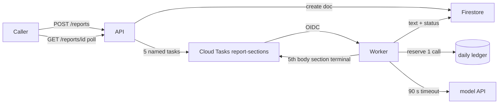

# PRD

# Due-diligence report generation

**Goal:** A caller asks for a company's due-diligence report and, within a few minutes and under a daily spend cap, reads six model-written sections led by an executive summary.

> [!NOTE]
> Web-grounded research (discovery Step 1.5): skipped — not a researchable question; force with `flow feature create --research`.

## Problem Statement

This service stores and serves company reports, and it already knows how to ask a language model to write one named section about a company, but nothing in it can actually produce a report. Someone who needs a due-diligence read on a company has no way to request one. The obvious way to build it, waiting on six model calls inside a single request, would leave them waiting two to six minutes and losing the work whenever the server restarts. It would also let anyone on the internet run up the model bill.

| Evidence | What the codebase shows |
| --- | --- |
| No create path | The only routes are read-by-id and mark-as-shared; nothing writes a new report [anchor: src/app.ts:9] |
| Section generation exists, unused | `generateSection(company, section)` exists with no caller; each call "takes 20-60 s per call and costs money per call" [anchor: src/llm.ts:1] |
| Reports are not durable | Reports live in a process-local map, lost on every restart, scale-down or deploy, and invisible to a second instance [anchor: src/db.ts:9] |
| Endpoint is public | The service deploys with `--allow-unauthenticated`, so any internet caller can reach any route [anchor: deploy.sh:3] |
| No context for a summary | The section prompt carries only the company and section name, so it cannot write a summary "from the other five sections" (user's words) [anchor: src/llm.ts:8] |

Weighed against the product brief's ranked priorities: **user experience (#1)** rules out a multi-minute blocking request, **cost (#2)** requires every paid call to pass one cap, **architecture (#3)** requires the work to survive restarts, and **product quality (#4)** asks that a failed section degrade to a partial report rather than a failed one.

## Request vetting

- **Hypothesis:** Six independent model calls (five body sections in parallel, then an executive summary fed their text) produce a usable report in a few minutes with bounded spend, provided the calls run outside any request and every call passes a daily cap.
- **Case against:** The literal reading invites one request that awaits six 20–60 s paid calls: 120–360 s sequentially, past Cloud Run's 5-minute default request timeout. On request-based billing, CPU is throttled the moment a response returns, so "respond early and keep working" also fails. The in-memory store loses the result on any restart [anchor: src/llm.ts:1] [anchor: src/db.ts:9] (https://docs.cloud.google.com/run/docs/configuring/request-timeout, https://docs.cloud.google.com/run/docs/configuring/billing-settings). A single call writing all six sections would cost 1 call instead of 6, but the user explicitly asked that "each" section be "written by a model call".
- **Sources:** https://docs.cloud.google.com/run/docs/configuring/request-timeout ; https://docs.cloud.google.com/run/docs/configuring/billing-settings ; https://docs.cloud.google.com/tasks/docs/creating-http-target-tasks
- **Verdict:** adopt-with-conditions: report creation returns 202 in under 2 s with no model call inside any request, every section runs as its own durable queued task, and every paid call passes one daily cap

## Existing-code assessment

- **src/db.ts:** rewrite — a process-local map cannot back a queue whose worker runs in another instance or service, and it loses every report on restart; replace it with a store interface plus a durable implementation (prerequisite, bundled as Tasks 3–4) [anchor: src/db.ts:9]
- **src/llm.ts:** simplify — calls have no timeout, never check the HTTP status, and interpolate the raw company name into the prompt; add a timeout, error classification, safe quoting and one spend-cap choke point before adding the summary call (bundled into Task 6) [anchor: src/llm.ts:6]
- **src/app.ts:** simplify — the share route does a whole-report read-modify-write that would overwrite concurrent section writes once reports are generated in the background; make it a single-field update while adding the new routes (bundled into Task 9) [anchor: src/app.ts:20]
- **deploy.sh:** simplify — one public, uncapped service; add a private worker service plus instance, concurrency and timeout limits (Task 10) [anchor: deploy.sh:3]
- **Dockerfile:** keep — the same image serves both roles, selected by an environment variable [anchor: Dockerfile:6]

## Scope Boundary

**In scope:**

- An authenticated "create report" request taking a company name and returning a report id immediately.
- Five body sections generated in parallel as durable queued tasks; one executive-summary task written from the completed body sections.
- The existing read-report route becomes the status resource, showing overall status, per-section progress and, when finished, the six sections in reading order.
- A daily model-call cap enforced at one choke point, and same-company-same-day dedupe.
- A durable report store, timeouts and error classification on every model call, and a private worker service.
- Metrics contract, helper and emission tests; GCP provisioning and restore-check scripts.

**Out of scope:**

- Authentication or ownership on the existing read and share routes (candidate follow-up).
- Re-running a single failed section (candidate follow-up).
- Live streaming of section text (SSE/WebSocket); polling is enough for minute-scale jobs.
- Any UI, PDF or document export.
- A model-suggested title (a deterministic title is used; see Open Questions).
- Choosing or bootstrapping a metrics backend.

## Behavioral contrast

### User flow

| Before | After |
| --- | --- |
| No way to request a report: the read and share routes only serve reports that nothing creates | A caller with the API key sends a company name and gets a report id and status link back in about a second |
| — | Polling that link shows each of the six sections moving from queued to running to done; a typical report finishes in about 1–3 minutes, executive summary first |
| Reports disappear whenever the server restarts, scales down or redeploys | Reports survive restarts and deploys |
| — | Asking again for the same company on the same day returns the same report instead of paying for a second one |
| — | When the day's model-call budget is used up, a new request is refused with a retry time instead of spending silently |
| — | If a section fails, the report still finishes as "partial", with the summary written from the sections that succeeded |

### System flow

- **Before:**
  - One public Cloud Run service with two routes over a process-local map.
  - The model client is never called; it has no timeout or status check.
- **After:**
  - The public API service validates and authenticates the request, writes a report document to Firestore, enqueues five named Cloud Tasks tasks (one per body section), and returns 202.
  - A private worker service, reachable only by the queue's service account, claims each section under a lease, reserves one call from the daily ledger, calls the model with a 90 s timeout, and writes the text.
  - When the fifth body section reaches a terminal state, the worker enqueues the executive-summary task, which is written from the completed body texts.
  - Retries live only in the queue (up to 4 attempts with backoff); a permanently failed section is recorded and acknowledged, never retried forever.

**Lost:** the process-local report map and its module-level get/save functions are replaced by an injected store, so nothing in-process holds reports any more (no data is lost: nothing creates reports today). The service also gains a hard daily ceiling on model calls, which refuses requests once reached.

## User Stories / Acceptance Criteria

### Story 1: Request a report

- [ ] Given a valid API key and a company name, when the caller POSTs `/reports`, then the response is 202 with `{id, status: "queued"}`, a `Location: /reports/<id>` header, and exactly five section tasks enqueued — asserted by `bun test src/app.test.ts`
- [ ] Given a missing or wrong API key, when the caller POSTs `/reports`, then the response is 401 and no report or task is created — `bun test src/app.test.ts`
- [ ] Given an empty, whitespace-only, over-200-character or control-character company name, when the caller POSTs, then the response is 422 — `bun test src/app.test.ts`
- [ ] Given fewer than 6 model calls left in today's budget, when the caller POSTs, then the response is 429 with a `Retry-After` header and nothing is enqueued — `bun test src/app.test.ts`
- [ ] Given a non-failed report already exists for the same normalized company on the same UTC day, when the caller POSTs again, then the same id is returned and only still-queued sections are re-enqueued (named-task dedupe makes this a no-op) — `bun test src/app.test.ts`

### Story 2: Follow progress and read the finished report

- [ ] Given a report in progress, when the caller GETs `/reports/<id>`, then the body shows `status` (`queued` | `running` | `partial` | `failed` | `done`) and a `progress` entry per section — `bun test src/db.test.ts`
- [ ] Given all six sections are done, when the caller GETs the report, then `sections` holds six texts in reading order with the executive summary first, and `title` is `Due-diligence report: <company>` — `bun test src/db.test.ts`

### Story 3: Executive summary written from the other five

- [ ] Given all five body sections are done, when the summary task runs, then the model client receives each body section's title and text (each capped at 6,000 characters) — `bun test src/worker.test.ts`
- [ ] Given four of five body sections are terminal, when the fourth completes, then no summary task is enqueued; when the fifth reaches a terminal state, exactly one is — `bun test src/worker.test.ts`

### Story 4: Failures stay visible and bounded

- [ ] Given a retryable model failure on a non-final attempt, when the worker handles the task, then it releases the lease and returns 503 so the queue retries — `bun test src/worker.test.ts`
- [ ] Given a retryable failure on the final attempt (`X-CloudTasks-TaskRetryCount` = 3), or any permanent failure, when the worker handles the task, then the section is recorded `failed` with its error type and the worker returns 200 — `bun test src/worker.test.ts`
- [ ] Given the daily ledger is exhausted, when a section task runs, then no model call is made and the section is `failed` with `budget_exhausted` — `bun test src/worker.test.ts`
- [ ] Given one body section failed and four succeeded, when the summary runs, then it is written from the four and the report is `partial`; given all five failed, then the summary is not generated and the report is `failed` — `bun test src/worker.test.ts`
- [ ] Given a section already `done`, when its task is delivered again, then no model call is made and no ledger call is reserved — `bun test src/worker.test.ts`

### Story 5: Sharing keeps working

- [ ] Given a report whose sections are being written, when the caller POSTs `/reports/<id>/share`, then `shared` becomes true and no section state is overwritten — `bun test src/db.test.ts src/app.test.ts`

## Instrumentation

**Contract:** `.flow/metrics.md` create

### Metrics

| Metric | Instrument | Unit | Attributes (closed values) | Emitted at |
| --- | --- | --- | --- | --- |
| `reports.report.create.duration` | Histogram | seconds | `operation.outcome` (`ok`, `error`) | create-report handler |
| `reports.report.create.failures` | Counter | none | `error.type` (`invalid_input`, `unauthorized`, `budget_exhausted`, `internal`, `_OTHER`) | create-report handler |
| `reports.section.duration` | Histogram | seconds | `operation.outcome` (`ok`, `error`), `operation.stage` (the six section names) | section worker |
| `reports.section.failures` | Counter | none | `error.type` (`upstream_error`, `upstream_timeout`, `rate_limited`, `budget_exhausted`, `internal`, `_OTHER`) | section worker |
| `reports.llm.duration` | Histogram | seconds | `server.address` (`api.example-llm.com`), `operation.outcome` (`ok`, `error`) | model client |
| `reports.llm.failures` | Counter | none | `server.address` (`api.example-llm.com`), `error.type` (`upstream_error`, `upstream_timeout`, `rate_limited`, `_OTHER`) | model client |
| `reports.report.duration` | Histogram | seconds | `operation.outcome` (`ok` = done, `error` = partial or failed) | section worker, when a report reaches a terminal state |
| `reports.llm.budget.used` | Gauge | `{call}` | none | spend ledger, after each reservation (read with `max`) |
| Cloud Tasks queue depth | Gauge | `{message}` | `messaging.destination.name` (`report-sections`) | platform-native (Cloud Tasks `queue/depth`) |

Request-scale buckets (14 bounds) for create; job-scale buckets `[1, 5, 10, 20, 30, 45, 60, 90, 120]` (9 bounds) for section and model-call durations; report-scale buckets `[30, 60, 90, 120, 180, 240, 300, 600, 1200]` (9 bounds) for end-to-end report duration.

Estimated series: 39 per operation for create report (2 × 17 + 5)
Estimated series: 150 per operation for section generation (2 outcomes × 6 stages × 12 + 6) — over 100, justified because the stage set is fixed by code at six values and per-section latency is the main tuning signal
Estimated series: 28 per operation for the model call (2 × 12 + 4)
Estimated series: 25 per operation for report completion (2 × 12, plus 1 for the budget gauge)

All counts are per reporting instance. If the suggested Google Cloud Monitoring OTLP route is adopted at a 60 s export interval, the worst case is about 242 samples per export, or about 10.5 million samples a month per instance (≈ $0.63 at the first-tier price, medium-confidence pricing).

**Attributes:** registers `operation.outcome`, `operation.stage` (`company_overview`, `market_and_competition`, `financial_health`, `management_and_governance`, `risks_and_legal`, `executive_summary`), `server.address` (`api.example-llm.com`), `error.type`, and `messaging.destination.name` (`report-sections`) as new `.flow/metrics.md` `## Attributes` rows

### Error types

New list seeded from the starter values, plus one repo-specific value:

- `budget_exhausted` — the day's model-call cap is reached; a deliberate shed, excluded from the availability SLO.
- `invalid_input`, `unauthorized`, `not_found` — client-caused, excluded from the availability SLO.
- `upstream_error`, `upstream_timeout`, `rate_limited` — the model API failed, timed out, or throttled us.
- `internal`, `_OTHER` — unexpected failure inside this service, and the fallback.

### Dashboard panels

On a new "reports-service overview" dashboard:

- Report requests and failures by `error.type`.
- Create latency p50/p95/p99.
- Section latency p50/p95/p99 by section.
- Section failures by `error.type`.
- Report end-to-end duration p50/p95, done vs partial/failed.
- Model-call latency and failures.
- Budget used against the cap.
- Cloud Tasks queue depth (native).

### Alerts

| Signal | Condition | Sustained for | Action | Routes to | Dashboard |
| --- | --- | --- | --- | --- | --- |
| Cloud Tasks queue depth | > 50 tasks in `report-sections` | 15 min | notify | owner-email | reports-service overview |
| Model-call budget used | `reports.llm.budget.used` ≥ 80% of the daily cap | 5 min | notify | owner-email | reports-service overview |

Plus the standard burn-rate tiers for the new SLO below.

### SLO

New journey SLO "generate a due-diligence report": 95% of accepted reports reach `done` within 10 minutes, over 30 days. Reports ending on `budget_exhausted` or client-caused errors are excluded. Standard burn-rate tiers (14.4× 1h/5m page, 6× 6h/30m page, 1× 3d/6h notify) are recorded once in `.flow/metrics.md`.

**As-code:** spec-only — the repo keeps no dashboard or alert config, and no metrics backend is chosen yet (`.flow/metrics.md` `## Backend`: none yet — suggested Google Cloud Monitoring via OTLP)

## Architecture Decisions

| Aspect | Decision |
| --- | --- |
| Layers touched | HTTP API, background worker, persistence (new Firestore store), model-API integration, GCP infrastructure (queue, IAM, deploy) |
| Domain modules | Existing: report store, model client, HTTP handlers. New: section catalogue, metrics helper, spend ledger, task-queue client, section worker |
| Data flow | Caller → API (validate, auth, admission) → Firestore report document → five named Cloud Tasks → private worker → model API → Firestore → fan-in enqueues summary → worker → Firestore; caller polls the report |
| Pattern | New: one queued task per section plus a parent status document (system-design multi-section row). Justified because no queue, durable store or worker exists in the repo today |
| Binary-framing check | Not framed as A-or-B by the user; the middle ground between "one request does everything" and "a workflow engine" is the queue-plus-status-document chosen here |

### Runtime design

| Operation | Est. p99 | Execution model | Timeout / deadline | Retries | Idempotency key | Cost bound |
| --- | --- | --- | --- | --- | --- | --- |
| Create report (POST) | ~1 s | inline — ~1 s, timeout 10 s | 10 s handler; 5 s per Firestore or Cloud Tasks call | none server-side; client re-POST is safe | normalized company + UTC day (new dedupe document) | admission check: ≥ 6 calls left in the new daily ledger |
| Body section generation (×5) | ~60 s | durable queue (Cloud Tasks `report-sections`) + private worker invoked synchronously under the attempt deadline | model call 90 s < worker request 150 s < dispatch deadline 180 s | queue only: max 4 attempts, backoff 10–300 s, 3 doublings | `<reportId>-<section>` named task + section lease (180 s) | new daily ledger, 1 call reserved per attempt |
| Executive summary generation | ~60 s | same queue, enqueued when all five body sections are terminal | same as above | same as above | `<reportId>-executive_summary` named task + lease | same ledger |
| Report status read (GET) | ~100 ms | inline — ~100 ms, timeout 5 s | 5 s | none | n/a (read) | none (no paid call) |
| Share (POST) | ~100 ms | inline — ~100 ms, timeout 5 s | 5 s | none | report id (setting a flag is idempotent) | none |
| Model API call | ~60 s | called only from the worker | 90 s abort | none at this layer | inherited from the task | ledger reservation before each call |

**Platform:** gcp

**Proportionality:** Deliberately left out:

- No workflow engine: a fixed two-phase fan-out fits a queue plus one document.
- No Pub/Sub: there is one consumer.
- No SSE or WebSocket: polling suits a minute-scale job.
- No per-IP rate limiter: the API key and daily cap bound spend.
- No backup schedule beyond PITR: reports regenerate at 6 calls each.
- No canary: there is no live traffic, so deploy straight and roll back to the previous revision.
- No multi-region.

**Recovery:**

- Firestore point-in-time recovery (7-day window) is enabled by the provisioning task, with a restore-drill script that clones to a scratch database and compares report counts.
- Reports are paid generations, regenerable at 6 model calls each.
- Ledger and dedupe documents expire by TTL and need no recovery.

## Technical Constraints

- **No work after the response.** On request-based billing, Cloud Run throttles CPU once the response returns, so no generation may continue after it (https://docs.cloud.google.com/run/docs/configuring/billing-settings).
- **Request timeouts rule out an inline report.** The default is 5 minutes and the maximum 60 (https://docs.cloud.google.com/run/docs/configuring/request-timeout), while six sequential calls take 120–360 s [anchor: src/llm.ts:1].
- **Cloud Tasks retries every non-2xx response.** A permanently failed section must be recorded and then answered with 200, or it retries until max attempts (https://docs.cloud.google.com/tasks/docs/creating-http-target-tasks).
- **Named-task dedupe is not enough on its own.** A task name can stay reserved after completion and dedupe is not instant, so the worker also dedupes with a section lease and a `done` check. A re-enqueue answered 409 counts as success.
- **The worker must be private.** It deploys with `--no-allow-unauthenticated`, and only the queue's service account holds `roles/run.invoker`. A public worker route would let anyone skip the cap [anchor: deploy.sh:3].
- **Two new dependencies need a stated reason** (AGENTS.md: "No new runtime dependencies without a reason"). `@google-cloud/firestore` is used with `preferRest: true` for transactional section and ledger updates. Cloud Tasks is called over REST with `fetch` and a metadata-server token, so it adds no dependency [anchor: AGENTS.md:5].
- **Token spend.** Each report costs 6 model calls nominally and up to 24 in the worst case (6 sections × 4 attempts). Everything is bounded by the daily cap (`DAILY_MODEL_CALL_CAP`, default 300 calls, about 50 reports).
- **Latency.** Create must stay under the 10 s interactive budget (target ~1 s). A typical report completes in about 40–120 s: five parallel sections of up to 60 s, then a summary of up to 60 s.

## Open Questions

- [ ] Q1: What daily model-call cap should the service enforce? Redirect changes the `DAILY_MODEL_CALL_CAP` default in Task 5 and the 80% alert threshold. The plan ships 300 calls/day (≈ 50 reports) until answered.
  - **Stakes:** both — too low refuses legitimate reports (user experience, priority #1); too high lets one bad day spend more than intended (cost, priority #2)
  - **Needs user input:** user-held preference or subjective taste — the budget is the owner's call, and the per-call price of the model API is not visible in the repo
- [ ] Which five body sections, in what reading order? Redirect changes the section catalogue constant (Task 1) and the metrics stage list; no other task changes.
  - **Stakes:** user — the wrong sections make every report miss what its reader needs
  - **Recommended:** company overview, market and competition, financial health, management and governance, risks and legal, read with the executive summary first — the list is one constant, so changing it later is a one-line edit with no data migration [confidence: medium] [anchor: weighing: reversibility — one constant drives prompts, ordering and the stage attribute]
- [ ] Should creating a report require an API key? Redirect drops Task 9's bearer check and the secret in Task 2, leaving only the daily cap as protection.
  - **Stakes:** both — without it, any internet caller can exhaust the day's budget and lock out real users (cost, priority #2; user experience, priority #1)
  - **Recommended:** yes — a single bearer key from Secret Manager on the create route only (read and share are unchanged); there is no existing create client to break [confidence: medium] [anchor: weighing: risk — a public route that starts six paid calls is open to cost abuse on an `--allow-unauthenticated` service]
- [ ] Should a repeat request for the same company on the same UTC day return the existing report? Redirect swaps the company-day key in Task 3 for an `Idempotency-Key` header.
  - **Stakes:** both — without dedupe, a client retry or double-click pays 6 more calls; with it, a caller cannot force a fresh same-day report
  - **Recommended:** yes, except when the existing report is `failed` or `partial`, in which case a new report is created so a failed run is not stuck until tomorrow [confidence: medium] [anchor: weighing: risk — a retried POST without dedupe silently doubles spend]
- [ ] When a body section fails, should the summary still be written? Redirect makes Task 8 skip the summary and mark the report `failed` on any body failure.
  - **Stakes:** user — all-or-nothing throws away up to five paid sections the reader could still use
  - **Recommended:** yes — write the summary from the sections that succeeded, name the missing ones in the prompt, and mark the report `partial`; skip the summary only when all five failed (brief priority #4: degrade gracefully) [confidence: medium] [anchor: weighing: risk — partial output keeps paid work visible instead of discarding it]
- [ ] How large may the summary prompt grow? Redirect changes the per-section cap in Task 6.
  - **Stakes:** user — if the model API rejects or truncates a long prompt, the headline section fails on every report
  - **Recommended:** cap each body section at 6,000 characters inside the summary prompt (≈ 30,000 characters total); a rejection marks only the summary `failed` and the report `partial`, visibly [confidence: medium] [anchor: weighing: risk — a fixed cap bounds the prompt whatever the API's unknown limit is]
- [ ] What should the report title be? Redirect adds an extra 1–3 s paid title call (the unused title helper) after the summary.
  - **Stakes:** user — a missing title makes a list of reports harder to scan
  - **Recommended:** a deterministic `Due-diligence report: <company>`, with no extra paid call (brief priority #2: cost) [confidence: medium] [anchor: weighing: footprint — zero extra calls and no extra failure mode]
- [ ] Which durable store backs reports and the ledger? See Decision B. Redirect changes Tasks 2, 4 and 5.
  - **Stakes:** system — the store decides fixed monthly cost, connection handling and how the fan-in update is made atomic
  - **Recommended:** Firestore (native mode), see Decision B [confidence: medium] [anchor: weighing: footprint — serverless, billed per operation, no always-on instance or connection pool]
- [ ] Should the worker be its own private service? See Decision C. Redirect replaces the second service in Task 10 with OIDC token verification in the public service.
  - **Stakes:** system — a mistake in hand-written token verification exposes paid work to anyone
  - **Recommended:** a second Cloud Run service from the same image with `--no-allow-unauthenticated`, see Decision C [confidence: medium] [anchor: weighing: risk — IAM enforces the caller with zero auth code to get wrong]
- [ ] Per-section queued tasks or one batch job per report? See Decision A. Redirect replaces Tasks 7–8 with a Cloud Run Job runner.
  - **Stakes:** both — it decides per-section retry granularity (spend on retries) and how fast a report starts
  - **Recommended:** one Cloud Tasks task per section, see Decision A [confidence: high] [anchor: src/llm.ts:1]
- [x] Should the Google Cloud clients be official SDKs or plain REST? Resolved: the Firestore SDK (transactions are error-prone over raw REST), and Cloud Tasks over REST with `fetch` (one call, no dependency).
  - **Stakes:** none — resolved without asking

## Decision analysis

**Decision A — how are the six model calls executed?** These branches are mutually exclusive.

- **A1, one Cloud Tasks task per section:**
  - User flow: POST → 202 in ~1 s → poll → done in ~40–120 s. 0 interruptions per run.
  - A section that fails transiently retries alone.
  - The summary starts within a second of the fifth section finishing.
  - Each task's 180 s ceiling sits well above one 60 s call.
- **A2, one Cloud Run Job execution per report:**
  - User flow: POST → 202 in ~1–2 s, plus job start latency → poll → done. 0 interruptions per run.
  - A retry re-runs the whole execution, so it needs per-section checkpoints in the store to avoid re-paying for finished sections.
  - Starting a job from the API needs the Run Admin API and a broader IAM grant.
  - No named-task dedupe and no queue-level rate cap.

Ranking: A1 > A2. Verdict: **A1** — per-section retry and named-task dedupe match the system-design guidance for multi-section reports, and the 20–60 s per-call contract fits one task per call [confidence: high] [anchor: src/llm.ts:1].

**Decision B — which durable store?** These branches are mutually exclusive with each other, and either one is complementary to A1.

- **B1, Firestore:**
  - Serverless, billed per read and write, and costs pennies at this volume.
  - Single-document transactions make the fan-in check atomic.
  - PITR and TTL are built in.
- **B2, Cloud SQL Postgres:**
  - An always-on instance has a fixed monthly cost even when idle (cost, priority #2).
  - Cloud Run needs connection pooling.
  - Adds a migration toolchain.
- **B3, Memorystore:** not durable enough for paid output without extra persistence configuration, and has a fixed cost.

Ranking: B1 > B2 > B3. Verdict: **B1** — the lowest fixed cost and smallest operational footprint for a document-shaped report [confidence: medium] [anchor: weighing: footprint — no instance, pool or migrations to run].

**Decision C — how is the worker protected?** These branches are mutually exclusive.

- **C1, a separate private service:**
  - Deployed from the same image with `--no-allow-unauthenticated`.
  - The queue's service account is the only invoker.
  - Zero auth code.
  - Costs one extra service to deploy, with no idle cost when it scales to zero.
- **C2, OIDC verification in the public service:**
  - Hand-written JWT signature, audience and email checks.
  - One bug exposes paid work.
  - One fewer service.

Ranking: C1 > C2. Verdict: **C1** — the platform enforces the caller, so there is no verification code to get wrong [confidence: medium] [anchor: weighing: risk — IAM-enforced invocation removes a security-sensitive code path].

Combined: A1 + B1 + C1 are complementary, and this is the ranked first combination. A2 + B1 + C1 is the viable fallback.

## Alternatives considered

- **Generate all six sections inside the create request** — rejected: 120–360 s sequentially (or ~60–120 s in parallel) exceeds the 10 s interactive budget and approaches Cloud Run's 300 s default timeout [anchor: src/llm.ts:1]; a client retry would also double the spend.
- **Respond 202 and keep generating in a detached in-process promise** — rejected: request-based billing throttles CPU after the response (https://docs.cloud.google.com/run/docs/configuring/billing-settings), and the process-local map is invisible to other instances and lost on restart [anchor: src/db.ts:9].
- **One model call that writes all six sections** — rejected: the user specified "six sections, each written by a model call" and "the executive summary section is written from the other five sections"; one failure would also lose the whole report.

## Recommendation

**Reconsider scope** — build the report as asked, but widen scope to the prerequisites it cannot ship without: a durable store, a queue plus private worker, a daily paid-call cap, and model-call timeouts. Rewrite the store (src/db.ts) and simplify the model client, routes and deploy script per the Existing-code assessment. See Decision A and Q1 for the cap value. [confidence: high] [anchor: src/db.ts:9]

**Redundancy:** none found — no existing route, job or helper creates reports; the section generator and title helper exist but have no caller

## Plan risks

The weakest assumption is that the model API accepts a ~30,000-character summary prompt. The executive summary is the only call whose input grows fivefold. If the API rejects or silently truncates long prompts, the headline section fails or degrades on every report, and that only shows up against the real API after deploy.

## Cut list

- A per-section re-run endpoint: left out (candidate follow-up). Re-POSTing for a partial report already creates a fresh one.
- A model-suggested title: replaced by a deterministic title, saving one paid call per report.
- A Firestore backup schedule on top of PITR: left out, because reports regenerate at a known 6-call cost.

# Candidate follow-up issues

| Candidate | Value | Complexity | Rationale | Relation to current request | Pull into this pipeline? |
| --- | --- | --- | --- | --- | --- |
| Authenticate and scope the read and share routes | High | Medium | needs its own design/decision session: the open decision is what "shared" means (public link vs owner-only access) and who owns a report, since today anyone with an id can read any report and flip its share flag | adjacent: the same routes this plan extends, but a different access model | No |
| Re-run a single failed section | Medium | Medium | needs its own design/decision session: the open decision is whether re-running one section also regenerates the executive summary (a second paid call) and how re-runs count against the daily cap | builds on this plan's per-section tasks | No |

- [x] Authenticate and scope the read and share routes — anyone holding a report id can read the report and mark it shared, so the share flag gates nothing.
  - **UX:** none
  - **Problem:** the read and share routes check no caller identity, so the `shared` flag has no effect on who can read a report [anchor: src/app.ts:12]
  - **Stability/efficiency:** none
  - **Value rank:** 2 — an unfired latent exposure of due-diligence content to anyone who obtains a report id [anchor: src/app.ts:12]
  - **Complexity:** Medium — routes, store ownership field and caller identity
  - **Risk:** Medium — changes access for every existing caller of the read route
  - **If never done:** every report stays readable by any holder of its id, and "shared" stays a label with no effect
  - **Verdict:** clears bar — a substantiated latent exposure on sensitive content outweighs a Medium change that needs its own access-model decision
- [ ] Re-run a single failed section — let a caller retry one failed section instead of requesting a whole new report.
  - **UX:** a caller with a partial report re-runs one section instead of waiting for a whole new report [anchor: src/llm.ts:1]
  - **Problem:** none
  - **Stability/efficiency:** fixing one failed section today costs a full new report (6 calls) instead of 1–2 [anchor: src/llm.ts:1]
  - **Value rank:** 2 — a single-instance cost annoyance; the re-POST path already recovers partial reports [anchor: src/llm.ts:1]
  - **Complexity:** Medium — new route, task naming for re-runs, summary regeneration rules
  - **Risk:** Medium — interacts with dedupe, the ledger and named-task reservation
  - **If never done:** a partial report is fixed by requesting a new one, at 6 calls instead of 1–2
  - **Verdict:** below bar — the existing re-POST recovery covers the need until failure rates are measured

# Task breakdown

### Task 1: Section catalogue and metrics helper

- **Skill:** `flow-metrics`
- **Description:**
  - Add the closed section catalogue (five body sections plus the executive summary, with display titles and reading order).
  - Add the repo-local, zero-dependency metrics helper with a swappable in-memory recorder, a closed `ErrorType` union mirroring `.flow/metrics.md`, and a typed attribute map.
  - Create `.flow/metrics.md` with `## Backend` (none yet — suggested Google Cloud Monitoring via OTLP, 60 s export), `## Namespace` (`reports`), `## Attributes`, `## error.type values` (`_OTHER`, `budget_exhausted`, `internal`, `invalid_input`, `not_found`, `rate_limited`, `unauthorized`, `upstream_error`, `upstream_timeout`), `## Helper`, `## Dashboard panels`, `## Dashboards`, `## Alerts`, `## As-code` (spec-only), `## SLOs` ("generate a due-diligence report") and `## Coverage`, all as specified in the PRD Instrumentation section.
- **Inputs:** none
- **Outputs:** section catalogue, metrics helper, metrics contract file
- **Contract:**
  - **Files:** create `src/sections.ts`, `src/metrics.ts`, `src/metrics.test.ts`, `.flow/metrics.md`
  - **Interfaces:**
    - `export const BODY_SECTIONS = ["company_overview", "market_and_competition", "financial_health", "management_and_governance", "risks_and_legal"] as const`
    - `export const SUMMARY_SECTION = "executive_summary" as const`
    - `export type BodySection = (typeof BODY_SECTIONS)[number]`
    - `export type SectionName = BodySection | typeof SUMMARY_SECTION`
    - `export const SECTION_TITLES: Record<SectionName, string>`
    - `export const READING_ORDER: readonly SectionName[]` (summary first)
    - `export type ErrorType = "_OTHER" | "budget_exhausted" | "internal" | "invalid_input" | "not_found" | "rate_limited" | "unauthorized" | "upstream_error" | "upstream_timeout"`
    - `export type Attributes = { "operation.outcome"?: "ok" | "error"; "operation.stage"?: SectionName; "server.address"?: "api.example-llm.com"; "error.type"?: ErrorType; "messaging.destination.name"?: "report-sections" }`
    - `export interface Recorder { histogram(name: string, seconds: number, attrs: Attributes): void; counter(name: string, inc: number, attrs: Attributes): void; gauge(name: string, value: number, attrs: Attributes): void }`
    - `export function setRecorder(r: Recorder): void`
    - `export function createMemoryRecorder(): Recorder & { records: { kind: string; name: string; value: number; attrs: Attributes }[] }`
    - `export async function instrument<T>(op: string, fn: () => Promise<T>, attrs?: Attributes): Promise<T>`, which records `<op>.duration` and, on throw, `<op>.failures`
    - `export function toErrorType(err: unknown): ErrorType`, which falls back to `_OTHER`
  - **Call-site edits:** none (first task)
- **Acceptance criteria:** `bun test src/metrics.test.ts && test -f .flow/metrics.md && grep -q 'budget_exhausted' .flow/metrics.md`. The tests cover: success records one `operation.outcome=ok` duration and no failure; failure records `error` plus one failures increment with the exact `error.type`; an unknown error maps to `_OTHER`.

### Task 2: GCP provisioning and restore-check scripts

- **Skill:** `flow-system-design`
- **Description:** Add an idempotent provisioning script and a restore-drill script, as the infrastructure surgical form below. These set up the Firestore database with PITR and TTL, the Cloud Tasks queue with its must-set retry settings, the service accounts, IAM and the API-key secret.
- **Inputs:** `deploy.sh` (region `us-central1`, service `reports-service`)
- **Outputs:** runnable infra scripts
- **Contract:**
  - **Files:** create `infra/setup.sh`, `infra/restore-check.sh`
  - **Interfaces:**
    - `infra/setup.sh` (bash, `set -euo pipefail`, each step skips if the resource already exists):
      - `gcloud services enable firestore.googleapis.com cloudtasks.googleapis.com secretmanager.googleapis.com run.googleapis.com`
      - `gcloud firestore databases create --location=us-central1 --type=firestore-native`
      - `gcloud firestore databases update --database='(default)' --enable-pitr`
      - TTL on field `expireAt` for collection groups `dedupe` and `spend`
      - `gcloud tasks queues create report-sections --location=us-central1 --max-attempts=4 --min-backoff=10s --max-backoff=300s --max-doublings=3 --max-concurrent-dispatches=10 --max-dispatches-per-second=1`
      - Service accounts `reports-api`, `reports-worker`, `reports-tasks-invoker`
      - Bindings: `roles/datastore.user` (api, worker); `roles/cloudtasks.enqueuer` (api, worker); `roles/iam.serviceAccountUser` on `reports-tasks-invoker` (api, worker); `roles/run.invoker` on service `reports-worker` for `reports-tasks-invoker`; `roles/secretmanager.secretAccessor` on secret `reports-api-key` for api
      - `gcloud secrets create reports-api-key`
    - `infra/restore-check.sh`:
      - Clones the database at a PITR timestamp into a scratch database (`reports-restore-check`).
      - Prints the `reports` document count for source and clone, exits non-zero on mismatch, then deletes the scratch database.
      - The implementer confirms the exact current `gcloud firestore` clone/restore flags against Google's docs.
  - **Call-site edits:** none
- **Acceptance criteria:** `bash -n infra/setup.sh && bash -n infra/restore-check.sh && grep -q -- '--max-attempts=4' infra/setup.sh && grep -q -- '--enable-pitr' infra/setup.sh && grep -q 'roles/run.invoker' infra/setup.sh`

### Task 3: Report model, store interface and in-memory store

- **Skill:** `flow-system-design`
- **Description:** Rewrite the store module around an injected store interface.
  - **Data model:** one document per report, with a per-section state map (status, text, error, lease, attempts). `deriveStatus` returns `queued` / `running` / `partial` / `failed` / `done`. Any non-terminal section on a report older than 30 minutes is presented as `failed` with `internal` (stalled).
  - **Read view:** keeps `sections: string[]` (completed texts in reading order) and `title` (deterministic `Due-diligence report: <company>`), and adds `status`, `progress`, `createdAt` and `completedAt`.
  - **Dedupe:** on normalized company (trimmed, lower-cased, whitespace collapsed) + UTC day; a `failed` or `partial` existing report does not dedupe.
  - **Section transitions:** claim, complete, fail and release are atomic. Claim succeeds only when the section is `queued`, or `running` with an expired lease.
  - **Share:** a single-field update.
  - **Contract tests:** one suite, exported so Task 4 reruns it against Firestore.
- **Inputs:** `src/sections.ts` (Task 1)
- **Outputs:** store interface, in-memory implementation, reusable contract test suite
- **Contract:**
  - **Files:** edit (rewrite) `src/db.ts`; create `src/db.test.ts`, `src/store-contract.ts`
  - **Interfaces:**
    - `export type SectionStatus = "queued" | "running" | "done" | "failed"`
    - `export type SectionState = { status: SectionStatus; text: string | null; error: ErrorType | null; leaseUntil: number | null; attempts: number }`
    - `export type ReportStatus = "queued" | "running" | "partial" | "failed" | "done"`
    - `export type Report = { id: string; company: string; title: string | null; shared: boolean; status: ReportStatus; sections: string[]; progress: Record<SectionName, SectionState>; createdAt: number; completedAt: number | null }`
    - `export type ClaimResult = "claimed" | "done" | "busy" | "missing"`
    - `export interface ReportStore`:
      - `create(input: { company: string; now: number }): Promise<{ report: Report; created: boolean }>`
      - `get(id: string, now?: number): Promise<Report | undefined>`
      - `setShared(id: string, shared: boolean): Promise<boolean>`
      - `claimSection(id: string, section: SectionName, now: number, leaseMs: number): Promise<ClaimResult>`
      - `completeSection(id: string, section: SectionName, text: string, now: number): Promise<Report>`
      - `failSection(id: string, section: SectionName, error: ErrorType, now: number): Promise<Report>`
      - `releaseSection(id: string, section: SectionName): Promise<void>`
    - `export function createMemoryStore(): ReportStore`
    - `export function dedupeKey(company: string, now: number): string`
    - `export function deriveStatus(progress: Record<SectionName, SectionState>, createdAt: number, now: number): ReportStatus`
    - `src/store-contract.ts`: `export function runStoreContract(name: string, make: () => Promise<ReportStore>): void`
    - Removed: `getReport`, `saveReport`
  - **Call-site edits:** `src/app.ts` `handle` keeps compiling via a temporary module-level `createMemoryStore()` instance until Task 9 rewires it (GET uses `store.get`; share uses `store.setShared`)
- **Acceptance criteria:** `bun test src/db.test.ts`, covering: dedupe hit and the failed/partial bypass; claim on a `done` section returns `done` without a lease; a concurrent claim returns `busy`; an expired lease is reclaimable; `setShared` leaves section state intact; reading order puts the summary first; the stalled cutoff at 30 min.

### Task 4: Firestore report store

- **Skill:** `flow-system-design`
- **Description:** Implement `ReportStore` on Firestore (native mode) with the official SDK in REST mode (`preferRest: true`) so it runs on Bun.
  - Each section transition is a single-document transaction.
  - Dedupe uses a `dedupe/<key>` document (`{reportId, expireAt: now + 2 days}`) created in the same transaction as the report.
  - Rerun Task 3's contract suite against the Firestore emulator when `FIRESTORE_EMULATOR_HOST` is set.
- **Inputs:** `src/db.ts`, `src/store-contract.ts` (Task 3); new: `@google-cloud/firestore` runtime dependency (reason: a durable, transactional store shared by API and worker)
- **Outputs:** durable store implementation
- **Contract:**
  - **Files:** create `src/db-firestore.ts`, `src/db-firestore.test.ts`; edit `package.json` (add `dependencies["@google-cloud/firestore"]`)
  - **Interfaces:** `export function createFirestoreStore(db?: Firestore): ReportStore`, where the default is `new Firestore({ preferRest: true })`; collections `reports/{id}` and `dedupe/{key}`
  - **Call-site edits:** none (wired in Task 9)
- **Acceptance criteria:** `gcloud emulators firestore start --host-port=127.0.0.1:8681 & sleep 8; FIRESTORE_EMULATOR_HOST=127.0.0.1:8681 bun test src/db-firestore.test.ts`. The contract suite passes against the emulator, and the test fails rather than skips when the env var is set and the emulator is unreachable.

### Task 5: Daily spend ledger

- **Skill:** `flow-system-design`
- **Description:** One ledger counting model calls per UTC day, the single choke point for spend.
  - `reserve(n)` atomically adds `n` only if the total stays at or under the cap.
  - `remaining()` drives the create-route admission check.
  - Each reservation emits the `reports.llm.budget.used` gauge.
  - The cap comes from `DAILY_MODEL_CALL_CAP`, default 300 (see Q1).
  - The Firestore implementation uses `spend/<YYYY-MM-DD>` with `expireAt` = day + 35 days.
- **Inputs:** `src/metrics.ts` (Task 1); `@google-cloud/firestore` (Task 4)
- **Outputs:** memory and Firestore ledger implementations
- **Contract:**
  - **Files:** create `src/ledger.ts`, `src/ledger.test.ts`
  - **Interfaces:**
    - `export const DEFAULT_DAILY_CAP = 300`
    - `export interface SpendLedger { reserve(calls: number, now: Date): Promise<boolean>; remaining(now: Date): Promise<number>; cap: number }`
    - `export function createMemoryLedger(cap: number): SpendLedger`
    - `export function createFirestoreLedger(cap: number, db?: Firestore): SpendLedger`
    - `export function capFromEnv(env: Record<string, string | undefined>): number`, which rejects non-positive or non-integer values
  - **Call-site edits:** none (consumed in Tasks 6 and 9)
- **Acceptance criteria:** `bun test src/ledger.test.ts`, covering: reserve up to the cap succeeds and the next call fails; the counter resets on a new UTC day; the gauge records the used count; with `FIRESTORE_EMULATOR_HOST` set, 20 concurrent reserves against a cap of 10 grant exactly 10.

### Task 6: Model client hardening and summary call

- **Skill:** `flow-system-design`
- **Bundled:** missing timeout, unchecked HTTP status and raw prompt interpolation in the existing model client, surfaced during discovery
- **Description:** Replace the module-level functions with a client factory.
  - Every call reserves 1 call from the ledger first (throws `LlmError` kind `budget` if refused).
  - Every call is aborted at 90 s.
  - The response status is classified: 429 → `rate_limited` (retryable); 5xx or network → `upstream_error` (retryable); abort → `upstream_timeout` (retryable); other 4xx or missing text → `upstream_error` (not retryable).
  - The company name is quoted with `JSON.stringify` inside the prompt.
  - New `generateSummary` builds one prompt from the completed body sections: each titled and capped at 6,000 characters, with missing sections named.
  - The title helper moves onto the same client so it also passes the ledger.
  - Model calls are timed with the outbound histogram and failures counter (`server.address=api.example-llm.com`).
- **Inputs:** `src/ledger.ts` (Task 5), `src/metrics.ts`, `src/sections.ts` (Task 1)
- **Outputs:** hardened model client with summary support
- **Contract:**
  - **Files:** edit `src/llm.ts`; create `src/llm.test.ts`
  - **Interfaces:**
    - `export const LLM_TIMEOUT_MS = 90_000`
    - `export const SUMMARY_SECTION_CHAR_CAP = 6_000`
    - `export class LlmError extends Error { kind: "budget" | "rate_limited" | "upstream_error" | "upstream_timeout"; retryable: boolean }`
    - `export type LlmClient = { generateSection(company: string, section: BodySection): Promise<string>; generateSummary(company: string, sections: { section: BodySection; text: string | null }[]): Promise<string>; suggestTitle(sections: string[]): Promise<string> }`
    - `export function createLlmClient(deps: { ledger: SpendLedger; fetchImpl?: typeof fetch; timeoutMs?: number; now?: () => Date }): LlmClient`
    - Removed: top-level `generateSection`, `suggestTitle` (no callers)
  - **Call-site edits:** none (no existing callers; consumed in Task 8)
- **Acceptance criteria:** `bun test src/llm.test.ts`, using a fake fetch and covering:
  - A refused reservation makes zero fetch calls.
  - 429, 503, a hung request (with a 50 ms test timeout) and 400 map to the four kinds with the right `retryable`.
  - A company containing `"` is JSON-quoted in the prompt.
  - The summary prompt contains all five titles and truncates a 10,000-character section to 6,000 characters.
  - One `reports.llm.duration` observation per call.

### Task 7: Section task queue client

- **Skill:** `flow-system-design`
- **Description:** Enqueue one named Cloud Tasks HTTP task per section over REST, with no SDK. The API call is `POST https://cloudtasks.googleapis.com/v2/projects/{project}/locations/us-central1/queues/report-sections/tasks`, using a bearer token from the metadata server.
  - Task name: `<reportId>-<section>`.
  - Must-set setting: `dispatchDeadline: "180s"` on every task (max attempts is set on the queue in Task 2).
  - `httpRequest`: `POST {WORKER_URL}/tasks/section`, JSON body `{version: 1, reportId, section}`, `oidcToken.serviceAccountEmail` = the `reports-tasks-invoker` account, audience = `WORKER_URL`.
  - HTTP 409 ALREADY_EXISTS → `"duplicate"`; any other non-2xx throws.
  - Each call has a 5 s timeout.
- **Inputs:** `src/sections.ts` (Task 1); queue `report-sections` and service accounts (Task 2)
- **Outputs:** queue client and in-memory fake
- **Contract:**
  - **Files:** create `src/queue.ts`, `src/queue.test.ts`
  - **Interfaces:**
    - `export type SectionTask = { version: 1; reportId: string; section: SectionName }`
    - `export interface TaskQueue { enqueue(task: SectionTask): Promise<"enqueued" | "duplicate"> }`
    - `export function taskName(t: SectionTask): string`
    - `export function parseSectionTask(body: unknown): SectionTask | null`, which accepts `version: 1` only
    - `export function createCloudTasksQueue(cfg: { project: string; location: string; queue: string; workerUrl: string; invokerEmail: string; fetchImpl?: typeof fetch }): TaskQueue`
    - `export function createMemoryQueue(): TaskQueue & { tasks: SectionTask[] }`, which dedupes by `taskName`
  - **Call-site edits:** none (consumed in Tasks 8 and 9)
- **Acceptance criteria:** `bun test src/queue.test.ts`, using a fake fetch and covering: the request body carries `dispatchDeadline` `180s`, the task name and the OIDC email; 409 returns `duplicate`; 500 throws; `parseSectionTask` rejects unknown versions and section names.

### Task 8: Section worker

- **Skill:** `flow-system-design`
- **Description:** The worker handles `POST /tasks/section`. It reads the retry count from `X-CloudTasks-TaskRetryCount`; the final attempt is retry count ≥ `MAX_ATTEMPTS - 1`.
  1. **Parse:** an invalid payload returns 200 (dropped, not retried).
  2. **Claim:** with lease 180 s:
     - `missing` → 200.
     - `busy` → 503.
     - `done` → for a body section, re-run the fan-in check; then 200 with no model call.
  3. **Generate:** a body section calls `generateSection`; the summary gathers body texts and calls `generateSummary`. If all five body sections failed, the summary is marked `failed` (`upstream_error`) with no call.
  4. **Complete:** on success, call `completeSection`. Then, for a body section, if all five body sections are terminal, enqueue `executive_summary` (a `duplicate` counts as success). Return 200; an enqueue failure returns 503 so the retry re-attempts the fan-in.
  5. **Errors:**
     - A retryable `LlmError` on a non-final attempt → `releaseSection`, then 503.
     - A final-attempt failure, any non-retryable failure, or `budget` → `failSection` with the mapped `ErrorType` (`budget` → `budget_exhausted`), run the fan-in check, then 200.
  6. **Metrics:** each attempt emits `reports.section.duration` (with `operation.stage`) and `reports.section.failures`. When a report reaches a terminal state, emit `reports.report.duration`.
  - Idempotency key: `<reportId>-<section>` (named task plus section lease). Timeout: model call 90 s, inside the worker's 150 s request timeout, inside the 180 s dispatch deadline.
- **Inputs:** `src/db.ts` (Task 3), `src/llm.ts` (Task 6), `src/queue.ts` (Task 7), `src/metrics.ts` (Task 1)
- **Outputs:** worker handler
- **Contract:**
  - **Files:** create `src/worker.ts`, `src/worker.test.ts`
  - **Interfaces:**
    - `export const LEASE_MS = 180_000`
    - `export const MAX_ATTEMPTS = 4`
    - `export async function handleSectionTask(req: Request, deps: { store: ReportStore; llm: LlmClient; queue: TaskQueue; now?: () => number }): Promise<Response>`
  - **Call-site edits:** none (routed in Task 9)
- **Acceptance criteria:** `bun test src/worker.test.ts`, using the memory store, memory queue and a fake `LlmClient`, and asserting:
  - Idempotency key `<reportId>-<section>`: a redelivered done section makes no model call.
  - Timeout ordering: `LLM_TIMEOUT_MS` < 150 s < 180 s.
  - Transient failure → 503 with the lease released; final attempt → `failed` + 200; budget → `budget_exhausted` + 200.
  - The fifth terminal body section enqueues exactly one summary task.
  - Summary from four sections → report `partial`; all five failed → report `failed` with no summary call.
  - One stage duration observation per attempt.

### Task 9: HTTP API: create, status, share and role routing

- **Skill:** `flow-system-design`
- **Bundled:** the share route's whole-report read-modify-write, which would overwrite concurrent section writes, surfaced during discovery
- **Description:** Replace the module-level handler with a factory.
  - **API role, `POST /reports`:**
    - Rejects a body over 4 KB.
    - Requires `Authorization: Bearer <REPORTS_API_KEY>` (constant-time compare) → otherwise 401.
    - Validates `company` (string, trimmed 1–200 characters, no control characters) → otherwise 422.
    - Admission: `ledger.remaining() < 6` → 429 with `Retry-After` set to the seconds until UTC midnight.
    - `store.create`, then enqueues each still-`queued` section (enqueue after commit). An enqueue failure → 503, and a client re-POST hits dedupe and re-enqueues.
    - Responds 202 `{id, status}` with `Location: /reports/<id>`.
  - **API role, other routes:** `GET /reports/:id` returns the status view; `POST /reports/:id/share` uses `store.setShared`.
  - **Worker role:** routes only `POST /tasks/section` → `handleSectionTask`.
  - **Shared:** the role is selected by `SERVICE_ROLE`; errors use one JSON shape `{error: <ErrorType>}`; create emits `reports.report.create.duration` and `reports.report.create.failures`; the entrypoint wires the Firestore store, Firestore ledger and Cloud Tasks queue from env.
- **Inputs:** Tasks 1, 3, 4, 5, 6, 7, 8
- **Outputs:** wired HTTP surface for both roles
- **Contract:**
  - **Files:** edit `src/app.ts`; create `src/app.test.ts`
  - **Interfaces:**
    - `export type Deps = { role: "api" | "worker"; store: ReportStore; ledger: SpendLedger; queue: TaskQueue; llm: LlmClient; apiKey: string; now?: () => number }`
    - `export function createHandler(deps: Deps): (req: Request) => Promise<Response>`
    - `export function depsFromEnv(env: Record<string, string | undefined>): Deps`, which reads `SERVICE_ROLE`, `REPORTS_API_KEY`, `DAILY_MODEL_CALL_CAP`, `GOOGLE_CLOUD_PROJECT`, `WORKER_URL`, `TASKS_INVOKER_EMAIL`
    - The `import.meta.main` block serves `createHandler(depsFromEnv(process.env))`
  - **Call-site edits:** `src/app.ts` — remove the Task 3 temporary module-level store; the share route switches from `saveReport({...report, shared: true})` to `store.setShared(id, true)`
- **Acceptance criteria:** `bun test src/app.test.ts`, using memory fakes and covering: 202 + Location + five tasks; 401; 422 on empty, overlong and control-character input; 429 with `Retry-After`; a same-day repeat returns the same id; a failed report bypasses dedupe; GET status view; share keeps sections; worker-role requests to `/reports` return 404 and API-role requests to `/tasks/section` return 404; one create duration observation per request.

### Task 10: Deploy both services

- **Skill:** `flow-system-design`
- **Description:** Deploy the private worker first, read its URL, then deploy the public API with the worker URL. Both run from the same source and image.
- **Inputs:** `infra/setup.sh` (Task 2); role routing (Task 9)
- **Outputs:** two-service deploy
- **Contract:**
  - **Files:** edit `deploy.sh`
  - **Interfaces:**
    - Worker, added before the API deploy: `gcloud run deploy reports-worker --source . --region us-central1 --no-allow-unauthenticated --service-account reports-worker@$PROJECT.iam.gserviceaccount.com --timeout 150 --concurrency 5 --max-instances 3 --set-env-vars SERVICE_ROLE=worker,DAILY_MODEL_CALL_CAP=300,GOOGLE_CLOUD_PROJECT=$PROJECT`
    - Worker URL: `WORKER_URL=$(gcloud run services describe reports-worker --region us-central1 --format 'value(status.url)')`
    - API, changed: `gcloud run deploy reports-service --source . --region us-central1 --allow-unauthenticated` (unchanged) gains `--service-account reports-api@$PROJECT.iam.gserviceaccount.com --timeout 30 --max-instances 3 --set-env-vars SERVICE_ROLE=api,DAILY_MODEL_CALL_CAP=300,GOOGLE_CLOUD_PROJECT=$PROJECT,WORKER_URL=$WORKER_URL,TASKS_INVOKER_EMAIL=reports-tasks-invoker@$PROJECT.iam.gserviceaccount.com --set-secrets REPORTS_API_KEY=reports-api-key:latest`
    - `PROJECT=$(gcloud config get-value project)`
  - **Call-site edits:** none
- **Acceptance criteria:** `bash -n deploy.sh && grep -q -- '--no-allow-unauthenticated' deploy.sh && grep -q 'SERVICE_ROLE=worker' deploy.sh && grep -q -- '--timeout 150' deploy.sh && grep -q 'REPORTS_API_KEY=reports-api-key:latest' deploy.sh`

| Task | Depends on |
| --- | --- |
| 1 | — |
| 2 | — |
| 3 | 1 |
| 4 | 3 |
| 5 | 1, 4 |
| 6 | 1, 5 |
| 7 | 1, 2 |
| 8 | 3, 6, 7 |
| 9 | 3, 4, 5, 6, 7, 8 |
| 10 | 2, 9 |

### Skills Summary

| Skill | Recommended? | Reason |
| --- | --- | --- |
| flow-system-design | Yes (Tasks 2–10) | New queued, paid, multi-section runtime work: execution model, deadlines, idempotency, spend cap |
| flow-metrics | Yes (Task 1) | First instrumented change in the repo: helper, contract file, error list |
| flow-testing | No (consulted) | Every task carries its own test file and runnable acceptance; no standalone test task |
| flow-ui-ux | No | No user interface surface |
| flow-refactoring | No | The store rewrite is a behaviour-changing prerequisite, not a behaviour-preserving refactor |
| flow-verify | No (implicit) | Runs as the pipeline's verify phase |

# PR description draft

## TLDR

Callers can now request a company due-diligence report and poll it to six model-written sections led by an executive summary; before, nothing could create a report, and spend stays under a daily cap.

## User-facing changes

- New: send a company name with the service's API key to the create-report request and get a report id plus a status link back in about a second.
- New: polling that status link shows each of the six sections (company overview, market and competition, financial health, management and governance, risks and legal, executive summary) as queued, running, done or failed, and the report's overall state.
- New: a finished report lists its six sections in reading order with the executive summary first, written from the other five sections, under the title "Due-diligence report: <company>".
- New: asking again for the same company on the same day returns the same report instead of paying for a second one; a failed or partial report can be requested again straight away.
- New: once the day's model-call budget (300 calls, about 50 reports, by default) is used up, new requests are refused with a time to retry instead of spending silently.
- New: if a section fails, the report still finishes as "partial" with a summary of the sections that succeeded, rather than failing outright.
- Reports now outlive restarts and deploys:
  - **Before:** reports lived only in one server's memory and vanished whenever it restarted, scaled down or redeployed.
  - **After:** reports are stored durably and survive restarts, scale-downs and deploys.
- Marking a report as shared now works while it is still being written:
  - **Before:** sharing rewrote the whole report from a snapshot, which would have wiped out sections written in the meantime.
  - **After:** sharing changes only the shared flag and leaves every section untouched.

## System changes

- Report generation is now queued work handled by a separate private worker, never done inside a request:
  - **Before:** one public service answered every request itself and never called the model.
  - **After:** the public service records the report and queues one task per section; a private worker service, which only the queue can call, writes each section and then queues the executive summary once all five body sections have finished.
- Model calls now have a hard daily ceiling, a time limit and a single retry layer:
  - **Before:** a model call had no time limit and no status check, and nothing bounded how many could run.
  - **After:** every call passes one daily budget check, is abandoned after 90 seconds, and is retried only by the queue (up to 4 attempts) before being recorded as failed.
- Ongoing cost: each report costs 6 model calls normally, and at most 24 if every section exhausts its retries. Model spend is capped at 300 calls a day by default. New infrastructure costs are a pay-per-use document database with point-in-time recovery, a task queue, and a second service that scales to zero, which comes to pennies a month at this volume.

## Why

Nobody can get a due-diligence report out of this service today. The building blocks exist, a stored report shape and a model call that writes one section, but nothing requests or assembles a report. Each section takes 20–60 seconds of paid model time, so the request has to be built so that nobody waits minutes on an open connection, work is not lost when a server restarts, and the model bill cannot run away.

## Key decisions

- **Queued per-section tasks over generating inside the request.** Six 20–60 second calls would take 2–6 minutes in one request, past the 10-second attention budget and close to the platform's 5-minute limit. A queue also lets a failed section retry on its own.
- **One task per section over one batch job per report.** Per-section retry never re-pays for finished sections, and duplicate tasks are rejected by name.
- **Pay-per-use document database over a managed Postgres instance.** There is no always-on instance cost, and a single-document transaction makes "all five sections finished" an atomic check.
- **A separate private worker service over checking tokens in the public one.** The platform enforces who may call the worker, so there is no hand-written verification to get wrong.
- **Partial over all-or-nothing.** The summary is written from whichever body sections succeeded, so paid output is never thrown away.
- **A fixed title over a model-suggested one.** This saves one paid call per report.
- **API key on report creation only.** The read and share routes keep today's open access; scoping them needs its own access-model decision and is a candidate follow-up.
- **Out of scope:** re-running a single failed section (candidate follow-up), live streaming of section text (polling suffices for minute-scale work), any UI or export.
- Bundled: missing time limit, unchecked status and unescaped company name in the existing model call.
- Bundled: the share route's whole-report rewrite, which would overwrite sections written concurrently.

## Instrumentation

Metrics are specified for report creation, each section, each model call, end-to-end report time, and budget used, plus native task-queue depth. They feed new "reports-service overview" dashboard panels: request and failure rates, section latency by section, report completion time, model-call latency and failures, and budget against cap. Alerts notify when the queue backs up (over 50 tasks for 15 minutes) or 80% of the daily budget is used. A new journey SLO, "generate a due-diligence report", targets 95% of accepted reports done within 10 minutes over 30 days. This change creates the repo's metrics contract, and no metrics backend has been chosen yet: the metrics are recorded through an in-memory helper, and graphs need a backend choice before they show anywhere. Google Cloud Monitoring is the suggested default. Dashboards and alerts are spec-only, since the repo keeps no dashboard or alert config.

## Test Steps

<!-- flow:authoring-rubric — for each checkbox item below, the three-question
automation test from manual-test-rubric.md is: (a) named fixture/setup,
(b) deterministic assertion(s), (c) exit condition. If all three are answerable
without subjective human judgment, it must be a runnable item. Source of truth:
skills/pipeline/flow-pr-review/references/manual-test-rubric.md. -->

- [ ] Run `bun test src/app.test.ts` — creating a report returns 202 with a status link and queues five section tasks; a missing key is refused with 401, a bad company name with 422, and an exhausted budget with 429 plus a retry time; a same-day repeat returns the same report.
- [ ] Run `bun test src/worker.test.ts` — the summary is queued exactly once after the fifth body section finishes and is written from the completed sections; a transient failure retries, a final-attempt failure is recorded as failed, a redelivered finished section makes no model call, and one failed section yields a "partial" report.
- [ ] Run `bun test src/db.test.ts` — the finished report lists six sections with the executive summary first, and sharing leaves sections untouched.
- [ ] Run `bun test src/llm.test.ts` — every model call is refused before any network request when the budget is spent, abandoned at its time limit, classified by response status, and the summary prompt caps each section at 6,000 characters.
- [ ] Run `bun test src/ledger.test.ts src/queue.test.ts src/metrics.test.ts` — the daily cap grants exactly up to its limit, each queued task carries a 180-second deadline and its section name, and metrics record outcome and error type.
- [ ] Start the database emulator with `gcloud emulators firestore start --host-port=127.0.0.1:8681 &` and wait for it to report ready.
- [ ] Run `FIRESTORE_EMULATOR_HOST=127.0.0.1:8681 bun test src/db-firestore.test.ts src/ledger.test.ts` — the durable store passes the same contract suite as the in-memory one, and 20 concurrent budget reservations against a cap of 10 grant exactly 10.
- [ ] Run `bash -n infra/setup.sh && bash -n infra/restore-check.sh && bash -n deploy.sh && grep -q -- '--max-attempts=4' infra/setup.sh && grep -q -- '--no-allow-unauthenticated' deploy.sh` — the provisioning and deploy scripts parse, the queue caps attempts, and the worker deploys private.
- [ ] DECISION: you accept a default daily cap of 300 model calls (about 50 reports a day), after which new report requests are refused until midnight UTC.
