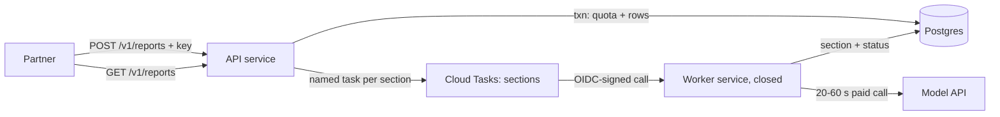

# PRD

> [!NOTE]
> Web-grounded research (discovery Step 1.5): skipped — not a researchable question; force with `flow feature create --research`.

# Partner Reports API

**Goal:** Partner companies holding an issued API key can request a report, watch it finish, and list their own past reports, without seeing anyone else's reports or running up unbounded spend.

## Problem Statement

Partner companies want reports from this service, but today the only way to get one is for someone on our side to set it up: there is no way to ask for a report from outside, and nothing that lists past reports. Every report request is therefore a manual hand-off, and partners cannot check on their own reports. Putting a request door on the public internet also means every request starts paid model calls, so without a sign-in and a spending ceiling one partner, or a stranger, could run up an unbounded bill or read another partner's reports.

What the code shows today (verified at `70a7383`):

| Fact | Evidence |
| --- | --- |
| No route creates a report. The only public routes are "read one report by id" and the queue worker's callback. | [anchor: src/app.ts:9-15] |
| The section-enqueue helper exists but nothing calls it, and it sends no credentials to the Cloud Tasks API, so its first real call would be rejected. | [anchor: src/queue.ts:4-15] |
| Reports carry no owner: only the company the report is about. Listing "their past reports" needs a new owner link. | [anchor: migrations/001_reports.sql:1-6] |
| A report's `status` is written once (`queued`) and never updated, so a partner could not tell a finished report from a pending one. | [anchor: migrations/001_reports.sql:4] |
| Each section is a paid model call taking 20-60 s, with no timeout and no error check. | [anchor: src/llm.ts:1-11] |
| The whole service, including the worker callback that starts paid generation, is deployed open to the internet with no caller check. | [anchor: deploy.sh:4] [anchor: src/app.ts:9] |
| The worker re-runs the paid call on every redelivery and has no failed state. | [anchor: src/worker.ts:5-12] |

Ranked against the product brief: **user experience** (partners serve themselves and see truthful status) is the top priority; **cost** (every report is N paid calls) is second and sets the quota and worker-lockdown conditions; **architecture** (owner scoping, one spending choke point) is third.

## Request vetting

- **Hypothesis:** An API key that resolves to a partner, plus owner-scoped report rows, lets partners create and list their own reports safely, and the existing queue-and-worker shape can carry the generation work once it is made to actually run.
- **Case against:** Opening a public create route on the current deployment is unsafe as-is: the worker callback that triggers paid generation is reachable by anyone on the open service [anchor: deploy.sh:4] [anchor: src/app.ts:9], so any per-partner limit on the new route could be bypassed by calling the worker directly; the enqueue path has never run and sends no credentials [anchor: src/queue.ts:5]; and redelivery re-bills every section [anchor: src/worker.ts:9].
- **Sources:** no outside source: research gate judged the feature not researchable; the case rests on committed repo paths and on Google's Cloud Tasks guidance quoted in the flow-system-design GCP reference (https://docs.cloud.google.com/tasks/docs/creating-http-target-tasks).
- **Verdict:** adopt-with-conditions: before the partner routes go live, the worker runs only behind an authenticated caller check, every partner has a daily report quota enforced in one place, and a redelivered section never triggers a second paid call.

## Existing-code assessment

- **src/app.ts:** simplify — routing is a single function mixing worker and read routes; split the role (public API vs worker) before adding partner routes, and keep partner handlers in their own module per AGENTS.md "Keep modules small" [anchor: src/app.ts:7-17]
- **src/db.ts:** keep — small tagged-SQL functions; extend with partner, key, create, list and status functions in the same style [anchor: src/db.ts:6-17]
- **src/queue.ts:** rewrite — sends no Authorization header, no caller-identity token for the worker, no task name for dedupe, no deadline, and ignores the response; a prerequisite for this feature since partner requests are its first caller [anchor: src/queue.ts:4-15]
- **src/worker.ts:** simplify — add the "already done" skip, final-attempt failure marking and report completion; the shape (one task per section) stays [anchor: src/worker.ts:5-12]
- **src/llm.ts:** simplify — add a timeout and an error check to the section call only; the title call is unused and untouched [anchor: src/llm.ts:2-11]
- **migrations/001_reports.sql:** keep — extended by a new additive migration, never edited [anchor: migrations/001_reports.sql:1-14]
- **deploy.sh:** rewrite — one open service and a queue created with default settings; becomes two services (open API, closed worker) plus explicit queue retry and rate settings and database backup settings [anchor: deploy.sh:3-4]

## Scope Boundary

**In scope:**

- Partner and API-key records; keys stored only as a hash; an operator command to issue and revoke keys.
- `POST /v1/reports` — request a report (company + optional section subset), with optional `Idempotency-Key`, a per-partner daily quota, and `202 Accepted` + `Location`.
- `GET /v1/reports` — list the calling partner's reports, newest first, cursor-paginated.
- `GET /v1/reports/{id}` — one report with its sections, only if the caller owns it.
- Making generation actually run and report truthfully: working enqueue, locked-down worker, no double-billing on redelivery, a visible `failed` state, report status reaching `done`.
- The legacy unauthenticated read route stops returning partner-owned reports.
- Metrics spec + helper, database backups/PITR, and a partner-facing API reference doc.

**Out of scope:**

- Self-service key management or a partner portal (operators issue keys).
- Completion webhooks (partners poll) — tracked as a candidate follow-up.
- Per-second rate limiting on read routes (reads are single indexed queries; the daily quota caps the paid path).
- Billing or invoicing partners.
- Removing the legacy read route outright (pending Q2).

## Behavioral contrast

### User flow

| Before | After |
| --- | --- |
| A partner cannot request a report; someone internal must create it. | A partner sends `POST /v1/reports` with its key and gets back a report id and a status link immediately. |
| A partner cannot list past reports. | `GET /v1/reports` returns the partner's own reports, newest first, 20 per page. |
| Anyone holding a report id can read it with no key. | Partner reports are readable only by the owning partner's key; other callers get `404`. |
| A report's status says `queued` forever. | Status moves to `done` when every section is written, or `failed` when a section gives up after its retries. |
| No limit on how many reports can be started. | Each partner has a daily report quota; over it, the request gets `429` with `Retry-After`. |

### System flow

- **Before:**
  - One open Cloud Run service serves both the read route and the worker callback.
  - The enqueue helper is never called and would be rejected for missing credentials.
  - A redelivered section task re-runs the paid model call; a section that keeps failing is retried until the queue drops it, with no trace.
- **After:**
  - Two services from one image: the open API service (partner routes + legacy read) and a worker service that accepts only the queue's signed identity.
  - Report creation writes the report and its section rows in one transaction, checks the partner's quota under a row lock, then enqueues one named task per section.
  - The worker skips sections already done, marks a section `failed` on its last attempt or on a permanent model error, and flips the report to `done` or `failed`.

**Lost:** Callers of the legacy `GET /reports/{id}` route lose access to partner-created reports (pre-existing reports are unaffected); the worker callback is no longer reachable on the public service URL.

## User Stories / Acceptance Criteria

### Story 1: Partner authenticates with an API key

- [ ] Given no `Authorization` header, a malformed key, an unknown key, or a revoked key, when any `/v1/*` route is called, then it returns `401` with the shared error body — `bun test src/partner-api.test.ts` passes the unauthenticated cases.
- [ ] Given an issued key, when the operator command creates it, then the plaintext key is printed once and only its SHA-256 hash is stored — `bun test src/auth.test.ts` asserts the stored value equals the hash and never the key.

### Story 2: Partner requests a report

- [ ] Given a valid key and `{ "company": "Acme" }`, when `POST /v1/reports` is called, then it returns `202` with `Location: /v1/reports/{id}`, the report row carries the partner as owner, one section row exists per default section, and one task is enqueued per section — `bun test src/partner-api.test.ts`.
- [ ] Given the same `Idempotency-Key` and the same body twice, then the second call returns the same report id and creates no new rows; with a different body it returns `422` — `bun test src/partner-api.test.ts`.
- [ ] Given a partner who has already created its daily limit of reports in the last 24 hours, when it posts again, then it gets `429` with `Retry-After` and nothing is enqueued — `bun test src/partner-api.test.ts`.
- [ ] Given an empty, over-200-character company or a section outside the allowed list, then it returns `400` and nothing is written — `bun test src/partner-api.test.ts`.

### Story 3: Partner lists and reads its own reports

- [ ] Given a partner with 25 reports, when it calls `GET /v1/reports`, then it gets the 20 newest and a `next_page_token`; following the token returns the remaining 5 and no token — `DATABASE_URL=… bun test src/db.test.ts`.
- [ ] Given a report owned by partner A, when partner B calls `GET /v1/reports/{id}`, then it gets `404`; partner A gets the report with its sections in order — `bun test src/partner-api.test.ts`.
- [ ] Given a partner-owned report, when the legacy unauthenticated `GET /reports/{id}` is called, then it returns `404` — `bun test src/app.test.ts`.

### Story 4: Generation finishes truthfully and is billed once

- [ ] Given a section already marked done, when its task is redelivered, then the worker returns `200` without calling the model — `bun test src/worker.test.ts`.
- [ ] Given the model call fails on the final allowed attempt (or with a permanent `4xx`), then the section is marked `failed`, the report becomes `failed`, and the worker returns `200` to stop retries — `bun test src/worker.test.ts`.
- [ ] Given the last pending section completes, then the report status becomes `done` exactly once — `bun test src/worker.test.ts`.
- [ ] Given the worker role, when a request hits a partner route, or the API role and a request hits the worker route, then it returns `404` — `bun test src/app.test.ts`.

## Instrumentation

**Contract:** .flow/metrics.md create

### Metrics

| Metric | Instrument | Unit | Attributes (closed values) | Emitted at |
| --- | --- | --- | --- | --- |
| `reports.report.create.duration` | Histogram | seconds | operation.outcome (ok, error) | create-report handler |
| `reports.report.create.failures` | Counter | none | error.type (closed list below) | create-report handler |
| `reports.report.list.duration` | Histogram | seconds | operation.outcome (ok, error) | list-reports handler |
| `reports.report.list.failures` | Counter | none | error.type | list-reports handler |
| `reports.report.get.duration` | Histogram | seconds | operation.outcome (ok, error) | get-report handler |
| `reports.report.get.failures` | Counter | none | error.type | get-report handler |
| `reports.section.generate.duration` | Histogram | seconds | operation.outcome (ok, error) | section worker |
| `reports.section.generate.failures` | Counter | none | error.type | section worker |
| `reports.outbound.duration` | Histogram | seconds | server.address (api.example-llm.com, cloudtasks.googleapis.com, metadata.google.internal), operation.outcome (ok, error) | model client, enqueue helper, token fetch |
| `reports.outbound.failures` | Counter | none | server.address (same 3 hosts), error.type | model client, enqueue helper, token fetch |
| Cloud Tasks `queue/depth` | Gauge | {message} | messaging.destination.name (sections) | platform-native (Cloud Tasks) |
| Cloud Run request count / latency | — | — | — | platform-native (Cloud Run, per service) |

Request-scale histograms use the OpenTelemetry advisory boundaries (14 bounds); the section and outbound histograms use explicit boundaries `[0.05, 0.1, 0.25, 0.5, 1, 2.5, 5, 10, 20, 30, 45, 60, 90, 120]` (14 bounds) because model calls run 20-60 s.

Estimated series: 43 per operation (create, list, get, generate: 2 × 17 histogram + 9 error.type); outbound: 3 hosts × 2 × 17 = 102 histogram + 27 failures = 129 per instance — over 100 because three dependencies share one metric; justified as the host list is fixed in code (bounded-but-large rule). Backend none yet, so no samples/month figure.

**Attributes:** new keys registered in `.flow/metrics.md` `## Attributes`: `operation.outcome` (ok, error), `error.type` (closed list below), `server.address` (api.example-llm.com, cloudtasks.googleapis.com, metadata.google.internal), `messaging.destination.name` (sections). No per-partner label (partner id is a per-entity key and is never a label).

### Error types

New list (first instrumented change): `_OTHER`, `idempotency_conflict` (client-caused: same key, different body), `internal`, `invalid_input` (client-caused), `not_found` (client-caused), `rate_limited` (quota exceeded, or upstream 429), `unauthorized` (client-caused), `upstream_error`, `upstream_timeout`.

### Dashboard panels

On a new "reports-service overview" dashboard (spec-only): partner create/list/get p50/p95 and error rate; quota rejections (`create.failures{error.type=rate_limited}`); section generation p95 and failure rate by error.type; outbound latency by host; `sections` queue depth.

### Alerts

| Signal | Condition | Sustained for | Action | Routes to | Dashboard |
| --- | --- | --- | --- | --- | --- |
| Section generation failures | `generate.failures` / `generate.duration` count > 10% | 15 min | notify | service owner channel (name recorded in `.flow/metrics.md`) | reports-service overview |
| `sections` queue backlog | `queue/depth` > 200 | 15 min | notify | service owner channel | reports-service overview |
| Partner API availability | burn-rate tiers on the SLO below | — | page (fast) / notify (slow) | service owner channel | reports-service overview |

### SLO

New user-journey SLO "partner report delivery": SLI = share of partner-created reports that reach `done` within 15 minutes of creation; target 95% over 28 days. Client-caused error types are excluded from the API availability SLI.

**As-code:** spec-only — the repo keeps no dashboard or alert config, and no metrics backend exists yet (suggested: Google Cloud Monitoring).

## Architecture Decisions

| Aspect | Decision |
| --- | --- |
| Layers touched | DB (new migration) / persistence (`src/db.ts`) / auth (new) / HTTP handlers (new partner module + router) / queue client / worker / model client / deploy |
| Domain modules | Existing: db, queue, worker, llm, app. New: `src/auth.ts` (key parse/hash/lookup), `src/partner-api.ts` (the three `/v1` handlers), `src/metrics.ts` (helper), `scripts/api-key.ts` (operator CLI) |
| Data flow | Partner request → key hash lookup → validate → one transaction (lock partner row, quota count, insert report + sections) → after commit enqueue one named task per section → worker generates and writes section → conditional report-status update → partner polls the status link or the list |
| Pattern | Existing one-task-per-section queue + worker (src/queue.ts, src/worker.ts), made idempotent; parent report row with status derived from child section rows (flow-system-design workflows pattern). New: API-key auth, justified by the request. |
| Binary-framing check | Not framed as a binary. Middle ground taken on the legacy read route: keep it for old reports, exclude partner-owned ones (neither "leave open" nor "delete now"). |
| Goal-anchor check | Every decision traced to the Goal: quota and worker lockdown serve "without running up unbounded spend"; owner scoping serves "without seeing anyone else's reports"; status transitions serve "watch it finish". |



### Runtime design

| Operation | Est. p99 | Execution model | Timeout / deadline | Retries | Idempotency key | Cost bound |
| --- | --- | --- | --- | --- | --- | --- |
| `POST /v1/reports` | ~1.5 s (DB txn + ≤10 parallel enqueues) | inline; responds 202 + status resource; paid work is queued | 10 s overall; 5 s per enqueue call; 2 s token fetch | none in handler; caller retries with the same `Idempotency-Key` on 503 | `(partner_id, Idempotency-Key)` unique; request hash rejects a changed body | new per-partner daily report quota, checked under a partner row lock (the single choke point for all paid calls) |
| `GET /v1/reports` | inline — ~50 ms, timeout 5 s | inline | 5 s | none | read-only | none needed |
| `GET /v1/reports/{id}` | inline — ~50 ms, timeout 5 s | inline | 5 s | none | read-only | none needed |
| Section generation (worker) | ~65 s | existing Cloud Tasks queue `sections` + worker invoked synchronously under the attempt deadline | model call 90 s < dispatch deadline 120 s < worker service request timeout 150 s | Cloud Tasks only: max 5 attempts, backoff 10 s → 300 s, 4 doublings; worker never retries itself | Cloud Tasks task name `<reportId>-<sectionIndex>` plus consumer check "section already done" | ≤ quota × 10 sections per partner per day; queue caps at 10 concurrent dispatches, 2/s |
| Enqueue section task (outbound) | ~300 ms | inline inside create | 5 s | none (create-level retry via idempotent repeat) | task name; `409 ALREADY_EXISTS` treated as success | free |
| Model call (outbound) | ~60 s | inside worker | 90 s | none at this layer | inherits task name | counted by the quota |

**Platform:** gcp

**Proportionality:** No outbox or relay (an idempotent repeat re-enqueues pending sections and named tasks dedupe); no per-second rate limiter on reads; no workflow engine (fixed fan-out, no branches); no completion webhooks; no dead-letter queue (a section's last attempt writes a visible `failed` state instead); no multi-region.

**Recovery:** Cloud SQL automated daily backups plus point-in-time recovery enabled by the deploy script (idempotent patch), and a restore-check script that clones the instance to a scratch instance at a recent point in time and compares row counts for `partners`, `api_keys` and `reports`; run once at rollout and quarterly. Partner and key rows are the irreplaceable data (keys could be re-issued but every partner would have to reconfigure); generated sections are regenerable at the cost of re-running paid calls.

## Technical Constraints

- No new runtime dependencies: hashing via Web Crypto / `Bun.CryptoHasher`, Google tokens via the metadata server, SQL via the built-in `bun` client — AGENTS.md "No new runtime dependencies without a reason".
- Modules stay small and single-purpose: partner handlers live in `src/partner-api.ts`, not in `src/app.ts` — AGENTS.md.
- The worker URL must not be reachable without the queue's signed identity; deploy the worker with `--no-allow-unauthenticated` and grant only the queue's service account `roles/run.invoker` — flow-system-design GCP reference (Cloud Tasks section).
- Deadlines shrink inward: model call 90 s < Cloud Tasks dispatch deadline 120 s < worker service request timeout 150 s; the default 10-minute dispatch deadline would let a hung call hold a slot far too long — src/llm.ts:1 (20-60 s per call).
- The migration is additive only (new tables, nullable columns, new defaulted column); old rows keep working with `partner_id` null — expand/contract rule, flow-system-design data reference.
- **Cost:** each accepted report triggers up to 10 paid model calls (src/llm.ts:1 "costs money per call"); at the recommended 50 reports per partner per day that is a ceiling of 500 paid calls per partner per day. The dollar price per call is not in the repo.

## Open Questions

- [ ] Q1. Which sections does a partner report contain by default, and which section names may a partner request? Changes the allowed-sections list the create handler validates against and how many paid calls one report costs.
  - **Stakes:** both — partners get the wrong report content, and each extra default section adds one paid call per report.
  - **Needs user input:** a user-held product preference: the repo has no section list anywhere (sections are only rows written by an unknown process, migrations/001_reports.sql:8-14). Until answered, the implementation ships a single named constant with a placeholder list (`summary`, `financials`, `risks`) that the reviewer must confirm.
- [ ] Q2. Does anything outside this repo call the unauthenticated `GET /reports/{id}` route? Changes whether the plan removes the route from the public service (no callers) or keeps it for pre-existing reports with partner-owned reports excluded (callers exist).
  - **Stakes:** both — removing it breaks an unknown internal consumer; keeping it leaves pre-existing reports readable by anyone holding an id.
  - **Needs user input:** an external fact the agent cannot verify: nothing in the repo calls it, but callers outside the repo are not recorded. The plan's default is to keep it and exclude partner-owned reports.
- [ ] Should the worker be isolated as a separate closed Cloud Run service, or should the open service verify the queue's identity token in code? Changes the deploy script and whether the app needs token-verification code.
  - **Stakes:** system — the wrong choice either leaves paid generation open to the internet or adds hand-written signature verification to maintain.
  - **Recommended:** a separate closed service from the same image, selected by a `SERVICE_ROLE` setting — the platform checks the caller, so the app carries zero verification code and no new dependency [confidence: medium] [anchor: weighing: risk — platform-enforced caller check beats hand-written JWT verification with no library]
- [ ] What daily report limit should each partner get by default? Changes the default value of the per-partner limit column.
  - **Stakes:** both — too low and partners hit `429` in normal use; too high and one partner can spend far more than intended.
  - **Recommended:** 50 reports per rolling 24 hours per partner, stored per partner so an operator can raise it for one partner without a deploy [confidence: medium] [anchor: weighing: reversibility — a per-partner column changes with one SQL update, and 50 × 10 sections bounds the daily paid calls per partner at 500]
- [ ] How does a partner send its key? Changes the header the auth module parses and the partner doc.
  - **Stakes:** user — a header partners' HTTP tooling does not expect costs every partner integration time.
  - **Recommended:** `Authorization: Bearer <key>` — the standard bearer scheme most HTTP clients support natively [confidence: medium] [anchor: weighing: convention — RFC 6750 bearer tokens are what generic API clients send by default]
- [ ] How are keys issued and revoked? Changes whether the plan adds an admin HTTP surface or an operator command.
  - **Stakes:** system — an admin HTTP route is one more internet-reachable surface that needs its own auth.
  - **Recommended:** an operator command run with database access (`bun scripts/api-key.ts create|revoke`) that prints the key once [confidence: medium] [anchor: weighing: footprint — no new public route, no second auth scheme]
- [ ] Does a partner's list include reports that existed before this change? Changes the list query's owner filter.
  - **Stakes:** user — a partner could see reports it did not request, or miss ones it expects.
  - **Recommended:** no — only reports created through the partner API carry an owner; older rows have no owner and stay out of every partner's list [confidence: high] [anchor: migrations/001_reports.sql:1-6]
- [ ] When one section fails after its retries, what does the partner see? Changes the report status rule and the response body.
  - **Stakes:** user — a partner either waits forever on a stuck report or loses sections that did succeed.
  - **Recommended:** the report becomes `failed`, finished sections are still returned with their text, and the failed section shows `status: failed` with no body [confidence: medium] [anchor: adjacent: src/worker.ts:8 — the worker already treats a missing report as a permanent outcome and acknowledges it]
- [x] List page size — resolved without asking: default 20, maximum 100, opaque cursor token.
  - **Stakes:** none — resolved without asking
- [x] Is the `Idempotency-Key` header required? — resolved without asking: optional; absent means every POST creates a new report.
  - **Stakes:** none — resolved without asking

## Decision analysis

**Decision A — How is the paid worker route protected once the service hosts a public API?**

| Branch | System flow | Friction |
| --- | --- | --- |
| A1: separate closed worker service (same image, `SERVICE_ROLE=worker`, `--no-allow-unauthenticated`, queue service account has `roles/run.invoker`) | Cloud Run rejects any caller without a valid Google identity token before the app runs; the public service no longer routes `/tasks/*` | 0 interruptions — fully automated; one extra service to deploy |
| A2: verify the identity token inside the open service | The app fetches Google's signing keys, checks signature, audience and service-account email on every task; the worker URL stays on the public host | 0 interruptions; ~100 lines of security-critical code with no library |
| A3: shared secret header on each task | Secret travels inside every queued task payload | 0 interruptions; secret lives in the task payload, which the GCP reference rules out |

Mutually exclusive (one protection mechanism per route). Ranked: A1 > A2 > A3. Verdict: **A1** — the platform does the check, so there is no verification code to get wrong [confidence: medium] [anchor: weighing: risk — hand-written token checks are the riskier surface; A1 has none].

**Decision B — Where is the spending ceiling enforced?**

| Branch | System flow | Friction |
| --- | --- | --- |
| B1: per-partner daily report quota checked in the create transaction under a partner row lock | Over-quota requests get `429` + `Retry-After` before any row or task exists | 0 interruptions for partners under quota; 1 rejected request per over-quota attempt |
| B2: queue rate cap only (max dispatches / concurrency) | All requests accepted; spend is slowed, not bounded; one partner can fill the queue and delay everyone | 0 interruptions, but other partners wait behind a noisy one |
| B3: a dollar spend ledger per partner | Every model call reserves against a dollar budget | Needs the per-call price, which the repo does not hold |

B1 and B2 are complementary (B1 bounds total spend, B2 bounds instantaneous load); B3 is exclusive with B1 as the primary cap. Ranked: B1+B2 > B1 > B2 > B3. Verdict: **B1 + B2** — a report count is the one thing the API can count exactly at a single choke point, and the queue cap protects the model API from bursts [confidence: medium] [anchor: weighing: effort — counting reports needs no price data; a dollar ledger needs a per-call price the repo lacks].

## Alternatives considered

- **Generate sections inside the POST request** — rejected: each section call takes 20-60 s (src/llm.ts:1), so even one section blows the 10 s interactive budget, and a deploy mid-request loses paid work.
- **Hash API keys with argon2/bcrypt** — rejected: keys are 256-bit random secrets, so a slow hash adds per-request latency without brute-force benefit, and it needs a new runtime dependency AGENTS.md asks us to avoid.
- **Outbox table and relay for enqueueing** — rejected: a retried POST with the same Idempotency-Key re-enqueues only pending sections and named tasks dedupe, so the enqueue-after-commit gap closes without a relay process.

## Recommendation

**Reconsider scope** — build the partner API, but widen it to include the prerequisites the request implies: a working, credentialed enqueue path, a worker closed to the internet, billing-once redelivery, a visible failed state, and a per-partner daily quota (Decision A, Decision B); confirm the section list (Q1) and the legacy route's callers (Q2) at review. Existing-code verdicts: `src/queue.ts` and `deploy.sh` rewrite; `src/app.ts`, `src/worker.ts`, `src/llm.ts` simplify. [confidence: high] [anchor: src/queue.ts:5]

**Redundancy:** none found — no existing route creates or lists reports (src/app.ts:7-17), and there is no existing auth surface.

## Plan risks

The plan assumes the queue-and-worker path has simply never been exercised and only needs credentials, a task name and deadlines to work; if reports are in fact created by an out-of-repo process that relies on today's open worker route or unnamed tasks, closing the worker service breaks that process on deploy.

## Cut list

- The outbound metric covers the metadata token fetch as a third host; it could be dropped to two hosts (model API, Cloud Tasks) since a token failure already surfaces as an enqueue failure — keep only if the implementer finds token fetches flaky.
- The restore-check script could be a documented one-off command at rollout instead of a committed script; kept because the recovery contract requires a repeatable restore check.

# Candidate follow-up issues

| Candidate | Value | Complexity | Rationale | Relation to current request | Pull into this pipeline? |
| --- | --- | --- | --- | --- | --- |
| Completion webhooks for partner reports | Medium | Medium | genuinely novel non-trivial feature: a push-delivery surface with its own signing, retry and partner-registration design; partners can poll the status link until then | extends the partner API; polling covers the need for v1 | No |

- [ ] Completion webhooks for partner reports — notify a partner-registered URL when a report reaches `done` or `failed`, signed so partners can verify it.
  - **UX:** partners stop polling the status link and learn about completion within seconds [anchor: user: "let partner companies request reports and list their past reports"]
  - **Problem:** none
  - **Stability/efficiency:** none
  - **Value rank:** 2 — a latent convenience; no partner has asked for push delivery and polling works [anchor: user: "list their past reports through a public API"]
  - **Complexity:** Medium — new table for endpoints, signing secret handling, a delivery task with retries
  - **Risk:** Medium — outbound calls to partner-controlled URLs need SSRF guarding
  - **If never done:** partners keep polling the status link, a few cheap reads per report
  - **Verdict:** below bar — polling meets the stated need, and no observed partner demand outweighs a Medium build with Medium risk

# Task breakdown

### Task 1: Schema for partners, API keys, report ownership and section status

- **Skill:** `flow-system-design`
- **Description:** Additive migration: partner and key tables, owner + idempotency columns on reports, a status column on sections backfilled from existing bodies, and the list index.
- **Inputs:** migrations/001_reports.sql
- **Outputs:** migrations/002_partner_api.sql
- **Contract:**
  - **Files:** create `migrations/002_partner_api.sql`
  - **Interfaces (DDL):**
    ```sql
    create table partners (
      id text primary key,
      name text not null,
      daily_report_limit int not null default 50 check (daily_report_limit >= 0),
      created_at timestamptz not null default now()
    );
    create table api_keys (
      id text primary key,
      partner_id text not null references partners(id),
      key_hash bytea not null unique,
      key_prefix text not null,
      created_at timestamptz not null default now(),
      revoked_at timestamptz
    );
    alter table reports add column partner_id text references partners(id);
    alter table reports add column idempotency_key text;
    alter table reports add column request_hash text;
    create unique index reports_partner_idem on reports (partner_id, idempotency_key) where idempotency_key is not null;
    create index reports_partner_created on reports (partner_id, created_at desc, id desc);
    alter table sections add column status text not null default 'pending' check (status in ('pending', 'done', 'failed'));
    update sections set status = 'done' where body is not null;
    ```
  - **Call-site edits:** none
- **Acceptance criteria:** `docker run -d --rm --name rp-pg -e POSTGRES_PASSWORD=pg -p 55432:5432 postgres:16 && sleep 5 && for f in migrations/001_reports.sql migrations/002_partner_api.sql; do psql "postgres://postgres:pg@localhost:55432/postgres" -v ON_ERROR_STOP=1 -f $f || exit 1; done`

### Task 2: Metrics helper and metrics contract

- **Skill:** `flow-metrics`
- **Description:** Create the repo-local metrics helper (`instrument(op, fn)` duration + failures + in-flight, `recordOutbound(host, fn)`) behind a swappable in-memory recorder, with a closed `ErrorType` union and attribute map mirroring `.flow/metrics.md`. Create `.flow/metrics.md` with Backend (`none yet — suggested: Google Cloud Monitoring`), Namespace `reports`, Attributes, error.type values (the nine listed in the PRD), Helper, Dashboard panels, Dashboards, Alerts, As-code (`spec-only`), SLOs and Coverage, per the PRD's Instrumentation section.
- **Inputs:** none
- **Outputs:** src/metrics.ts, .flow/metrics.md, src/metrics.test.ts
- **Contract:**
  - **Files:** create `src/metrics.ts`, create `.flow/metrics.md`, create `src/metrics.test.ts`
  - **Interfaces:**
    - `export type ErrorType = "_OTHER" | "idempotency_conflict" | "internal" | "invalid_input" | "not_found" | "rate_limited" | "unauthorized" | "upstream_error" | "upstream_timeout";`
    - `export type Operation = "reports.report.create" | "reports.report.list" | "reports.report.get" | "reports.section.generate";`
    - `export type OutboundHost = "api.example-llm.com" | "cloudtasks.googleapis.com" | "metadata.google.internal";`
    - `export class OpError extends Error { constructor(readonly errorType: ErrorType, message: string) }`
    - `export async function instrument<T>(op: Operation, fn: () => Promise<T>): Promise<T>` (maps thrown `OpError` to its type, anything else to `internal`; unknown values to `_OTHER`)
    - `export async function recordOutbound<T>(host: OutboundHost, fn: () => Promise<T>): Promise<T>`
    - `export function useRecorder(r: Recorder): void` and `export const memoryRecorder: Recorder & { reset(): void; observations: …; increments: … }`
  - **Call-site edits:** none (consumers wired in Tasks 5-7)
- **Acceptance criteria:** `bun test src/metrics.test.ts && grep -q "## error.type values" .flow/metrics.md && grep -q "## Coverage" .flow/metrics.md`

### Task 3: Persistence functions for partners, keys, reports and sections

- **Skill:** `flow-system-design`
- **Description:** Extend the persistence module. `createReportWithSections` runs one transaction: lock the partner row (`select … for update`), return the existing report if `(partner_id, idempotency_key)` matches (or throw `idempotency_conflict` when `request_hash` differs), count reports in the last 24 h against `daily_report_limit` (throw `rate_limited` with seconds until the oldest counted report ages out), insert the report (`crypto.randomUUID()` id) and its section rows. Listing uses a keyset cursor on `(created_at desc, id desc)`, encoded as base64url JSON. Section status updates and the conditional report completion live here. The legacy `getReport` gains a `partner_id is null` filter variant for the open route.
- **Inputs:** Task 1 migration; src/db.ts
- **Outputs:** extended src/db.ts; src/db.test.ts (integration against local Postgres)
- **Contract:**
  - **Files:** edit `src/db.ts`, create `src/db.test.ts`
  - **Interfaces:**
    - `export type Partner = { id: string; name: string; daily_report_limit: number };`
    - `export type ReportSummary = { id: string; company: string; status: "queued" | "done" | "failed"; created_at: string };`
    - `export async function findPartnerByKeyHash(hash: Uint8Array): Promise<Partner | undefined>` (excludes revoked keys)
    - `export async function createReportWithSections(input: { partnerId: string; company: string; sections: string[]; idempotencyKey?: string; requestHash: string }): Promise<{ report: ReportSummary; created: boolean; pendingSections: { index: number; name: string }[] }>`
    - `export async function listReportsForPartner(partnerId: string, pageSize: number, pageToken?: string): Promise<{ reports: ReportSummary[]; nextPageToken?: string }>`
    - `export async function getReportForPartner(partnerId: string, id: string): Promise<(ReportSummary & { sections: { name: string; status: string; body: string | null }[] }) | undefined>`
    - `export async function getUnownedReport(id: string): Promise<Report | undefined>`
    - `export async function getSection(reportId: string, name: string): Promise<{ status: string } | undefined>`
    - `export async function markSectionDone(reportId: string, name: string, body: string): Promise<void>` (replaces `saveSection`; sets `status='done'`)
    - `export async function markSectionFailed(reportId: string, name: string): Promise<void>` (also sets the report to `failed`)
    - `export async function completeReportIfDone(reportId: string): Promise<boolean>` (`update reports set status='done' where id=$1 and status='queued' and not exists (select 1 from sections where report_id=$1 and status <> 'done')`)
    - `export async function insertPartnerWithKey(name: string, keyHash: Uint8Array, keyPrefix: string): Promise<{ partnerId: string; keyId: string }>` and `export async function revokeKey(keyPrefix: string): Promise<number>`
  - **Call-site edits:** `src/worker.ts` `handleGenerateSection` — `saveSection` → `markSectionDone` (finished in Task 6)
- **Acceptance criteria:** `DATABASE_URL=postgres://postgres:pg@localhost:55432/postgres bun test src/db.test.ts` (covers quota rejection, idempotent repeat, body-mismatch conflict, 25-report pagination, cross-partner `undefined`, conditional completion firing once)

### Task 4: API key auth module

- **Skill:** `flow-testing`
- **Description:** Parse `Authorization: Bearer rpk_<43 base64url chars>`, SHA-256 the full key, look the hash up; generate new keys from 32 random bytes. Never log the key.
- **Inputs:** Task 3 `findPartnerByKeyHash`
- **Outputs:** src/auth.ts, src/auth.test.ts
- **Contract:**
  - **Files:** create `src/auth.ts`, create `src/auth.test.ts`
  - **Interfaces:**
    - `export function generateApiKey(): { key: string; prefix: string; hash: Uint8Array }` (`prefix` = first 8 chars after `rpk_`)
    - `export async function hashApiKey(key: string): Promise<Uint8Array>`
    - `export async function authenticate(req: Request): Promise<Partner | null>` (null on missing header, wrong scheme, malformed key, unknown or revoked key)
  - **Call-site edits:** none (consumed by Task 7 and Task 9)
- **Acceptance criteria:** `bun test src/auth.test.ts`

### Task 5: Make section enqueueing work and dedupe

- **Skill:** `flow-system-design`
- **Bundled:** the enqueue helper has never been called and sends no credentials (src/queue.ts:5) — a prerequisite, since partner requests are its first caller.
- **Description:** Fetch an access token from the metadata server (cached until 60 s before expiry, 2 s timeout); create the task with `Authorization: Bearer <token>`, a task name `<QUEUE>/tasks/<reportId>-<index>`, `dispatchDeadline: "120s"`, `httpRequest.headers["content-type"]`, and `oidcToken: { serviceAccountEmail: TASKS_SA, audience: WORKER_URL }`; 5 s timeout per call; treat `409` as success; throw `OpError("upstream_error" | "upstream_timeout")` otherwise. Wrap calls in `recordOutbound`.
- **Inputs:** src/queue.ts; Task 2 metrics helper
- **Outputs:** rewritten src/queue.ts, src/queue.test.ts
- **Contract:**
  - **Files:** edit `src/queue.ts`, create `src/queue.test.ts`
  - **Interfaces:** `export async function enqueueSection(reportId: string, index: number, section: string): Promise<void>` (signature gains `index`); env: `SECTIONS_QUEUE`, `WORKER_URL`, `TASKS_SA`
  - **Call-site edits:** none existing (first caller added in Task 7)
- **Acceptance criteria:** `bun test src/queue.test.ts` (mocked `fetch`: asserts task name, dispatch deadline `120s`, OIDC audience, `409` resolves, `500` rejects with `upstream_error`, timeout rejects with `upstream_timeout`)

### Task 6: Worker bills once, fails visibly, completes the report; model call gets a timeout

- **Skill:** `flow-system-design`
- **Bundled:** redelivery re-runs the paid call and failures leave no trace (src/worker.ts:9); the model call has no timeout or error check (src/llm.ts:6-10) — prerequisites for truthful partner-visible status and bounded cost.
- **Description:** `generateSection` gets `AbortSignal.timeout(90_000)`, a `res.ok` check (4xx → `OpError("upstream_error")` marked permanent, 5xx/429 → transient, abort → `upstream_timeout`), wrapped in `recordOutbound`. The worker: report missing → 200; section already `done` → 200 without calling the model (idempotency key = task name / `(reportId, section)`); on success `markSectionDone` then `completeReportIfDone`; on permanent error, or transient error when `X-CloudTasks-TaskRetryCount` + 1 ≥ `SECTIONS_MAX_ATTEMPTS` (default 5), `markSectionFailed` and return 200; otherwise return 500 so Cloud Tasks retries. Wrapped in `instrument("reports.section.generate", …)`.
- **Inputs:** src/worker.ts, src/llm.ts; Task 2 helper; Task 3 section functions
- **Outputs:** edited src/worker.ts, src/llm.ts; src/worker.test.ts
- **Contract:**
  - **Files:** edit `src/worker.ts`, edit `src/llm.ts`, create `src/worker.test.ts`
  - **Interfaces:** `export async function handleGenerateSection(req: Request): Promise<Response>` (unchanged signature); `generateSection(company, section, signal?)` unchanged return type; `export class PermanentUpstreamError extends OpError`
  - **Call-site edits:** `src/worker.ts` — `saveSection` → `markSectionDone`; `src/db.ts` — remove `saveSection` once unused
- **Acceptance criteria:** `bun test src/worker.test.ts` (asserts: done section skips the model; final-attempt failure marks section and report failed and returns 200; non-final transient failure returns 500; last section flips report to done once; model call aborts at the 90 s timeout using a fake timer)

### Task 7: Partner API handlers and role-based routing

- **Skill:** `flow-new-feature`
- **Description:** New module with the three `/v1` handlers, each wrapped in `instrument`. Shared error body `{ "error": { "code": <error.type>, "message": string } }`. Create: JSON body ≤ 8 KB; `company` 1-200 chars, control characters stripped; `sections` optional, unique, ≤ 10, each in the `REPORT_SECTIONS` constant (placeholder list pending Q1); `request_hash` = SHA-256 of canonical `{company, sections}`; after commit, enqueue `pendingSections` in parallel within a 10 s overall budget; on enqueue failure return 503 + `Retry-After: 5` (the report stays queued; a repeat with the same key re-enqueues pending sections). Return 202 with `Location` and the report summary (200 for an idempotent repeat). List: `page_size` default 20, max 100, `page_token`. Get: 404 for not-owned. Router: `SERVICE_ROLE=api` (default) serves `/v1/*` and the legacy read route via `getUnownedReport`; `SERVICE_ROLE=worker` serves only `POST /tasks/generate-section`.
- **Inputs:** Tasks 2-6
- **Outputs:** src/partner-api.ts, edited src/app.ts, tests
- **Contract:**
  - **Files:** create `src/partner-api.ts`, edit `src/app.ts`, create `src/partner-api.test.ts`, create `src/app.test.ts`
  - **Interfaces:**
    - `export const REPORT_SECTIONS: readonly string[]`
    - `export async function createReport(req: Request, partner: Partner): Promise<Response>`
    - `export async function listReports(req: Request, partner: Partner): Promise<Response>`
    - `export async function getReportById(partner: Partner, id: string): Promise<Response>`
    - `export async function handlePartnerApi(req: Request): Promise<Response | undefined>` (undefined when the path is not `/v1/*`)
    - `src/app.ts`: `export async function handle(req: Request): Promise<Response>` reads `process.env.SERVICE_ROLE`
  - **Call-site edits:** `src/app.ts` `handle` — legacy route `getReport` → `getUnownedReport`; worker route gated to the worker role; delegate `/v1/*` to `handlePartnerApi`
- **Acceptance criteria:** `bun test src/partner-api.test.ts src/app.test.ts` (db, queue and auth mocked via `mock.module`; covers 401, 400, 202 + Location, idempotent 200, 422 mismatch, 429 + Retry-After, 503 on enqueue failure, cross-partner 404, legacy 404 for owned reports, role gating, and one emission assertion per handler against `memoryRecorder`)

### Task 8: Two services, queue settings, database backups

- **Skill:** `flow-system-design`
- **Bundled:** the open deployment exposes the paid worker route (deploy.sh:4) and the queue is created with default retry settings (deploy.sh:3); database backups/PITR are required once partner and key records exist.
- **Description:** Config/infra change to the deploy script plus a restore-check script.
- **Inputs:** deploy.sh; Task 7 `SERVICE_ROLE`
- **Outputs:** edited deploy.sh, scripts/restore-check.sh
- **Contract:**
  - **Files:** edit `deploy.sh`, create `scripts/restore-check.sh`
  - **Config before → after (deploy.sh):**
    - queue: `gcloud tasks queues create sections --location us-central1 || true` → create-if-missing then `gcloud tasks queues update sections --location us-central1 --max-attempts=5 --min-backoff=10s --max-backoff=300s --max-doublings=4 --max-concurrent-dispatches=10 --max-dispatches-per-second=2` (dispatch deadline `120s` is set per task in Task 5)
    - worker service: (none) → `gcloud run deploy reports-worker --source . --region us-central1 --no-allow-unauthenticated --set-env-vars SERVICE_ROLE=worker,SECTIONS_MAX_ATTEMPTS=5 --timeout=150 --concurrency=10 --max-instances=3`, then `gcloud run services add-iam-policy-binding reports-worker --region us-central1 --member="serviceAccount:${TASKS_SA}" --role=roles/run.invoker`
    - API service: `gcloud run deploy reports-service --source . --region us-central1 --allow-unauthenticated` → same plus `--set-env-vars SERVICE_ROLE=api,WORKER_URL=<reports-worker URL>,TASKS_SA=${TASKS_SA},SECTIONS_QUEUE=projects/${PROJECT}/locations/us-central1/queues/sections --timeout=30 --max-instances=5`
    - database: (none) → `gcloud sql instances patch "${SQL_INSTANCE}" --backup-start-time=03:00 --enable-point-in-time-recovery --retained-backups-count=7`
  - **scripts/restore-check.sh:** clones `${SQL_INSTANCE}` to `${SQL_INSTANCE}-restore-check` at `--point-in-time` 10 minutes ago, prints row counts of `partners`, `api_keys`, `reports` on both, exits non-zero on mismatch beyond rows created in the window, then deletes the clone.
  - **Call-site edits:** none
- **Acceptance criteria:** `bash -n deploy.sh && bash -n scripts/restore-check.sh && grep -q -- "--no-allow-unauthenticated" deploy.sh && grep -q -- "--max-attempts=5" deploy.sh && grep -q -- "--enable-point-in-time-recovery" deploy.sh`

### Task 9: Operator command to issue and revoke keys

- **Skill:** `flow-testing`
- **Description:** `bun scripts/api-key.ts create --partner "<name>"` inserts a partner and key and prints the key once with a warning that it cannot be shown again; `bun scripts/api-key.ts revoke --prefix <prefix>` sets `revoked_at`. Exits non-zero on bad arguments.
- **Inputs:** Task 3 `insertPartnerWithKey` / `revokeKey`; Task 4 `generateApiKey`
- **Outputs:** scripts/api-key.ts, scripts/api-key.test.ts
- **Contract:**
  - **Files:** create `scripts/api-key.ts`, create `scripts/api-key.test.ts`
  - **Interfaces:** `export async function run(argv: string[], out: (line: string) => void): Promise<number>` (exit code)
  - **Call-site edits:** none
- **Acceptance criteria:** `bun test scripts/api-key.test.ts`

### Task 10: Partner-facing API reference

- **Skill:** `flow-new-feature`
- **Bundled:** partners cannot integrate without a written contract (auth header, endpoints, status values, errors, quota).
- **Description:** Docs page covering the auth header, the three endpoints with example requests/responses, status values (`queued`, `done`, `failed`), the error body and codes, `Idempotency-Key`, pagination, and the daily quota with `429`/`Retry-After`; one line in AGENTS.md layout list for the new modules.
- **Inputs:** Task 7 behaviour
- **Outputs:** docs/partner-api.md, AGENTS.md line
- **Contract:**
  - **Files:** create `docs/partner-api.md`, edit `AGENTS.md`
  - **Docs anchor:** AGENTS.md `- Layout:` bullet — append `src/auth.ts` API-key auth, `src/partner-api.ts` partner `/v1` handlers, `src/metrics.ts` metrics helper, `scripts/api-key.ts` key issuance.
  - **Interfaces:** none
  - **Call-site edits:** none
- **Acceptance criteria:** `grep -q "Authorization: Bearer" docs/partner-api.md && grep -q "Idempotency-Key" docs/partner-api.md && grep -q "429" docs/partner-api.md && grep -q "src/partner-api.ts" AGENTS.md`

| Task | Depends on |
| --- | --- |
| 1 | — |
| 2 | — |
| 3 | 1 |
| 4 | 3 |
| 5 | 2 |
| 6 | 2, 3 |
| 7 | 2, 3, 4, 5, 6 |
| 8 | 7 |
| 9 | 3, 4 |
| 10 | 7 |

### Skills Summary

| Skill | Recommended? | Reason |
| --- | --- | --- |
| flow-system-design | Yes (Tasks 1, 3, 5, 6, 8) | Queue, idempotency, deadlines, spend cap, worker isolation and recovery are the core risks |
| flow-metrics | Yes (Task 2) | First instrumented change; creates the helper and `.flow/metrics.md` |
| flow-testing | Yes (Tasks 4, 9) | Auth and CLI are pure logic best driven by unit tests |
| flow-new-feature | Yes (Tasks 7, 10) | The user-facing endpoints and their partner doc |
| flow-ui-ux | No | No UI surface |
| flow-refactoring | No | Existing-code simplifications are small and bundled into the feature tasks |

# PR description draft

## TLDR

Partner companies can now request reports and list their own past reports through a key-protected public API, where before every report had to be set up by hand and no listing existed.

## User-facing changes

- New: partners send `POST /v1/reports` with their API key and get back a report id and a status link immediately; sections generate in the background.
- New: `GET /v1/reports` lists the calling partner's reports, newest first, 20 per page with a next-page token.
- New: `GET /v1/reports/{id}` returns one report with its sections, only to the partner that requested it.
- New: each partner has a daily report quota (default 50); over it, requests are refused with a retry-after time.
- New: repeating a request with the same `Idempotency-Key` returns the original report instead of starting and billing a second one.
- Report status now reflects reality:
  - **Before:** every report said `queued` forever.
  - **After:** a report moves to `done` when all sections are written, or `failed` when a section gives up after its retries.
- The old open report link no longer shows partner reports:
  - **Before:** anyone with a report id could read it without a key.
  - **After:** partner-requested reports are only readable with the owning partner's key; reports created before this change behave as before.
- New operator command issues a partner key (shown once) and revokes keys.

## System changes

- The service now runs as two services:
  - **Before:** one open service handled both reads and the background worker callback that starts paid generation.
  - **After:** the public service handles the API; a separate service, closed to the internet, accepts only the queue's signed calls.
- Background generation now runs and bills once per section:
  - **Before:** the enqueue path had never run and sent no credentials; a redelivered task re-ran the paid model call.
  - **After:** tasks are named per section and deduplicated; a finished section is never generated again.
- Paid spend is bounded: at most 10 model calls per report and 50 reports per partner per day (≤500 paid calls per partner per day), with at most 10 calls in flight across the service.
- Database backups with point-in-time recovery are switched on, with a repeatable restore check.

## Why

Partners who want reports depend on someone internally creating each one, and they have no way to see what they have already received. Opening this to partners also opens a paid generation path to the internet, so the service has to know who is calling, keep each partner's reports private, and cap how much any one caller can spend.

## Key decisions

- Worker isolation by a separate closed service rather than token checks in code: the platform verifies the caller, so there is no hand-written verification to get wrong.
- Spending ceiling as a per-partner daily report count, not a dollar ledger: the per-call price is not known to the service, while report counts are exact; a queue concurrency cap protects against bursts.
- API keys are random 256-bit secrets stored only as a SHA-256 hash; a slow password hash would add latency with no benefit for random keys and would need a new dependency.
- Keys are issued by an operator command, not an admin web route, to avoid a second internet-facing surface.
- Partner lists include only reports created through the partner API; older reports have no owner.
- The old open report link stays for pre-existing reports but hides partner reports; removing it entirely waits on confirming no outside system uses it.
- Out of scope: completion webhooks (partners poll), self-service key management, billing partners.
- Bundled: making the never-used enqueue path work (credentials, task names, deadlines).
- Bundled: worker bills once per section, marks failures visibly, and completes reports; model calls get a 90-second timeout.
- Bundled: two-service deploy, explicit queue retry and rate settings, and database backups.
- Bundled: a partner-facing API reference.

## Instrumentation

- New metrics for partner create, list and get (latency by outcome, failures by error type), section generation, and outbound calls to the model API and the task queue; queue depth comes from the platform.
- Panels on a new "reports-service overview" dashboard — spec-only, no dashboard URL yet.
- Alerts: section failure rate above 10% for 15 minutes and queue backlog above 200 for 15 minutes (notify); new SLO "partner report delivery": 95% of partner reports done within 15 minutes, over 28 days.
- No metrics backend has been chosen yet (suggested: Google Cloud Monitoring), so these metrics are recorded in memory and won't show on any graph until one is picked; status lives in the repo's metrics contract.

## Test Steps

<!-- flow:authoring-rubric — for each checkbox item below, the three-question
automation test from manual-test-rubric.md is: (a) named fixture/setup,
(b) deterministic assertion(s), (c) exit condition. If all three are answerable
without subjective human judgment, it must be a runnable item. Source of truth:
skills/pipeline/flow-pr-review/references/manual-test-rubric.md. -->

- [ ] Run `bun test src/auth.test.ts` — key parsing, hashing and revoked-key rejection pass.
- [ ] Run `bun test src/partner-api.test.ts src/app.test.ts` — 401, 400, 202 + Location, idempotent repeat, 422 mismatch, 429 quota, cross-partner 404, legacy-route 404 and role gating pass.
- [ ] Run `bun test src/worker.test.ts` — done-section skip, final-attempt failure, retryable 500 and single report completion pass.
- [ ] Run `bun test src/queue.test.ts` — task name, 120 s dispatch deadline, OIDC audience and 409-as-success pass.
- [ ] Run `bun test src/metrics.test.ts scripts/api-key.test.ts` — emission and key-issuance tests pass.
- [ ] Start a local Postgres with `docker run -d --rm --name rp-pg -e POSTGRES_PASSWORD=pg -p 55432:5432 postgres:16`, then apply both migrations with `psql "postgres://postgres:pg@localhost:55432/postgres" -v ON_ERROR_STOP=1 -f migrations/001_reports.sql -f migrations/002_partner_api.sql` — exits 0.
- [ ] Run `DATABASE_URL=postgres://postgres:pg@localhost:55432/postgres bun test src/db.test.ts` — quota, idempotency, pagination and owner-scoping queries pass against the real database.
- [ ] Run `bash -n deploy.sh && grep -q -- "--no-allow-unauthenticated" deploy.sh && grep -q -- "--max-attempts=5" deploy.sh` — deploy script parses and closes the worker service.
- [ ] Run `DATABASE_URL=postgres://postgres:pg@localhost:55432/postgres SERVICE_ROLE=api bun src/app.ts &` then `curl -s -o /dev/null -w "%{http_code}" localhost:8080/v1/reports` — prints `401`.
- [ ] Run `DATABASE_URL=postgres://postgres:pg@localhost:55432/postgres bun scripts/api-key.ts create --partner smoke`, then `curl -s -H "Authorization: Bearer <printed key>" localhost:8080/v1/reports` — returns `{"reports":[]}`.
