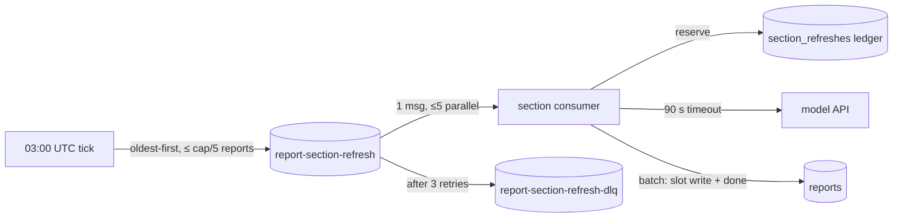

# PRD

> [!NOTE]
> Web-grounded research (discovery Step 1.5): skipped — not a researchable question; force with `flow feature create --research`.

# Nightly report refresh

**Goal:** Each night every saved report gets its five sections rewritten, model spend per night has a hard ceiling, and a failed rewrite never replaces a good section.

## Problem Statement

Saved reports are company write-ups, each made of five model-written sections, and readers open them later through the reports service. Today a report never changes after it is first written, so its content gets older every day and nothing brings it up to date. The user wants every saved report refreshed each night without anyone having to trigger it. Each rewrite is a slow, paid call to the model service, so refreshing every report every night is a recurring bill that grows with the number of saved reports. A refresh that goes wrong could also replace good text with an error or an empty section.

| Fact | Evidence |
| --- | --- |
| Each saved report has five sections; each model call takes 20-60 s and is paid | [anchor: src/llm.ts:1] |
| Sections are stored as one JSON array of five strings per report, with an `updated_at` timestamp | [anchor: src/db.ts:3] |
| "Saved report" = every row in the `reports` table; the listing query has no filter or limit | [anchor: src/db.ts:8-10] |
| The model client has no timeout, never checks the HTTP status, and returns `undefined` when `text` is missing | [anchor: src/llm.ts:3-8] |
| Nothing in the repo creates reports or calls the model client today; the five section names are not recorded anywhere in the repo | [anchor: src/index.ts:1-17] |
| The worker serves only `GET /reports` and `GET /reports/:id`; it has no scheduled job, queue, or migrations yet | [anchor: wrangler.toml:1-8] |

Who is affected, in the product brief's ranked terms: readers see fresher reports without having to do anything (priority 1, user experience). The owner pays a nightly model bill that grows with the number of saved reports (priority 2, cost). The design choices are how the work is split, retried, and capped (priority 3, architecture).

## Request vetting

- **Hypothesis:** Rewriting each report's five sections every night produces content readers value more than the stored copy, at a nightly model bill the owner accepts.
- **Case against:** The prompt carries only the company name and the section name, with no date or source data [anchor: src/llm.ts:6]. Unless the model service looks things up live, each night pays five 20-60 s calls per report [anchor: src/llm.ts:1] for a re-worded copy of the same content. The report listing is also unbounded [anchor: src/db.ts:9], so the nightly bill grows linearly with saved reports and has no ceiling. Finally, the client writes whatever comes back, including an error body or `undefined` [anchor: src/llm.ts:8], so an unguarded nightly run can overwrite every good section at once.
- **Sources:** https://developers.cloudflare.com/workers/platform/limits/ and https://developers.cloudflare.com/queues/platform/limits/ (cron 15-min wall-clock, `waitUntil` 30 s, queue 15-min consumer, retries and DLQ), via the flow-system-design Cloudflare mapping retrieved 2026-11-04; the model provider is a placeholder host with no documentation in the repo.
- **Verdict:** adopt-with-conditions: nightly model calls never exceed `REFRESH_MAX_SECTIONS_PER_NIGHT`, enforced at one choke point, and a failed, empty, or too-short regeneration never overwrites a stored section.

## Existing-code assessment

- **`src/llm.ts` model client:** simplify — add an explicit timeout, a status check, and a usable-text check before any caller relies on it. Today a 500 or a missing `text` field silently returns `undefined`, which would be written into a report. [anchor: src/llm.ts:3-8]
- **`src/db.ts` persistence:** keep — extend it with the refresh ledger and a write that updates one section at a time. `saveSections` has no caller and stays as is. [anchor: src/db.ts:12-16]
- **`src/index.ts` fetch handler:** keep — add `scheduled` and `queue` handlers next to `fetch` on the same default export, and add the queue and cap bindings to `Env`. [anchor: src/index.ts:3-5]
- **`wrangler.toml`:** keep — add the cron trigger, the queue producer and consumer, the dead-letter queue, and the cap variable. [anchor: wrangler.toml:5-8]

## Scope Boundary

**In scope:**

- A nightly cron tick (03:00 UTC) that enqueues one message per (report, section) for the reports that have gone longest without a refresh, up to the nightly cap.
- A queue consumer that regenerates one section, validates it, and writes it back. It writes only on success and leaves the other four sections alone.
- A per-section refresh ledger in D1. It handles idempotency, the nightly spend cap, and the visible failed state.
- Hardening the model client: a 90 s timeout, typed errors, and rejection of empty or too-short text.
- Metrics helper, `.flow/metrics.md`, emission tests; a workers-runtime test harness with local D1.
- A short runbook in `AGENTS.md`: creating the queues, changing the cap, and restoring D1 to a point before a bad night.

**Out of scope:**

- Creating reports or choosing which five sections a report has. The names are supplied by the user (Open Questions).
- A manual "refresh this report now" endpoint, which would need authentication the worker does not have.
- Any UI. Showing section-level freshness in the read API.
- Keeping prior versions of a section (point-in-time restore covers disaster recovery).
- A dead-letter-queue consumer or replay tool. The next night's run re-attempts failed sections.

## Behavioral contrast

### User flow

| Before | After |
| --- | --- |
| A report's sections stay exactly as first written, indefinitely | A report's sections are rewritten overnight; under the cap, no section is older than about one day |
| `GET /reports/:id` returns the same `sections_json` and `updated_at` forever | The same request returns rewritten sections and an `updated_at` from the most recent successful section rewrite |
| — | When the model service fails for a section, that section keeps its previous text; the other four still refresh |
| — | When saved reports exceed the nightly cap, the longest-unrefreshed reports go first and the rest rotate through on later nights |

### System flow

- **Before:**
  - The worker answers two read endpoints and does nothing on a schedule; the model client is unused.
- **After:**
  - A 03:00 UTC cron tick lists reports oldest-refresh-first, takes at most `cap / 5` of them, enqueues one versioned message per section, and prunes ledger rows older than 30 days.
  - A queue consumer (one message at a time, at most 5 in parallel) reserves the section in the ledger, which enforces the cap and dedupes. It then calls the model with a 90 s timeout and writes the section and its "done" mark in one transaction.
  - Transient failures retry through the queue only: 3 retries with exponential backoff and jitter, then the dead-letter queue. Permanent failures are marked `failed` in the ledger.

**Lost:** each night's rewrite replaces the previous text of a section in place. The prior wording is gone from the app and comes back only through a database point-in-time restore.

## User Stories / Acceptance Criteria

### Story 1: Reports refresh overnight

- [ ] Given 3 valid saved reports and a cap of 500, when the nightly tick runs, then exactly 15 messages are enqueued, each with `v: 1`, a report id, a section index 0-4, and the run's UTC date (test: `src/refresh.test.ts`)
- [ ] Given a reserved section and a model response of usable text, when the consumer handles the message, then that one array slot in `sections_json` is replaced, the other four are byte-identical, `updated_at` changes, and the ledger row is `done` (test: `src/refresh.test.ts`)
- [ ] Given the same message delivered twice, when the consumer handles the second copy, then no model call is made and the message is acknowledged (test: `src/refresh.test.ts`)

### Story 2: Spend never exceeds the nightly cap

- [ ] Given 4 valid reports and a cap of 10, when the tick runs, then only the 2 reports with the oldest `updated_at` are enqueued (10 messages) and 10 sections are counted as `budget_exhausted` skips (test: `src/refresh.test.ts`)
- [ ] Given the ledger already holds `cap` rows for the run date, when a new section message arrives, then the consumer makes no model call and acknowledges it (test: `src/db.test.ts`)

### Story 3: A failed rewrite never damages a report

- [ ] Given the model returns 500, 429, a timeout, or text shorter than 200 characters, when the consumer handles the message, then `sections_json` is unchanged and the message is retried with a delay (test: `src/refresh.test.ts`)
- [ ] Given the model returns a non-429 4xx, when the consumer handles the message, then `sections_json` is unchanged, the ledger row is `failed` with its `error_type`, and the message is acknowledged without retry (test: `src/refresh.test.ts`)
- [ ] Given a report is deleted between tick and consume, when its message arrives, then no model call is made and the message is acknowledged (test: `src/refresh.test.ts`)

### Story 4: Failures and backlog are visible

- [ ] Given each outcome above, when it occurs, then the helper's in-memory recorder holds the matching duration observation, failures increment, or skip increment (test: `src/metrics.test.ts`, `src/refresh.test.ts`)
- [ ] Given the queue configuration, when `wrangler.toml` is read, then the consumer has `max_retries = 3`, `max_concurrency = 5`, and a `dead_letter_queue` (command: `grep -q 'dead_letter_queue = "report-section-refresh-dlq"' wrangler.toml`)

## Instrumentation

**Contract:** `.flow/metrics.md` create

### Metrics

| Metric | Instrument | Unit | Attributes (closed values) | Emitted at |
| --- | --- | --- | --- | --- |
| `reports.refresh.tick.duration` | Histogram | seconds | `operation.outcome` (`ok`, `error`) | nightly scheduled handler |
| `reports.refresh.tick.failures` | Counter | none | `error.type` (repo list below) | nightly scheduled handler |
| `reports.refresh.last_success` | Gauge | seconds (Unix time) | none | end of a successful tick |
| `reports.refresh.section.duration` | Histogram | seconds | `operation.outcome` (`ok`, `error`); boundaries `[1, 5, 10, 20, 30, 45, 60, 90, 120]` | queue consumer, per message |
| `reports.refresh.section.failures` | Counter | none | `error.type` (repo list below) | queue consumer |
| `reports.refresh.section.skipped` | Counter | none | `refresh.skip_reason` (`already_done`, `budget_exhausted`, `malformed_report`, `report_deleted`, `superseded`) | tick (deferred and malformed) and consumer |
| `reports.llm.request.duration` | Histogram | seconds | `server.address` (`api.example-llm.com`), `operation.outcome` (`ok`, `error`); same boundaries | model client call site in the consumer |
| Queue backlog and oldest-message age, main and DLQ | Gauge | `{message}`, seconds | `messaging.destination.name` | platform-native (Cloudflare Queues analytics) |

Estimated series: 41 per operation for the tick (histogram 2 × 17 + failures 6 + gauge 1)

Estimated series: 59 per operation for the section refresh (histogram 2 × 12 + failures 6 + skipped 5 + outbound histogram 1 × 2 × 12)

**Attributes:** new keys `operation.outcome` (`ok`, `error`), `error.type` (list below), `server.address` (`api.example-llm.com`), `messaging.destination.name` (`report-section-refresh`, `report-section-refresh-dlq`), and `refresh.skip_reason` (`already_done`, `budget_exhausted`, `malformed_report`, `report_deleted`, `superseded`). All become `.flow/metrics.md` `## Attributes` rows.

### Error types

New list, created in `.flow/metrics.md`: `_OTHER` (fallback), `internal` (unexpected failure in this worker), `invalid_response` (model answered 200 but the text was missing, blank, or under 200 characters), `rate_limited` (model returned 429), `upstream_error` (model returned another non-2xx), `upstream_timeout` (no answer within 90 s). None are client-caused.

### Dashboard panels

On a new "Reports overview" dashboard (spec-only): sections refreshed per night by outcome; section failures by `error.type`; skips by `refresh.skip_reason`, where a non-zero `budget_exhausted` means the cap is truncating the nightly run; section and model-call latency p50/p95/p99; main-queue and DLQ backlog; hours since `reports.refresh.last_success`.

### Alerts

| Signal | Condition | Sustained for | Action | Routes to | Dashboard |
| --- | --- | --- | --- | --- | --- |
| Refresh staleness | now − `reports.refresh.last_success` > 48 h (2× the schedule) | 15 min | notify | the repo owner's notification channel, named in `.flow/metrics.md` when a backend is chosen | Reports overview |
| DLQ backlog | `report-section-refresh-dlq` backlog > 0 | 1 h | notify | same channel | Reports overview |

### SLO

New journey SLO "report freshness": 99% of sections attempted on a night end `done` (SLI = `section.duration{outcome=ok}` count / total count), over 30 days, with the standard burn-rate tiers recorded once in `.flow/metrics.md`.

**As-code:** spec-only — the repo keeps no dashboard or alert config and has no metrics backend yet (suggested: Workers Analytics Engine)

## Architecture Decisions

| Aspect | Decision |
| --- | --- |
| Layers touched | Data (new D1 ledger table, baseline migration for `reports`), integration (model client), runtime (cron tick, queue consumer), config (`wrangler.toml`) |
| Domain modules | Existing `src/db.ts`, `src/llm.ts`, `src/index.ts`; new `src/refresh.ts` (tick + consumer + section list) and `src/metrics.ts` (helper), kept single-purpose per `AGENTS.md` |
| Data flow | `reports` row → message `{v, reportId, sectionIndex, runDate}` → model call → one slot of `sections_json` rewritten + ledger row `done`, in one D1 batch |
| Pattern | New for this repo (no scheduled or queued work exists): scheduler-enqueue plus queue consumer with a per-unit ledger, as prescribed by flow-system-design for periodic multi-section model work |
| Binary-framing check | The request reads as "all reports every night". The middle ground is all reports every night under a hard cap, with the longest-unrefreshed first. That equals the literal request whenever reports × 5 ≤ cap, and degrades to rotation above it (Decision A) |
| Goal-anchor check | The Goal says "every saved report", so the cap rotates through all reports over later nights rather than dropping any; the cap protects the cost priority without abandoning the goal |

### Runtime design

| Operation | Est. p99 | Execution model | Timeout / deadline | Retries | Idempotency key | Cost bound |
| --- | --- | --- | --- | --- | --- | --- |
| Nightly tick (list, enqueue, prune) | ~3 s at 1,000 reports | scheduler-enqueue (Cron Trigger `0 3 * * *`); never runs the units | platform 15 min wall-clock; app work is one query + `sendBatch` in chunks of 100 | none — the next night re-runs; a duplicate tick on the same date dedupes at the consumer | run date (UTC `YYYY-MM-DD`) carried in every message | enqueues at most `floor(cap / 5)` reports; no paid call |
| Section refresh | ~65 s | queue consumer, `max_batch_size = 1`, `max_concurrency = 5` | model call 90 s < platform 15 min consumer wall-clock | queue only: `max_retries = 3`, delay `min(600, 60 × 2^(attempts−1)) + jitter(0-30) s`; permanent errors stop at once | `<reportId>:<sectionIndex>:<runDate>`, ledger primary key | new spend ledger: conditional reserve refuses once the run date holds `cap` rows; worst case `cap × 4` calls/night |
| Model call | ~60 s | inline in the consumer | `AbortSignal.timeout(90_000)` | none at this layer | inherits the section key | counted by the ledger reservation |

**Platform:** cloudflare

**Proportionality:** No workflow engine: each unit is one call plus one write. No dead-letter consumer or replay tool: the next night re-attempts every non-`done` section. No per-tenant caps: there are no tenants. No version history table: D1 point-in-time restore covers disaster recovery. No HTTP-edge metrics: the read endpoints are unchanged.

**Recovery:** The nightly job rewrites paid-generation content in bulk, so D1 Time Travel (always on; 30-day point-in-time restore on Paid) is the recovery path. The `AGENTS.md` runbook (Task 6) records the restore command (`npx wrangler d1 time-travel restore reports --timestamp=<before 03:00 UTC>`) and the check (`npx wrangler d1 time-travel info reports` returns a bookmark). The ledger table is regenerable bookkeeping (30-day retention), so it is covered by the same restore.

## Technical Constraints

- The units cannot run in the cron tick. A scheduled Worker has a 15-minute wall-clock, so at up to 60 s per call only about 15 sections fit, run one after another. `waitUntil` is capped at 30 s, which is less than one call. Source: https://developers.cloudflare.com/workers/platform/limits/
- The queue needs a dead-letter queue. Without one, Cloudflare Queues deletes a message after its retries are exhausted. Source: https://developers.cloudflare.com/queues/configuration/dead-letter-queues/
- Messages carry ids, not text: a queue message is at most 128 KB, and the API key stays a Worker secret (`LLM_API_KEY`, [anchor: src/index.ts:3]), never in the payload. Source: https://developers.cloudflare.com/queues/platform/limits/
- Concurrent section writes must not lose each other's updates. Five messages for one report can run in parallel, so each write rewrites one array slot with SQLite `json_set` in a single statement, never read-modify-write of the whole array [anchor: src/db.ts:12-15]. That write and the ledger "done" mark go in one `env.DB.batch`, which D1 runs as a transaction.
- No new runtime dependency per `AGENTS.md`; `@cloudflare/vitest-pool-workers` is a dev-only test dependency.
- Cost: nightly model calls = min(5 × valid reports, cap), with up to 3 retries per failing section. Each call is paid and takes 20-60 s [anchor: src/llm.ts:1]. At the default cap of 500 that is at most 500 calls a night, and at most 2,000 in the worst case where every section exhausts its retries.

## Open Questions

- [ ] What are the five section names? On redirect, the five strings in `REPORT_SECTIONS` (Task 5) change, and so does what is written into every report.
  - **Stakes:** user — wrong names would overwrite every report's sections with content about the wrong topics, the first night it runs
  - **Recommended:** a five-entry `REPORT_SECTIONS` list in the refresh module whose exact values the user supplies at plan review. The implementer must not invent them, and positions 0-4 must match the order already stored in `sections_json`. Rationale — deliberated (high): Define a five-entry list of section names whose exact values the user supplies before implementation (Option B). [confidence: high] [anchor: src/db.ts:12-15]
- [ ] Does re-running the same prompt actually bring in newer information? On redirect, if the provider has no live data, the Recommendation moves to `Reject — do nothing` or a much lower cap.
  - **Stakes:** both — readers get re-worded but not fresher reports, while the owner pays every night
  - **Recommended:** do not assume regeneration yields fresher content; ship with the cap so spend is bounded either way, and the user confirms with the provider. Rationale — deliberated (high): The repository can't tell us whether the model service uses current information, so we shouldn't assume regenerating gives fresher content until the provider confirms it does live lookup. [confidence: high] [anchor: src/llm.ts:3-6]
- [ ] What nightly cap? On redirect, the default of `REFRESH_MAX_SECTIONS_PER_NIGHT` in `wrangler.toml` (Task 6) changes.
  - **Stakes:** system — too low leaves reports stale for days, too high lets the nightly bill grow with no one noticing
  - **Recommended:** 500 sections a night (100 reports), set as a plain Worker variable the owner can change without a code change. [confidence: medium] [anchor: weighing: reversibility — a one-line `wrangler.toml` variable, changeable at deploy time]
- [ ] Should a report refresh section by section, or all five or nothing? On redirect, the consumer's write path changes (Decision B). All-or-nothing needs a per-report message and a combined write.
  - **Stakes:** user — a report can briefly mix sections from two different nights
  - **Recommended:** section by section. A failure keeps that one section's last good text and the four paid successes still land. [confidence: medium] [anchor: weighing: risk — all-or-nothing throws away up to 4 paid calls whenever 1 fails]
- [ ] What should the minimum usable section length be? On redirect, `MIN_SECTION_CHARS` in the model client (Task 1) changes.
  - **Stakes:** user — too high rejects legitimately short sections, and they never refresh; too low lets a one-line refusal overwrite a real section
  - **Recommended:** 200 characters, treated as a retryable `invalid_response`. [confidence: medium] [anchor: weighing: risk — a false reject only delays one section, a false accept destroys good content]
- [ ] Add a workers-runtime test harness (dev dependency `@cloudflare/vitest-pool-workers` plus local D1 migrations), or mock D1? On redirect, Task 3 shrinks to a hand-written fake and the SQL is no longer tested.
  - **Stakes:** system — the cap and the slot write live in SQL (`json_set`, a conditional insert) that a mock cannot check
  - **Recommended:** add the harness; it is dev-only, so it respects the no-new-runtime-dependencies rule. [confidence: medium] [anchor: weighing: risk — a mocked database passes even when the SQL is wrong]
- [ ] When should the nightly run happen? On redirect, one cron string changes (Task 6).
  - **Stakes:** user — readers in some time zones see content change during their working day
  - **Recommended:** 03:00 UTC. [confidence: medium] [anchor: weighing: reversibility — one cron string; changes propagate within 15 minutes]
- [x] Does "every saved report" mean every row in `reports`? — resolved: yes, the existing listing has no saved/unsaved flag [anchor: src/db.ts:8-10]
  - **Stakes:** none — resolved without asking

## Decision analysis

**Decision A — how much to refresh each night?** Exclusive.

| Branch | Downstream flow | Interruptions per run |
| --- | --- | --- |
| A1: every report, every night, uncapped (literal request) | Readers always get the previous night's rewrite. Spend = 5 × reports, unbounded: a copy-loop or bulk import of 10,000 reports means 50,000 paid calls the next night, and the owner finds out from the bill | 0 |
| A2: every report, every night, under a hard cap, longest-unrefreshed first | Identical to A1 while reports × 5 ≤ cap. Above the cap, the oldest reports refresh first and the rest rotate, so every report is refreshed within ⌈reports × 5 / cap⌉ nights. Spend never exceeds the cap, and a `budget_exhausted` skip count shows when the cap bites | 0 |
| A3: refresh only reports older than N days | Spend falls by up to N×, but no report is ever fresher than N days, which contradicts "nightly" | 0 |

Ranked: A2 > A3 > A1. Verdict: **A2** — it equals the literal request at today's scale and adds the ceiling the cost priority demands without dropping any report. [confidence: medium] [anchor: weighing: risk — an uncapped paid loop has no upper bound on spend]

**Decision B — what is the unit of work?** Exclusive.

| Branch | Downstream flow | Interruptions per run |
| --- | --- | --- |
| B1: one message per section | One failed section retries alone: one paid call, not five. The other four land independently. Needs a per-slot write to avoid lost updates | 0 |
| B2: one message per report (5 calls in parallel inside one consumer) | Reuses the existing whole-array `saveSections`. One failing section re-runs all five paid calls on retry, or needs custom partial-retry bookkeeping inside the message | 0 |

Ranked: B1 > B2. Verdict: **B1** — retries are 5× cheaper per failure, and the per-slot write costs one SQL statement. [confidence: medium] [anchor: weighing: effort — one `json_set` statement versus partial-retry state carried inside each message]

## Alternatives considered

- **Run the model calls inside the cron tick** — rejected: the 15-minute scheduled wall-clock fits at most about 15 sections at 60 s each, and a crash loses the rest with no retry (https://developers.cloudflare.com/workers/platform/limits/).
- **Fire regeneration from `waitUntil`** — rejected: capped at 30 s, which is less than one 20-60 s call [anchor: src/llm.ts:1].
- **Cloudflare Workflows per report** — rejected: each unit is one call plus one write, with no branches, waits, or sleeps; a queue plus the ledger already gives per-step retry and idempotency.

## Recommendation

**Reconsider scope** — build the nightly refresh under a hard nightly section cap with longest-unrefreshed-first rotation (Decision A2) instead of an uncapped every-report run. Simplify the model client first (timeout, status and text checks) so a bad night cannot overwrite good sections. Before relying on the refresh to make reports fresher, confirm with the provider whether it uses live data (Open Questions, freshness). [confidence: medium] [anchor: weighing: risk — the request as written puts an unbounded paid loop on a client that writes error bodies as content]

**Redundancy:** none found — the repo has no scheduled job, queue, or regeneration path; the only model-client function, `generateSection`, has no callers [anchor: src/llm.ts:2]

## Plan risks

The weakest assumption is that "HTTP 200 with at least 200 characters of text" means a good section. If the provider returns a polite refusal or an error message as normal text, every check passes, and one night overwrites every report's sections with junk. The only fallbacks are the length floor and a manual point-in-time restore.

## Cut list

- The staleness gauge, the two alert rows, and the freshness SLO are spec-only until a metrics backend exists. They can be dropped from this PR if the owner has no plan to choose a backend soon; the skip and failure counters already cover the tests.
- The `superseded` skip reason, which drops messages from an earlier night, matters only if a night's backlog spills past the next 03:00 tick (about 67 minutes of work at the default cap). It could wait for a measured backlog.

# Candidate follow-up issues

| Candidate | Value | Complexity | Rationale | Relation to current request | Pull into this pipeline? |
| --- | --- | --- | --- | --- | --- |
| Decide whether `GET /reports` and `GET /reports/:id` should require authentication | Medium | Small | needs its own design/decision session: the open decision is whether saved reports are public by design or must be restricted to their owner | unrelated to the refresh; surfaced while reading the fetch handler | No |

- [ ] Decide whether `GET /reports` and `GET /reports/:id` should require authentication — today anyone with the worker URL can list and read every saved report.
  - **UX:** none
  - **Problem:** every saved report is listed and readable with no credentials [anchor: src/index.ts:12-14]
  - **Stability/efficiency:** none
  - **Value rank:** 2 — an unfired latent risk; whether reports are meant to be private is not recorded anywhere in the repo [anchor: src/index.ts:12-14]
  - **Complexity:** Small — the fetch handler plus a secret binding
  - **Risk:** Medium — locking the endpoints breaks any existing unauthenticated reader
  - **If never done:** if reports are private, they stay exposed to anyone who learns the worker URL
  - **Verdict:** below bar — whether reports are meant to be public is unknown, so the value is not yet established

# Task breakdown

### Task 1: Harden the model client

- **Skill:** `flow-system-design`
- **Bundled:** the missing timeout, status check, and usable-text check in the model client, which the refresh would otherwise write straight into reports
- **Description:** Give `generateSection` an explicit timeout (default 90 s) and make it throw a typed `LlmError` instead of returning `undefined`. Timeout → `upstream_timeout` (retryable); 429 → `rate_limited` (retryable); 5xx → `upstream_error` (retryable); other non-2xx → `upstream_error` (not retryable); a `text` that is missing, not a string, blank, or under `MIN_SECTION_CHARS` → `invalid_response` (retryable). Add no retry loop: retries live in the queue only.
- **Inputs:** `src/llm.ts`
- **Outputs:** hardened client plus unit tests using a stubbed global `fetch`
- **Contract:**
  - **Files:** edit `src/llm.ts`; create `src/llm.test.ts`
  - **Interfaces:** `export type LlmErrorKind = "upstream_timeout" | "rate_limited" | "upstream_error" | "invalid_response"`; `export class LlmError extends Error { readonly kind: LlmErrorKind; readonly retryable: boolean }`; `export const MIN_SECTION_CHARS = 200`; `export async function generateSection(apiKey: string, company: string, section: string, opts?: { timeoutMs?: number }): Promise<string>` (default `timeoutMs` 90_000, passed as `AbortSignal.timeout`)
  - **Call-site edits:** none — `generateSection` has no callers yet
- **Acceptance criteria:** `npx vitest run src/llm.test.ts` — specs for ok, 429, 500, 400, timeout, missing text, and short text each pass, asserting `kind` and `retryable`

### Task 2: Metrics helper and metrics contract

- **Skill:** `flow-metrics`
- **Description:** Create the repo-local helper with a swappable recorder, defaulting to an in-memory recorder; no backend is configured. It holds closed `ErrorType` and `SkipReason` unions and the metrics named in `## Instrumentation`: `reports.refresh.tick.duration`/`.failures`, `reports.refresh.last_success`, `reports.refresh.section.duration`/`.failures`/`.skipped`, and `reports.llm.request.duration`. Explicit boundaries `[1, 5, 10, 20, 30, 45, 60, 90, 120]` for section and model-call histograms. Create `.flow/metrics.md` (Backend `none yet — suggested: Workers Analytics Engine`, Namespace `reports`, Attributes, error.type values, Helper, Dashboard panels, Dashboards, Alerts, As-code `spec-only`, SLOs, Coverage).
- **Inputs:** `## Instrumentation` above; new: `src/metrics.ts`
- **Outputs:** helper, contract file, emission tests
- **Contract:**
  - **Files:** create `src/metrics.ts`, `src/metrics.test.ts`, `.flow/metrics.md`
  - **Interfaces:** `export type ErrorType = "_OTHER" | "internal" | "invalid_response" | "rate_limited" | "upstream_error" | "upstream_timeout"`; `export type SkipReason = "already_done" | "budget_exhausted" | "malformed_report" | "report_deleted" | "superseded"`; `export interface Recorder { histogram(name: string, seconds: number, attrs: Record<string, string>): void; counter(name: string, n: number, attrs: Record<string, string>): void; gauge(name: string, value: number, attrs: Record<string, string>): void }`; `export function memoryRecorder(): Recorder & { readonly records: ReadonlyArray<{ kind: string; name: string; value: number; attrs: Record<string, string> }> }`; `export function setRecorder(r: Recorder): void`; `export function toErrorType(e: unknown): ErrorType` (maps `LlmError.kind`, else `_OTHER`); `export async function instrument<T>(op: "reports.refresh.tick" | "reports.refresh.section", fn: () => Promise<T>): Promise<T>`; `export async function recordOutbound<T>(host: "api.example-llm.com", fn: () => Promise<T>): Promise<T>`; `export function recordSkip(reason: SkipReason, n?: number): void`; `export function recordLastSuccess(unixSeconds: number): void`
  - **Call-site edits:** none — consumers arrive in Task 5
- **Acceptance criteria:** `npx vitest run src/metrics.test.ts` — one ok observation with no failure increment; one `error` observation plus a failure increment for each `ErrorType` branch; an unknown error maps to `_OTHER`; skip and gauge records carry the expected attributes and values

### Task 3: Ledger migration and workers test harness

- **Skill:** `flow-testing`
- **Bundled:** a baseline `reports` migration so local D1 (and the tests) has the table that today exists only as a comment in `src/db.ts`
- **Description:** Add D1 migrations and run tests inside the Workers runtime with local D1 so the SQL is exercised. The baseline uses `IF NOT EXISTS`, so applying it to production is a no-op.
- **Inputs:** `src/db.ts` schema comment; `wrangler.toml`
- **Outputs:** migrations directory, vitest workers config, migration setup file, dev dependency
- **Contract:**
  - **Files:** create `migrations/0000_reports_baseline.sql`, `migrations/0001_section_refreshes.sql`, `vitest.config.ts`, `test/apply-migrations.ts`; edit `package.json` (devDependencies)
  - **Interfaces:** `0000`: `CREATE TABLE IF NOT EXISTS reports (id TEXT PRIMARY KEY, company TEXT, sections_json TEXT, updated_at TEXT);` `0001`: `CREATE TABLE section_refreshes (report_id TEXT NOT NULL, section_index INTEGER NOT NULL CHECK (section_index BETWEEN 0 AND 4), run_date TEXT NOT NULL, status TEXT NOT NULL CHECK (status IN ('reserved','done','failed')), attempts INTEGER NOT NULL DEFAULT 0, error_type TEXT, updated_at TEXT NOT NULL DEFAULT (datetime('now')), PRIMARY KEY (report_id, section_index, run_date)); CREATE INDEX section_refreshes_run_date ON section_refreshes (run_date, status);` `vitest.config.ts` uses `defineWorkersConfig` with `wrangler.configPath = "./wrangler.toml"` and a `TEST_MIGRATIONS` binding from `readD1Migrations("./migrations")`, applied in `test/apply-migrations.ts` via `applyD1Migrations(env.DB, env.TEST_MIGRATIONS)`
  - **Call-site edits:** `package.json` — add `"@cloudflare/vitest-pool-workers"` to `devDependencies` only (pin a release compatible with `vitest@^3`)
- **Acceptance criteria:** `npx wrangler d1 migrations apply reports --local && npx vitest run src/llm.test.ts src/metrics.test.ts` — both migrations apply and the earlier suites pass under the workers pool

### Task 4: Ledger and per-section persistence

- **Skill:** `flow-system-design`
- **Description:** Add the D1 functions the tick and the consumer need.
  - The reserve is one conditional statement, the single spend choke point: it inserts a `reserved` row only while the run date holds fewer than `cap` rows, then increments `attempts`, and returns the row's state.
  - The section write and its "done" mark go in one `env.DB.batch` (a transaction). The write sets one slot with `json_set(sections_json, '$[' || ? || ']', ?)` and bumps `updated_at`.
  - Candidates are listed by `updated_at` ascending, with a `valid` flag for `json_valid(sections_json) AND json_array_length(sections_json) = 5`.
  - The prune deletes ledger rows older than the retention window.
- **Inputs:** Task 3 migrations; `src/db.ts`
- **Outputs:** five new exported functions plus SQL-level tests against local D1
- **Contract:**
  - **Files:** edit `src/db.ts`; create `src/db.test.ts`
  - **Interfaces:** `export type RefreshKey = { reportId: string; sectionIndex: number; runDate: string }`; `export async function listRefreshCandidates(env: Env): Promise<{ id: string; valid: number }[]>`; `export async function reserveSection(env: Env, key: RefreshKey, cap: number): Promise<"reserved" | "already_done" | "already_failed" | "budget_exhausted">`; `export async function saveSectionAndMarkDone(env: Env, key: RefreshKey, text: string): Promise<void>`; `export async function markSectionFailed(env: Env, key: RefreshKey, errorType: string): Promise<void>`; `export async function pruneRefreshLedger(env: Env, runDate: string, keepDays: number): Promise<void>`
  - **Call-site edits:** none — `getReport`, `listSavedReports`, and `saveSections` are unchanged
- **Acceptance criteria:** `npx vitest run src/db.test.ts` — reserve returns `reserved` and then `already_done` after the save for the same key; it returns `budget_exhausted` once `cap` rows exist for the date and `reserved` again for a new date; the slot write changes only the target index and leaves the other four byte-identical; a two-write race on different slots keeps both; prune removes only rows older than `keepDays`

### Task 5: Nightly tick and section consumer

- **Skill:** `flow-system-design`
- **Description:** Implement the refresh module.
  - **Tick:** compute `runDate` (UTC date of `now`) and list candidates. Count invalid ones as `malformed_report` skips. Take the first `floor(cap / 5)` valid ids and enqueue 5 `RefreshMessage`s each with `env.REFRESH_QUEUE.sendBatch` in chunks of 100. Count the deferred sections as `budget_exhausted` skips, prune the ledger with 30-day retention, and record `last_success`; the whole tick is wrapped in `instrument("reports.refresh.tick")`.
  - **Consumer:** wrapped in `instrument("reports.refresh.section")`, idempotency key `<reportId>:<sectionIndex>:<runDate>`. A wrong `v`, an out-of-range index, or `runDate` ≠ today is acknowledged: an old date is a `superseded` skip, the rest map to `internal`. Then it reserves the section; `already_done`, `already_failed`, and `budget_exhausted` are acknowledged as skips. It loads the report and acknowledges a `report_deleted` skip if it is gone. It calls `generateSection(..., { timeoutMs: 90_000 })` inside `recordOutbound` and, on success, runs `saveSectionAndMarkDone` and `ack()`.
  - **Consumer errors:** a retryable `LlmError` on attempts < 4 calls `msg.retry({ delaySeconds: retryDelaySeconds(msg.attempts) })`. On the final attempt it first runs `markSectionFailed`, then `retry()`, so the queue routes the message to the DLQ. A non-retryable error runs `markSectionFailed` and `ack()`. Nothing writes to `reports` on any failure path. `REPORT_SECTIONS` holds the five user-supplied names (Open Questions).
- **Inputs:** Tasks 1, 2, 4; existing `getReport` in `src/db.ts`
- **Outputs:** refresh module plus tests with a fake queue binding and a stubbed `fetch` against local D1
- **Contract:**
  - **Files:** create `src/refresh.ts`, `src/refresh.test.ts`
  - **Interfaces:** `export const REPORT_SECTIONS: readonly [string, string, string, string, string]`; `export type RefreshMessage = { v: 1; reportId: string; sectionIndex: 0 | 1 | 2 | 3 | 4; runDate: string }`; `export async function enqueueNightlyRefresh(env: Env, now: Date): Promise<{ enqueued: number; deferred: number; malformed: number }>`; `export async function handleRefreshMessage(env: Env, msg: Message<RefreshMessage>, now: Date): Promise<void>`; `export function retryDelaySeconds(attempts: number, rand?: () => number): number` (= `min(600, 60 * 2 ** (attempts - 1)) + floor(rand() * 31)`)
  - **Call-site edits:** none — wired in Task 6
- **Acceptance criteria:** `npx vitest run src/refresh.test.ts` — Story 1-3 criteria pass. Specifically: 15 messages for 3 reports; the cap limits the tick to the oldest reports; a duplicate delivery of the same key makes no second model call; a 500 retries with `sections_json` unchanged; a 400 marks `failed` and acks; a deleted report acks without a call; an old `runDate` is a `superseded` skip; matching metric records exist in the in-memory recorder

### Task 6: Wire handlers, queue config, and runbook

- **Skill:** `flow-system-design`
- **Description:** Add `scheduled` and `queue` handlers to the default export, along with their `Env` bindings. In `wrangler.toml` add the cron trigger, the producer and consumer, the dead-letter queue, and the cap variable. Add a short "Nightly refresh" section to `AGENTS.md`: create both queues before the first deploy, apply migrations, change the cap, and restore D1 to a point before 03:00 UTC, with its restore check. This task owns the recovery setup. The backups are D1 Time Travel point-in-time recovery, which is on by default for the `reports` database and covers the new ledger table too. The task records the restore check (`npx wrangler d1 time-travel info reports`) and the restore command in the runbook.
- **Inputs:** Task 5 exports; `src/index.ts`; `wrangler.toml`; `AGENTS.md`
- **Outputs:** deployable configuration, handler wiring, and an integration test of the scheduled entry point
- **Contract:**
  - **Files:** edit `src/index.ts`, `wrangler.toml`, `AGENTS.md`; create `src/index.test.ts`
  - **Interfaces:** `Env` gains `REFRESH_QUEUE: Queue<RefreshMessage>; REFRESH_MAX_SECTIONS_PER_NIGHT: string`. The default export gains `async scheduled(_c: ScheduledController, env: Env): Promise<void>`, which awaits `enqueueNightlyRefresh(env, new Date())`, and `async queue(batch: MessageBatch<RefreshMessage>, env: Env): Promise<void>`, which awaits `handleRefreshMessage` for each message. `wrangler.toml` key paths (before → after, all absent before):
    - `triggers.crons` → `["0 3 * * *"]`
    - `queues.producers[0]` → `{ binding = "REFRESH_QUEUE", queue = "report-section-refresh" }`
    - `queues.consumers[0]` → `{ queue = "report-section-refresh", max_batch_size = 1, max_batch_timeout = 5, max_retries = 3, max_concurrency = 5, dead_letter_queue = "report-section-refresh-dlq" }`
    - `vars.REFRESH_MAX_SECTIONS_PER_NIGHT` → `"500"`
  - **Call-site edits:** `src/index.ts` default export — add `scheduled` and `queue` next to the unchanged `fetch`; `AGENTS.md` — append a `## Nightly refresh` section after the existing bullets, including `npx wrangler queues create report-section-refresh`, `npx wrangler queues create report-section-refresh-dlq`, `npx wrangler d1 migrations apply reports --remote`, and the `npx wrangler d1 time-travel info reports` / `restore` commands
- **Acceptance criteria:** `npx vitest run && grep -q 'dead_letter_queue = "report-section-refresh-dlq"' wrangler.toml && grep -q '0 3 \* \* \*' wrangler.toml && grep -q 'time-travel' AGENTS.md` — the full suite passes, including a `src/index.test.ts` spec that calls the scheduled handler, asserts messages reach the queue, and asserts the loaded `REFRESH_MAX_SECTIONS_PER_NIGHT` is `"500"`; the config is in place

| Task | Depends on |
| --- | --- |
| 1 | — |
| 2 | 1 |
| 3 | — |
| 4 | 3 |
| 5 | 1, 2, 4 |
| 6 | 5 |

### Skills Summary

| Skill | Recommended? | Reason |
| --- | --- | --- |
| flow-system-design | Yes (Tasks 1, 4, 5, 6) | Scheduled enqueue, queue consumer, timeouts, a single retry layer, idempotency, and the spend cap |
| flow-metrics | Yes (Task 2) | First instrumented change; creates the helper and `.flow/metrics.md` |
| flow-testing | Yes (Task 3) | Workers-runtime test harness with local D1 migrations |
| flow-new-feature | No (implicit) | Drives the implement phase; not a per-task skill |
| flow-ui-ux | No | No UI surface |
| flow-refactoring | No | The model-client change alters behaviour (it throws instead of returning `undefined`), so it is not a pure refactor |

# PR description draft

## TLDR

Saved reports now have their five sections rewritten nightly under a fixed limit on model calls; before, reports never changed once written, and a failed rewrite never replaces good text.

## User-facing changes

- Saved reports now refresh overnight:
  - **Before:** a report's five sections stayed exactly as first written, indefinitely.
  - **After:** each night at 03:00 UTC, every saved report's sections are rewritten, and the report's last-updated time moves forward.
- When the model service fails for a section, that section keeps its previous text and the other four still refresh.
- When there are more saved reports than the nightly limit allows (500 sections, about 100 reports, by default), the reports refreshed longest ago go first and the rest are picked up on following nights.

## System changes

- The worker now runs nightly background work:
  - **Before:** the worker only answered report reads and did nothing on a schedule.
  - **After:** a nightly timer queues one job per report section, and a background worker rewrites each section, retrying temporary failures up to three times before setting the job aside for inspection.
- Ongoing cost: up to one paid model call per section per night, so at most 500 calls a night at the default limit. In the worst case, where every call exhausts its retries, that is at most 2,000.
- New database bookkeeping records each section's nightly attempt. It is what prevents double charges on repeat deliveries and what enforces the nightly limit. It keeps 30 days of history.
- The model client now gives up after 90 seconds and treats error responses and empty or very short answers as failures instead of content.

## Why

Saved reports never change after they are first written, so their content keeps getting older and nothing brings it up to date. Refreshing them is a slow, paid operation per section. If it went unbounded or unguarded, the bill could grow with no ceiling, or a bad night could replace good reports with error text.

## Key decisions

- Nightly limit with longest-unrefreshed-first rotation, rather than an uncapped "every report, every night" run. It matches the literal request at today's scale and bounds spend beyond it.
- One background job per section rather than per report, so a single failure retries one paid call instead of five, and the four successful sections still land.
- Retries happen only in the queue (3, with growing delays). The model client itself never retries, so retry layers cannot stack.
- Sections are overwritten in place with no version history; recovery from a bad night is a database point-in-time restore, documented in the agent guide.
- Section names are supplied by the user, not invented: the repository does not record which five sections a report has.
- Out of scope: a manual "refresh now" endpoint (the worker has no authentication), a dead-letter replay tool (the next night re-attempts), and any UI.
- Bundled: the model client's missing timeout, status check, and usable-text check, which the refresh would otherwise write straight into reports.
- Bundled: a baseline database migration for the existing reports table so the tests run against a real local database.

## Instrumentation

This PR creates the repo's metrics contract. It records nightly-run duration and outcome, per-section rewrite duration, failures by error type, skips by reason (including when the nightly limit bites), model-call latency, and a last-successful-run timestamp. Queue and dead-letter backlog come from the platform. It specs a new "Reports overview" dashboard, staleness and dead-letter alerts, and a "report freshness" objective (99% of attempted sections succeed over 30 days). Spec-only: no metrics backend is chosen yet (suggested: Workers Analytics Engine), so these metrics are recorded but won't show on any graph until one is.

## Test Steps

<!-- flow:authoring-rubric — for each checkbox item below, the three-question
automation test from manual-test-rubric.md is: (a) named fixture/setup,
(b) deterministic assertion(s), (c) exit condition. If all three are answerable
without subjective human judgment, it must be a runnable item. Source of truth:
skills/pipeline/flow-pr-review/references/manual-test-rubric.md. -->

- [ ] Run `npx vitest run src/llm.test.ts` — the model client classifies timeout, 429, 5xx, 4xx, missing text, and short text as typed errors.
- [ ] Run `npx vitest run src/db.test.ts` — the nightly limit, duplicate-delivery dedupe, and single-section write hold against local D1.
- [ ] Run `npx vitest run src/refresh.test.ts` — the nightly run queues 5 jobs per report oldest-first under the limit, and failed rewrites leave stored sections unchanged.
- [ ] Run `npx vitest run src/metrics.test.ts` — each outcome, failure type, and skip reason is recorded.
- [ ] Run `npx vitest run src/index.test.ts` — the scheduled entry point, loaded with the real worker config, delivers jobs to the queue and stops at the configured nightly limit of 500.
- [ ] Run `npx wrangler d1 migrations apply reports --local` — both migrations apply cleanly.
- [ ] Run `npx wrangler deploy --dry-run --outdir "$(mktemp -d)"` — the worker builds with its nightly schedule, queue, dead-letter queue, and limit bindings.
- [ ] DECISION: you accept a default nightly limit of 500 section rewrites (about 100 reports), knowing that above it reports refresh on rotation rather than every night.
- [ ] DECISION: you accept that each night's rewrite replaces a section's previous wording with no in-app history, and that recovery from a bad night is a database point-in-time restore.
