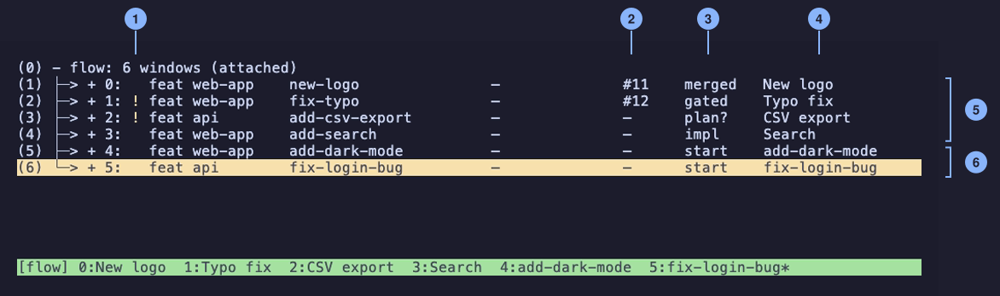

# Run pipelines in parallel with tmux

Use the tmux launcher when you want several pipelines running at once, or want to start one, walk away, and re-attach later from any terminal. Each pipeline gets its own tmux window; nothing stops when you detach.

## Turn it on

1. Opt in per run with `flow feature create --tmux "<description>"`.
2. Or make tmux your default with `flow config launcher set tmux`. The first interactive `flow install` also asks this question; `flow install --upgrade` never re-asks.
3. Any launch without a TTY (scripts, agents) must pass `--tmux`, because the default plain launcher refuses non-interactive launches by design.

Under the tmux launcher, `flow feature create` returns at once and the pipeline keeps running in its own window.

## Move around

- `flow attach` jumps into the flow session; `flow attach <name>` (alias `flow a <name>`) jumps straight to one pipeline.
- Detach with `Ctrl-b d`. The pipelines keep running; come back with `flow attach`.
- `flow ls` lists your pipelines and needs no tmux setup.

## See every pipeline at once

Out of the box, `Ctrl-b w` lists windows by name only. This recipe turns it into a pipeline board with one row per run: repo, slug, epic, PR number, phase, and window title.

1. Add one line to `~/.tmux.conf`. Adjust the path if you cloned flow somewhere other than `~/code/flow`:

   ```sh
   echo 'source-file ~/code/flow/docs/tmux-tree.conf' >> ~/.tmux.conf
   ```

2. If tmux is already running, reload it with `tmux source-file ~/.tmux.conf`.
3. Inside the flow session, press `Ctrl-b w`.

The file `docs/tmux-tree.conf` holds exactly this binding:

```sh
bind-key w choose-tree -Zw -F "#{?pane_format,#{pane_current_command}#{?pane_active,*,}#{?#{pane_title}, #{pane_title},},#{?window_format,#{?@flow-slug,#{?#{||:#{m:*[?],#{@flow-phase-short}},#{||:#{==:#{@flow-phase-short},human},#{==:#{@flow-phase-short},gated}}},#[fg=yellow]!#[default], } #{?#{m:epic*,#{@flow-kind}},epic,feat} #{p10:#{=10:@flow-repo}} #{p22:#{=22:@flow-slug}} #{p14:#{?#{@flow-epic},#{=14:@flow-epic},—}} #{p6:#{?#{@flow-pr},###{@flow-pr},—}} #{p7:#{@flow-phase-short}}  #W,#W#{window_flags} (#{window_panes} panes)},#{session_windows} windows#{?session_attached, (attached),}}}"
```



Prefer `source-file` over pasting the line yourself: a pasted copy goes stale when flow's phases change, while the sourced file stays current when you update flow. Run `tmux source-file ~/.tmux.conf` (or restart tmux) to pick up the new version.

What each column shows, left to right:

| Column | Meaning                                                                                         |
| ------ | ----------------------------------------------------------------------------------------------- |
| `!`    | The pipeline is waiting for you (a phase ending in `?`, `human`, or `gated`)                    |
| kind   | `feat` for a feature pipeline, `epic` for an epic design or run                                 |
| repo   | The repository, cut to 10 characters                                                            |
| slug   | The pipeline name, cut to 22 characters                                                         |
| epic   | The epic the pipeline belongs to, or `—`                                                        |
| PR     | The pull request number once one is open, or `—`                                                |
| phase  | flow's short phase name, such as `impl`, `ci`, `plan?`, `gated`, `merged`                       |
| title  | The window title: the short name flow gives each pipeline after triage (rename with `Ctrl-b ,`) |

Windows that flow did not create keep their stock `Ctrl-b w` row, so the recipe is safe in a session that mixes flow and everything else. Sessions show their window count.

To keep the stock `Ctrl-b w` and use this view on `W` instead, paste the line into `~/.tmux.conf` with `bind-key W`, and drop the `source-file` line. You will need to re-copy it when flow updates.

Tested on tmux 3.6a. flow never writes your tmux config: you add the `source-file` line yourself.

## Status-bar badges

flow also publishes the same data as window options (`@flow-repo`, `@flow-phase-short`, `@flow-pr` and friends) for your status bar. See [tmux status-bar bindings](configuration.md#tmux-status-bar-bindings-opt-in) in the configuration guide.

For more tips, such as coloring windows by whether Claude is working or waiting, see [tmux status integration](../CONTRIBUTING.md#tmux-status-integration-optional) in CONTRIBUTING.md.

## Forgot what you asked?

`flow prompt [<slug>]` prints a pipeline's original request from any terminal. Each pipeline window also shows it under the Claude banner when it starts.
